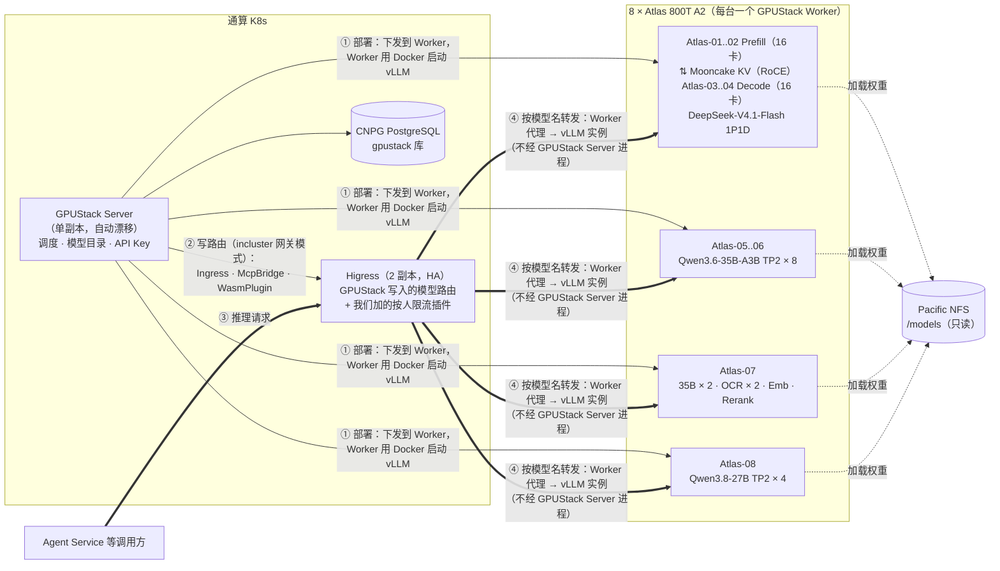
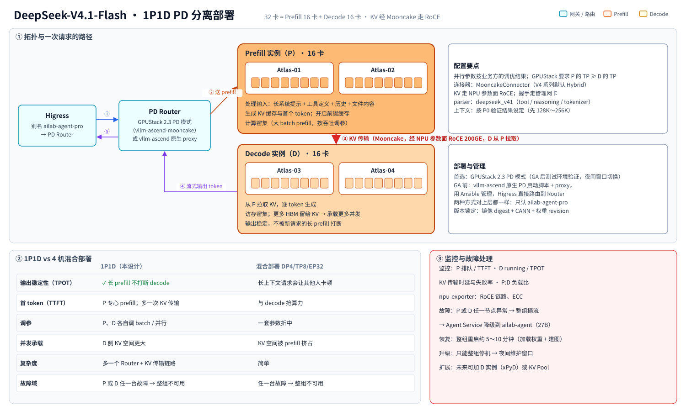
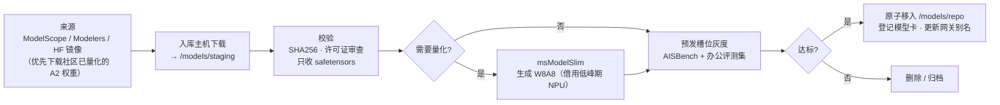

# 02 · 模型服务层设计（GPUStack + vLLM-Ascend）

> 相关图：[04 NPU 分配](diagrams/svg/04-npu-allocation.svg) ｜ [17 DeepSeek 1P1D](diagrams/svg/17-deepseek-pd.svg) ｜ [05 模型路由与降级](diagrams/svg/05-model-routing.svg) ｜ [02 物理部署](diagrams/svg/02-deployment.svg)

## 1. 结构



**部署与请求是两条线**：
- **部署（管理面）**：运维在 GPUStack 里选模型、选卡、点部署 → GPUStack Server 把任务下发给对应 Atlas 上的 GPUStack Worker → Worker 用 Docker 启动 vllm-ascend 实例，监听 `Atlas 的 IP:端口`（端口从 `--service-port-range` 分配，默认 40000～40063）。
- **请求（数据面）**：调用方并不直接访问这些端口，而是访问 **GPUStack 的网关地址**（`/v1/chat/completions`，按请求里的 `model` 名路由）。GPUStack 2.x 的网关就是 **Higress**：请求经 Higress → Atlas 上的 Worker 代理 → vLLM 实例。GPUStack Server 进程本身不转发推理流量，它只负责把路由写进 Higress、管理 API Key 和统计用量。

**网关模式（`--gateway-mode`）怎么选**：

| 模式 | 含义 | 本平台 |
|---|---|---|
| `embedded` | GPUStack 容器里自带一套 Higress（单机安装的默认） | **不用**：网关和单副本 Server 在同一个容器里，Server 一重启推理就中断；而且会和我们的 Higress 形成两层网关 |
| `incluster` | GPUStack 部署在 K8s 里，把路由写进集群里**已有的 Higress**（Ingress、McpBridge、WasmPlugin、EnvoyFilter） | **采用**：全平台只有一套 Higress（2 副本 + VIP），模型路由由 GPUStack 自动维护，不需要自己同步实例地址 |
| `external` | 同上，但 Higress 在另一个 K8s 集群 | 不需要 |
| `disabled` | 不用网关，走 GPUStack 内置的 Python 代理 | 不用（性能差，也没有 HA） |

**GPUStack Server 宕机时推理会不会断**（取决于版本，已对照源码核实）：
- **2.2.x**：网关上的鉴权插件对**每个推理请求**都回调 GPUStack Server 校验 API Key，Server 不可用时请求被拒（403）——即使路由还在 Higress 里，推理也会中断 1～3 分钟。
- **2.3（rc，即将 GA）**：鉴权改为网关本地校验 Key 摘要，Server 不可用时已有的 Key 继续可用（只是暂时不检查 Key 的模型范围）。**所以生产上以 2.3.x 为准**，这也是 DeepSeek PD 所需的版本。2.3 GA 前的过渡期接受这个风险。

**我们在 GPUStack 写入的路由之上加什么**：GPUStack 已经提供 API Key 鉴权、按模型路由、Token 统计；它**没有按用户限流**。所以我们在同一套 Higress 上为这些路由额外挂 `ai-token-ratelimit`（按 `x-user-id` 限 TPM）和 `ai-statistics` 的 `user_id` / `run_id` 日志字段（见 09）。调用方（Agent Service、文件处理 Worker）各用一个 **GPUStack 签发的服务 API Key**，限定可用模型。

**备选方案（P0 不达标时启用）**：如果 incluster 模式和我们自己的 Higress 配置冲突（例如 GPUStack 管理的 McpBridge 固定名为 `default`、它写的 EnvoyFilter 影响全局），有两条退路：① 给 GPUStack 单独部署一套 Higress（两层网关，Agent Service 经我们的 Higress 再到它）；② 不用 GPUStack 网关，由一个自建同步器每 30 秒从 `/v2/model-instances` 读取实例的 `worker_ip:port`，写进我们的 Higress，直接转发到 vLLM 端口（需要给 vLLM 加 `--api-key`，用量统计以我们的网关为准）。

- **GPUStack Server**：在通算 K8s 里单副本运行（官方 Helm Chart 自 2.2.0 起提供，以 StatefulSet 部署，文档明确**不支持多副本**），亲和到 TaiShan，`tolerationSeconds=30`，节点故障时尽快漂移。数据库用外部 CNPG PostgreSQL，通过固定 VIP 暴露给 Worker。官方 Chart 默认带一套 higress-core 子 Chart，我们改用平台已有的 Higress。Chart 的关键 values（已对照 chart 源码核实）：
  - `higress-core.enabled: false`：不部署自带的 Higress（values 注释写明“集群里已有 Higress 时关闭”），`gateway.ingressClassname` 指向我们的 Higress；
  - `server.ingress.hostname: gpustack.xxx.local`：**运维域名**。Chart 会为 GPUStack Server 建一条路径为 `/` 的 Ingress，默认不带 host，等于“任何没匹配上的域名、直接用 VIP 的 IP 访问，都会打开 GPUStack”；设了 hostname 后只在这个域名上提供（见 09 第 10.1 节）；
  - 生产关闭 `/docs` 接口文档（`disable_openapi_docs`），并修改启动时生成的初始管理员密码。
- **GPUStack Worker**：每台 Atlas 以官方推荐的 Docker 方式运行（NPU 驱动、Ascend Docker Runtime、`hccn_tool`）。
- **版本**：
  - 截至 2026-10-16，**最新稳定版是 2.2.3**；2.3.0 还在 rc 阶段，里程碑定在 10 月 18 日。
  - DeepSeek 的 PD 分离需要 **2.3**（`vllm-ascend-mooncake` 模式）。**2.3 GA 前**：其他模型先用 2.2.3 部署；DeepSeek PD 先用 vllm-ascend 原生 PD 启动脚本加 proxy（Ansible 管理），由 Higress 直接路由。**2.3 GA 后**先在测试环境验证，再借夜间维护窗口在正式的 4 台机器上切换到 GPUStack 统一管理（预发槽位只有 4 卡，放不下 32 卡的 PD 组）。
  - 2.3 带来两项重要能力：“自定义镜像 + 保留 vLLM 分布式”，以及 PD 分离。
  - 任何情况下都不能低于 2.2.2，之前的版本有 SAML 绕过和集群接口越权漏洞。
- **自定义镜像**：GPUStack 内置的 runner 镜像版本会落后于 vllm-ascend。例如 DeepSeek-V4.1-Flash 需要 vllm-ascend ≥ v0.30.0rc1，或官方专用镜像 `quay.io/ascend/vllm-ascend:deepseek-v4.1-flash`，这时要在 GPUStack 里给 vLLM 后端追加“自定义版本 + 镜像”。

## 2. 推理引擎配置基线

所有模型统一使用 vLLM（vllm-ascend）后端：

| 参数 | 取值 | 说明 |
|---|---|---|
| 量化 | `--quantization ascend`（W8A8） | 910B 不支持 FP8；优先用 Eco-Tech 等社区已量化的 A2 权重 |
| 前缀缓存 | `--enable-prefix-caching` | **对 Agent 最关键**：每一轮都重放很长的系统提示和工具定义 |
| 分块预填充 | `--enable-chunked-prefill` | 长上下文时防止 prefill 阻塞 decode |
| 工具调用 | `--enable-auto-tool-choice --tool-call-parser <模型对应>` | DeepSeek-V4.1 **必须用 `deepseek_v41`**（用 V4 的 parser 会静默失败，tool call 变成纯文本）；Qwen 用 `qwen3` / `qwen3_xml` |
| 推理解析 | `--reasoning-parser <模型对应>` | 把思考过程与正文分开 |
| 上下文上限 | DeepSeek 按 PD 验证结果设定（建议 128K 起步，逐步放大）；35B / 27B 128K；OCR 8K | 模型支持 1M 也不一定开满，KV 显存是瓶颈；PD 分离后 D 侧 KV 空间更大 |
| 图模式 | 按官方 A2 教程（如 27B 用 FULL_DECODE_ONLY） | |
| 投机解码 | 27B 开 MTP（`qwen3_5_mtp`，3 token）；DeepSeek 的 DSpark 在 A2 上是否启用以 P0 实测为准 | |
| 指标 | `/metrics`（GPUStack 自动采集） | TTFT、TPOT、排队、KV 使用率、前缀缓存命中率 |
| 实例命名 | `模型-量化-版本`，例如 `dsv41flash-w8a8-r20260910` | 与网关别名解耦 |

## 3. NPU 分配与模型选型

### 3.1 业务方草案和可行性评估

| | 草案 | 可行性（2026-10 vllm-ascend / GPUStack 实际支持情况） |
|---|---|---|
| (a) | DeepSeek-V4.1-Flash，4 台 32 卡，**1P1D PD 分离**，复杂 Agent / Coding | ✅ **采纳**（业务方确认 32 卡 1P1D 可行）。注意：vllm-ascend 公开文档中这一组合的 A2 示例较少，P0 要按业务方提供的并行配置完整验证（显存余量、KV 传输、长上下文、tool calling） |
| (b) | Qwen3.6-35B-A3B，2 卡 × 10 实例，日常办公 | ✅ 可行：官方 A2 示例就是 W8A8 TP2。激活参数只有 3B，20 卡大概率富余，压测后可以缩减 |
| (c) | Qwen3.6-35B，2 卡 × 2 实例，识图 OCR | ⚠️ 可行但不划算：和 (b) 是同一个模型，单独建池只为隔离；昇腾上它的视觉能力为实验状态。纯 OCR 有更合适的专用模型 |
| (d) | Qwen3.8-27B，4 卡 × 2 实例，简单 Agent | ✅ 可行；官方 A2 教程是 TP2，改成 TP2 × 4 吞吐更高 |
| — | 没有向量 / 重排、没有预发槽位 | 资料库检索和 RAG 需要向量模型；模型升级需要灰度位置 |

### 3.2 调整后的方案（本设计采用）

| 别名 | 模型 | 节点 | 并行 / 实例 | NPU | 关键参数 |
|---|---|---|---|---|---|
| `ailab-agent-pro` | **DeepSeek-V4.1-Flash** W8A8（Eco-Tech，约 798 GB，含 DSpark 草稿 + INT8 Engram） | P：Atlas-01/02；D：Atlas-03/04 | **1P1D**（P 16 卡 + D 16 卡），并行参数按业务方的调优结果 | 32 | `--tool-call-parser deepseek_v41 --reasoning-parser deepseek_v41 --tokenizer-mode deepseek_v41`；`enable_engram` / `engram_storage: int8`；KV 连接器 Mooncake；max-model-len 128K 起步 |
| `ailab-chat` | **Qwen3.6-35B-A3B** W8A8（约 40 GB，多模态） | Atlas-05/06 各 4 个，Atlas-07 上 2 个 | TP2 × **10** | 20 | max-num-seqs 128；Atlas-07 上的 2 个实例平时服务对话，评测或灰度时临时让出 |
| `ailab-agent` | **Qwen3.8-27B** W8A8（约 32 GB，稠密，多模态） | Atlas-08 | TP2 × **4** | 8 | MTP 3 token；推理强度默认 low/medium（默认档会想太多、变慢） |
| `ailab-ocr` | **DeepSeek-OCR-2**（3.4B）+ **PaddleOCR-VL**（0.9B） | Atlas-07 | TP1 × 各 1 | 2 | PaddleOCR-VL 的版面模型需要单独环境 |
| `ailab-embed` / `ailab-rerank` | Qwen3-Embedding + Qwen3-Reranker（4B 或 8B） | Atlas-07 | TP1 × 各 1 | 2 | **不与其他模型共卡**（910B 上同卡多实例会因图捕获耗尽资源而失败） |
| | | | | **64** | |

### 3.3 DeepSeek-V4.1-Flash 1P1D PD 分离设计



**拓扑**

| 角色 | 节点 | NPU | 职责 |
|---|---|---|---|
| PD Router | 随 GPUStack PD 模式部署（或 vllm-ascend 原生 proxy，放在 Atlas-01） | — | 统一入口，把请求先送 P，再把 P 的 KV 句柄交给 D，汇总流式输出 |
| Prefill（P） | Atlas-01、Atlas-02 | 16 | 处理输入（长系统提示、工具定义、历史、文件内容），生成 KV 和首个 token；开启前缀缓存 |
| Decode（D） | Atlas-03、Atlas-04 | 16 | 从 P 拉取 KV，逐 token 生成；HBM 更多留给 KV，承载更多并发 |
| KV 传输 | P → D | — | **MooncakeConnector**（vllm-ascend；V4 系列默认 MooncakeHybridConnector），走 **NPU 参数面 RoCE 200GE**；握手走管理网卡 |

**配置要点**
- P 和 D 的并行参数（DP/TP/EP）按业务方的调优结果来；用 GPUStack PD 模式时，规则是 **P 的 TP ≥ D 的 TP**。
- 两侧使用同一份权重（`/models/repo/...` 同一路径）和同一个镜像版本。
- 部署前用 `hccn_tool` 检查 4 台机器参数面的连通性和带宽。KV 传输量和上下文长度成正比，这条链路是 PD 的生命线。
- 上下文先开 128K，压测 KV 传输时延和 D 侧并发后再逐步放大。

**为什么适合我们的场景**：Work 模式下 Agent 每一轮都要重放很长的上下文，prefill 很重。混合部署时，一个新请求的长 prefill 会让所有正在输出的请求卡顿。PD 分离后 decode 不受打扰，输出节奏稳定，P、D 也可以分别按吞吐和时延调参。

**风险与对策**
1. **单组单点**：1P1D 一组跨 4 台机器，P 或 D 任一台故障（或一次驱动升级）整组不可用。对策：
   - Agent Service 降级到 `ailab-agent`（27B）；
   - 维护放夜间窗口；
   - 如果评测显示 27B 能满足大部分 Work 任务，把 Work 默认档设为“标准”。
2. **管理方式**：GPUStack 2.3 的 PD 模式刚引入，截至 10-16 仍是 rc，已知有缓存命中率显示、端口冲突等问题。GA 前用 vllm-ascend 原生 PD 脚本部署，Higress 直接路由到 Router；GA 后在灰度验证，再纳入 GPUStack 统一管理。对上层都只是 `ailab-agent-pro`。
3. **需要 P0 重点验证的项**：
   - 两侧显存余量（W8A8 权重约 798 GB，分到每侧 16 卡上）；
   - Engram 相关配置；
   - KV 传输时延和失败率；
   - 长上下文（128K/256K）稳定性；
   - `deepseek_v41` tool calling 正确率；
   - 单机故障后整组的恢复时间。
4. **备选**：如果 V4.1 在 A2 上的稳定性或工具调用达不到要求，可以换成上一代 **DeepSeek-V4-Flash**（284B，单机 8 卡）。它在 A2 上有官方 PD 示例，也可以 4 台各一个副本做冗余。
5. **扩展**：后续可以按负载改成 xPyD（如增加 D 实例），或者接入 KV Pool 做跨实例的前缀缓存共享。

### 3.4 分配原则

1. **整卡分配**，不让多个实例共用一张卡。
2. **别名与模型解耦**：上层只认别名，换模型只改网关映射（见第 5 节）。
3. **预发槽位**：Atlas-07 上的 2 个 35B 实例兼作预发。新模型或新版本先在这里灰度，评测通过后再替换正式实例。大模型的验证只能在夜间低峰期借用正式节点。
4. **压测后调整**：P0 用 AISBench 测出每个池在 P95 TTFT < 3s 下的最大并发。如果 35B 池富余，可以从 10 个实例缩到 6～8 个，把卡让给 27B 或预发。

### 3.5 推理容量（量级估算，以压测为准）

| 池 | 估算 |
|---|---|
| DeepSeek（1P1D，32 卡） | 以 D 侧 KV 容量和 P 侧 prefill 吞吐为准，量级约 64～128 条并发序列，支撑约 50～100 个并发专家档 Work 任务（以压测为准） |
| 35B（10 × TP2） | 每个实例 max-num-seqs 128 → 数百个并发 Chat 流 |
| 27B（4 × TP2） | 约 100～200 条并发序列 |

## 4. 模型权重管理（存储里的模型权重）

### 4.1 目录规范（Pacific NFS）

```
/models                                  # Pacific NFS 文件系统 ai-models（≈15 TB 配额）
├── repo/                                # 正式库（Atlas 只读挂载）
│   └── <org>/<model>/<quant>/<revision>/
│       ├── *.safetensors / config.json / tokenizer*
│       ├── MANIFEST.sha256              # 入库时生成，加载前校验
│       └── MODEL_CARD.md                # 来源、许可证、量化方式、评测结论、负责人
├── staging/                             # 下载、量化中（只有入库主机可写）
└── archive/                             # 下线版本，保留 30 天
```

例：`/models/repo/deepseek-ai/DeepSeek-V4.1-Flash/w8a8/2026-09-10/`

### 4.2 挂载与使用

- 8 台 Atlas 都以**同一路径** `/models` **只读**挂载 `repo/`（`ro,hard,nconnect=8`；条件具备时用 NFS over RDMA 或 DPC 提速）。跨机实例要求每个节点上的模型路径完全一致。
- GPUStack 部署时一律选 **Local Path**；不使用它的在线下载和共享缓存目录。

### 4.3 入库流程



### 4.4 权重容量估算

| 模型 | 版本 | 体积（约） |
|---|---|---|
| DeepSeek-V4.1-Flash | Eco-Tech W8A8（Ascend 用） | 798 GB |
| DeepSeek-V4.1-Flash | 官方原版（FP8 + INT8，用于重新量化） | 510 GB |
| DeepSeek-V4-Flash（备选） | W8A8 | ~300 GB |
| Qwen3.6-35B-A3B | W8A8 / BF16 | 40 GB / 72 GB |
| Qwen3.8-27B | W8A8 / BF16 | 32 GB / 56 GB |
| DeepSeek-OCR-2 / PaddleOCR-VL | BF16 | 7 GB / 2 GB |
| Qwen3-Embedding / Reranker | BF16 | ~20 GB |
| **小计（当前 + 上一版本 + 原版）** | | **约 2.5～3.5 TB** |

规划配额仍按 **15 TB**：模型大约每季度换代一次，新旧版本会并存，评测阶段也要放候选模型。

### 4.5 加载时间

DeepSeek 的 P、D 两侧都要加载完整权重（每侧 16 卡分担约 798 GB，每台约 400 GB）：按每台 3～5 GB/s 的 NFS 吞吐算约 1.5～2 分钟（4 台并发读，需关注 Pacific 总吞吐），加上图编译和 PD 建链，总启动约 5～10 分钟。如果故障恢复时间要求更高，可以给 DeepSeek 加上 Atlas 本地 NVMe 预热副本。

## 5. 模型路由与降级


| 场景 | 别名 | 降级 |
|---|---|---|
| Chat 对话（默认）、看图、标题/摘要/上下文压缩 | `ailab-chat` | → `ailab-agent` |
| Work 专家档（复杂任务、Coding） | `ailab-agent-pro` | → `ailab-agent`（界面提示“已切换为标准模型”） |
| Work 标准档、子 Agent | `ailab-agent` | → `ailab-chat` |
| 扫描件取文字 | `ailab-ocr` | → `ailab-chat`（多模态） |
| 语义检索 | `ailab-embed` / `ailab-rerank` | → 关键词检索 |

- 别名就是 GPUStack 里的模型名（或模型路由名），在 GPUStack 一处维护；GPUStack 自动把它写进 Higress。同一个 Run 内尽量不切换模型（否则前缀缓存失效）。
- **降级由 Agent Service 执行，不在 Higress**：Higress 没有“上游 5xx 就改发另一个模型”的插件（`ai-proxy` 的 `retryOnFailure` 只对非流式请求、且只重试同一上游）。所以 Agent Service 的模型客户端按上表的降级链处理：连接失败、5xx 或首 token 超时（例如 30 秒）时改用下一级别名，**只在首 token 之前切换**（已经开始输出的流不中途换模型）；切换时发 `model_fallback` 事件，界面提示“已切换为标准模型”，账本按实际模型记账。实例级故障由 GPUStack 处理：实例状态变化后，它更新 Higress 里的实例列表（McpBridge），把非 running 的实例摘掉（生效时间 P0 实测）。
- **Work 默认档在 P0 评测后确定**：如果 27B 在评测集上的成功率接近 DeepSeek，默认用“标准”，把 DeepSeek 留给复杂任务，同时缓解它单组的风险和容量压力。

## 6. 监控指标（模型层）

| 来源 | 指标 | 用途 |
|---|---|---|
| vLLM `/metrics`（GPUStack 采集） | TTFT/TPOT/E2E、running/waiting、KV 使用率、前缀缓存命中率 | 服务质量与容量 |
| GPUStack 设备指标 | NPU 利用率、HBM、温度 | 资源看板 |
| **npu-exporter（MindCluster）** | AICore、HBM、功耗、**ECC、HCCS/RoCE 链路** | 硬件健康（GPUStack 不覆盖） |
| Higress ai-statistics | consumer × model 的 Token、首 Token 时延、错误率 | 对账、网关视角 |

**关键告警**：P95 TTFT > 5s 持续 5 分钟；waiting > 32；KV 使用率 > 95%；ECC 错误；RoCE 链路 down；**PD 的 KV 传输时延或失败率异常、P/D 任一实例异常（整组不可用）**；降级被触发（Agent Service 上报 `model_fallback_total` 指标）。

## 7. 评测与升级流程

- **评测集**：业务方提供 100～200 个真实办公任务（PPT、Word、Excel、PDF、多轮修改）。自动跑 Work 模式，统计任务成功率、**工具调用格式正确率**（DeepSeek 尤其要测）、步数、Token、耗时。
- **升级节奏**：vllm-ascend、CANN、模型每季度最多集中升级一次。先在预发槽位灰度，评测通过后再替换。DeepSeek 1P1D 只有一组，P 和 D 必须用同一版本，升级只能整组停机，放在夜间维护窗口。
- **版本台账**：每个线上实例记录 `镜像 digest + CANN + 驱动/固件 + 权重 revision + 启动参数`，放进 Git。
