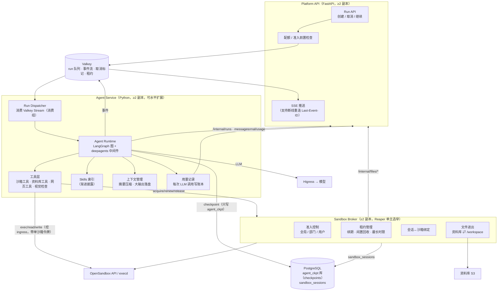
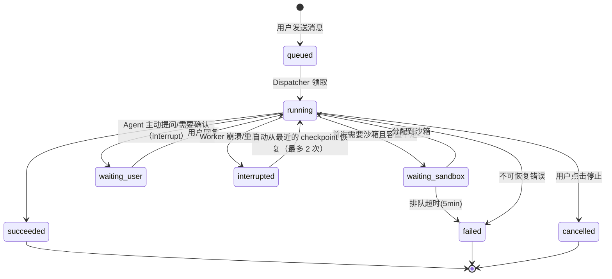
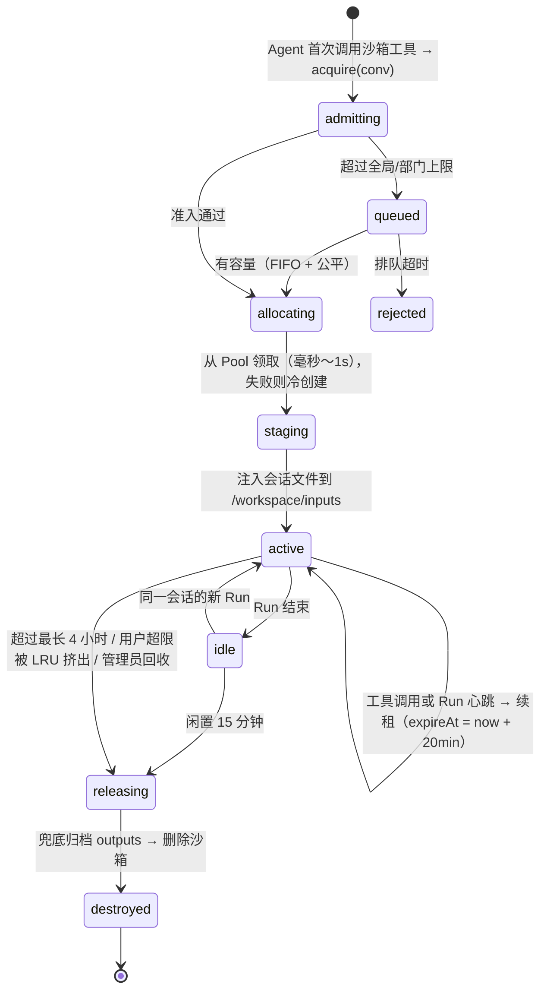
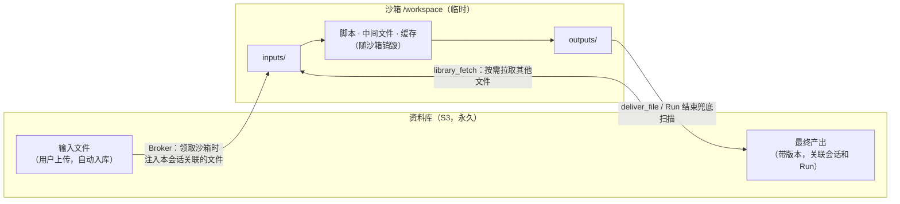
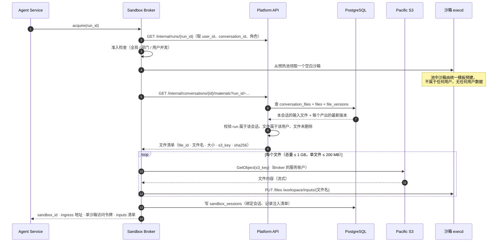
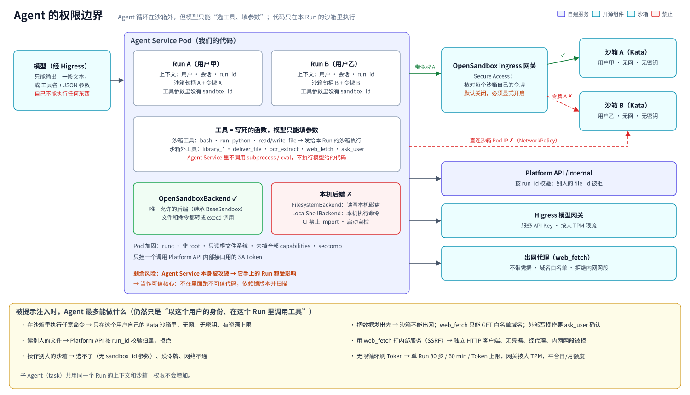

# 03 · Agent 与沙箱设计

> 相关图：[06 Work 全链路](diagrams/svg/06-work-flow.svg) ｜ [07 Agent Service 内部](diagrams/svg/07-agent-internals.svg) ｜ [08 沙箱生命周期](diagrams/svg/08-sandbox-lifecycle.svg) ｜ [09 文件生命周期](diagrams/svg/09-file-lifecycle.svg) ｜ Skills 与依赖见 [08 文档](08-Skills与沙箱环境设计.md)

## 1. 组件与内部结构



**数据写入边界**：Agent Service 只直接写 `agent_ckpt` 库（LangGraph checkpoint，属于它自己的内部状态）；消息、Run 状态、Token 账本都通过 Platform API 的 `/internal/*` 接口写入。Broker 只直接写自己的 `sandbox_sessions` 表；文件元数据通过 `/internal/files/*` 写入。业务表只有 Platform API 一个写入方，权限和配额判定才不会被绕过。

**为什么拆成三个服务**：Platform API 负责面向用户的业务和权限；Agent Service 是计算密集、需要水平扩展的“思考”部分；Sandbox Broker 负责一个有状态的稀缺资源（沙箱）。三者故障域和扩缩容节奏不同，拆开后各自更简单。

## 2. Run（一次任务执行）的生命周期



- **持久化**：LangGraph 每走一步写一次 Postgres checkpoint（`langgraph-checkpoint-postgres`），Worker 崩溃后可以从最后一步继续；沙箱状态不在 checkpoint 中，恢复时如果沙箱已失效，就重新领取并注入文件，同时提示 Agent“环境已重置”。
- **投递**：Run 通过 Valkey Stream 消费组投递，Worker 超时没有 ACK 会被重新认领（`XAUTOCLAIM`）。
- **取消**：Platform API 设置 `cancel:{run_id}` 标记，Agent 在每次 LLM 调用或工具调用前检查；正在执行的沙箱命令通过 execd 中断。
- **事件流**：Agent 把 `token`、`tool_start/tool_end`、`plan_update`、`artifact`、`usage`、`error` 等事件写入 `run:{id}:events` Stream（保留 24 小时）；SSE 端从任意副本读取，前端断线后按 `Last-Event-ID` 续读。
- **护栏**：单个 Run 最多 80 步、最长 60 分钟、Token 上限（按角色配置，例如 200 万），超出后优雅停止，并把已完成的产出归档。

## 3. Agent 设计

### 3.1 两种 Agent

| | Chat Agent | Work Agent |
|---|---|---|
| 默认模型 | `ailab-chat`（Qwen3.6-35B-A3B，多模态，可直接看图） | 专家档 `ailab-agent-pro`（DeepSeek-V4.1-Flash）或标准档 `ailab-agent`（Qwen3.8-27B）负责规划与工具调用；`ailab-chat` 负责摘要、标题、版式检查（看图）；`ailab-ocr` 负责扫描件取文字 |
| 沙箱 | 无 | 懒创建 |
| 工具 | 读取已解析的上传文件、（可选）网页搜索、（二期）知识库检索 | 全部工具（见下表） |
| 上下文 | 64K，超出后滑动窗口加摘要 | 128K，超过 60% 时压缩（deepagents 摘要中间件） |

### 3.2 Work Agent 工具清单

| 工具 | 执行位置 | 说明 |
|---|---|---|
| `bash` / `run_python` | 沙箱 | 经 execd 执行，限时（默认 120s，最长 600s），输出截断（超过 32KB 的部分写入文件，只返回摘要和文件路径） |
| `read_file` / `write_file` / `edit_file` / `ls` / `glob` / `grep` | 沙箱 | deepagents 文件系统工具，后端由 OpenSandbox 适配器实现 |
| `load_skill` | 沙箱（读 `/opt/skills/<name>/SKILL.md`） | 渐进披露：系统提示里只有 Skill 名称和一句描述，用到时再读全文 |
| `library_search` | Agent Service → Platform API `GET /internal/files/search` | 在当前用户自己的资料库里按文件名/标签检索 |
| `library_fetch` | Agent Service → Broker `fetch` → Platform API `POST /internal/files/resolve` | 把选中的文件拉入 `/workspace/inputs`（见第 5.3 节） |
| `ocr_extract` | Agent Service（经 execd 读文件 → Higress `ailab-ocr`） | 扫描件、图片取文字和表格，结果写回 `/workspace/inputs/*.ocr.md` |
| `deliver_file` | Agent Service → Broker | 把 `/workspace/outputs/` 下的文件标记为最终产出并立即归档（Run 结束时还会兜底再扫描一次，见第 5.4 节） |
| `render_preview` + `inspect_visual` | 沙箱（LibreOffice → PDF → PNG）+ `ailab-chat`（多模态） | **自检版式**：生成 PPT 后渲染成图片，由视觉模型检查溢出、重叠、空白页等问题，然后再修正 |
| `web_search` / `web_fetch`（可选） | Agent Service | 需要公司允许出网，域名黑白名单；返回内容标记为“不可信” |
| `ask_user` | Agent Service | 通过 LangGraph interrupt 向用户提问或请求确认 |
| `write_todos` / `task`（子 Agent） | Agent Service | deepagents 内置：任务规划、把子任务委派给子 Agent（子 Agent 与父 Agent 共享同一个沙箱） |

### 3.3 Skills 体系

```
skills/ (Git 仓库)
├── pptx-builder/         SKILL.md + scripts/ + templates/（公司 PPT 母版）
├── docx-writer/          SKILL.md + scripts/ + templates/（公文、报告模板）
├── xlsx-analyst/         SKILL.md + scripts/
├── pdf-toolkit/
├── chart-maker/
├── doc-convert/          （LibreOffice / pandoc 格式互转）
└── data-analysis/
```

- **来源**：自研，在 **MiniMax-AI/skills（MIT）** 的基础上改写，底层用 python-pptx、python-docx、openpyxl、PptxGenJS、docx-js、LibreOffice headless 等开源库。
  > ⚠️ **不能使用 Anthropic 官方的 docx/pptx/xlsx/pdf Skills**：它们是专有许可（source-available），禁止复制、修改和再分发，不能打进我们的镜像。
- **最大价值是公司模板**：把华为/代表处的 PPT 母版、Word 公文模板、配色和字体规范做成 Skill 自带的 assets，产出风格就能统一。
- **发布流程**：Git 提交 → CI（格式校验、脚本单元测试、密钥扫描、评测集回归）→ 构建沙箱镜像 `sbx-office:2026.11.1` → 推送 Harbor → 把 Skills 索引（名称、描述、版本、适用角色）写入平台 DB → 更新 OpenSandbox Pool 模板（控制器自动滚动替换预热池）。
- **权限**：Skill 可以按角色或部门启用；三期再考虑开放用户自定义 Skill（需要审核）。

### 3.4 Agent 提示与契约

- `/workspace/inputs/`：本次注入的输入文件（只读约定）；`/workspace/outputs/`：**最终产出，会自动归档**；其他位置的文件都是临时文件。
- 系统提示明确告诉 Agent 上面这些约定、可用的 Skills 列表、“完成后调用 `deliver_file`”，以及“沙箱随时可能被回收，重要结果及时交付”。

## 4. 沙箱设计

### 4.1 沙箱生命周期（Sandbox Broker 视角）



- **双保险**：Broker 的 Reaper（选主后单实例运行，每 30 秒扫描一次）按租约主动回收；同时每个沙箱在 OpenSandbox 中都设置了 `expireAt`（比租约多 5 分钟），即使 Broker 全部宕机，沙箱也会被控制器回收，**不会泄漏**。
- **续租**：除了每次工具调用续租，Run 处于 running 状态时 Agent Service 每 60 秒发一次心跳续租，避免模型长时间思考（例如多个子 Agent 规划）期间沙箱被当成闲置回收。
- **一会话一沙箱**：`sandbox_sessions` 表在 `(conversation_id) WHERE state IN (active, idle)` 上有唯一约束；并发 acquire 用 PG 行锁串行化。
- **用户超限时的策略**：普通用户只允许 1 个活跃沙箱（并发 Run 上限 2 指“最多 1 个 Work + 1 个 Chat”）。用户在另一个会话里发起 Work 时，如果旧沙箱处于 idle 状态，就自动回收旧沙箱（LRU）；如果旧沙箱正在执行，就提示用户“另一个任务正在运行”，用户可以选择等待或停止它。

### 4.2 准入控制

```
acquire(user, dept, conv):
  1. 用户活跃沙箱数 < user_limit（user 1 / power 2 / platform_admin 5）  否则走 LRU 或提示
  2. 部门活跃沙箱数 < dept_share（按部门人数比例 × 全局容量 × 1.5，允许借用空闲容量）
  3. 全局：live = 活跃 + 分配中
       live < SOFT（容量 × 80%）            → 正常分配
       SOFT ≤ live < HARD（容量 × 95%）     → 分配，同时把预热池缩到最小，并禁止 Heavy 规格
       live ≥ HARD                         → 进入队列（向用户推送排队位置），超时 5 分钟
  4. 容量值 = 根据各节点的 allocatable 和当前 requests 动态计算（每 30 秒刷新），
     所以节点故障时上限自动下调
```

### 4.3 规格（第一期只有两种）

| 规格 | vCPU（limit） | CPU request | 内存（request=limit） | 临时盘 | 用途 |
|---|---|---|---|---|---|
| **standard**（默认） | 2 | 250m（加 Kata 开销 250m，调度时占 0.5 核） | 2 GiB（加开销 320Mi） | 10 GiB | 绝大多数办公任务（P0 实测 Chromium + LibreOffice 峰值后，可能调到 3 GiB） |
| heavy（需要权限） | 4 | 500m | 6 GiB | 20 GiB | 大 Excel、批量转换、数据分析 |

> arm64 上的 Kata QEMU 不支持 CPU 热插拔，**vCPU 数在启动时就固定了**（`static_sandbox_resource_mgmt`），每种规格对应一个 Pool。

### 4.4 OpenSandbox 关键配置（示意）

> 字段名以所选 OpenSandbox 版本的 CRD 和配置文档为准，这里只用来说明设计意图。

```yaml
# Pool：standard 规格预热池
apiVersion: sandbox.opensandbox.io/v1alpha1
kind: Pool
metadata: { name: sbx-office-standard, namespace: sandbox }
spec:
  capacitySpec:
    bufferMin: 5        # 至少 5 个就绪
    bufferMax: 15
    poolMin: 5
    poolMax: 510        # 初值 = 全局硬上限（3 台 × 512 GB 时 ≈510），由 Broker 按 allocatable 动态调整
    # buffer*：池中“已就绪未领取”的数量范围；poolMin/poolMax：池的总规模（含已领取）
  recycleStrategy: Delete         # 用过即删，绝不复用（防止数据残留）
  template:
    spec:
      runtimeClassName: kata-qemu
      priorityClassName: sandbox-low
      automountServiceAccountToken: false
      containers:
      - name: sandbox
        image: harbor.ailab.internal/sandbox/sbx-office@sha256:...   # 锁定 digest
        resources:
          requests: { cpu: 250m, memory: 2Gi, ephemeral-storage: 10Gi }
          limits:   { cpu: "2",  memory: 2Gi, ephemeral-storage: 10Gi }
        securityContext: { runAsNonRoot: true, runAsUser: 10001, allowPrivilegeEscalation: false }
      # 出网策略固化在模板中：dns+nft 默认拒绝，仅放行内网镜像源
```

```toml
# OpenSandbox server 配置要点
[runtime]
type = "kubernetes"
workload_provider = "batchsandbox"
[secure_runtime]
type = "kata"
k8s_runtime_class = "kata-qemu"
# 认证：OPEN-SANDBOX-API-KEY（生命周期 API）只发给 Sandbox Broker；
# Pool 模板开启 secureAccess: true（每个沙箱一个随机令牌，经 ingress gateway 访问 execd，见第 7.3 节）；
# Agent Service 只拿 acquire 返回的单沙箱地址和令牌，不能自己创建沙箱、绕过准入
# 元数据库：PostgreSQL（CNPG）
```

### 4.5 沙箱镜像 `sbx-office`（arm64 原生构建）

完整依赖清单、字体映射、许可证排除项见 **[08-Skills与沙箱环境设计.md](08-Skills与沙箱环境设计.md)** 和 [10 沙箱镜像图](diagrams/svg/10-sandbox-image.svg)。要点如下：
- 基础是 **Debian 13 arm64**（不用 Ubuntu 24.04，它的 Chromium 只有 snap 包），Python 3.12 + Node 22；
- 系统工具：LibreOffice headless、poppler、pandoc、qpdf，外加一份 Playwright Chromium（共用）；
- Python 和 Node 办公库、中文字体按 fontconfig 映射、`/opt/skills` 和 `/opt/ailab-tools`；
- 体积约 2.3～3.0 GB，在三个节点上用 DaemonSet 预拉取；
- 运行时额外的 pip/npm 包只能从**内网镜像源**安装。

## 5. 文件流（资料库 ⇄ 沙箱）



### 5.1 基本原则

- 沙箱**不挂载**任何共享存储（既不挂 S3，也不挂 NFS），也**不持有**任何存储凭据；所有文件进出都由 Broker 经 execd 文件接口中转。
- 沙箱里只有**本次会话需要的那几个文件的副本**，看不到用户资料库的其他内容。
- 归档时计算 SHA256 去重；同名产出生成新版本（`report.pptx` v1、v2…），前端可以对比和回退。
- **会话再次进入 Work 模式时**：注入本会话关联的输入文件和**最新版本的产出**，Agent 可以直接在上次结果的基础上修改（“把第 3 页改成柱状图”），不需要保留旧沙箱。

### 5.2 注入：领取沙箱时怎么把文件放进去



**要点**
- **Broker 只认 `run_id`**：用户和会话由 Platform API 根据 `run_id` 给出，Broker 不接受调用方直接传来的 `user_id`，避免被伪造（见 06 第 1.4 节）。
- **注入哪些文件由会话决定，不是整个资料库**：`conversation_files` 表记录了“这个会话用到了哪些文件”（`role = input | output`），注入时只取这些。三种情况会写入它，**写入方都是 Platform API**：用户上传时（`/files/commit`）、`library_fetch` 拉取时（`/internal/files/resolve`）、产出归档时（`/internal/files/commit`）。
- **已删除的文件**：用户删除文件（进入回收站）后，materials 不再返回它，Agent 在 inputs 清单里会看到“已删除，未注入”。
- **Broker 的 S3 账户**：只能读写 `ailab-library` 桶的 `u/*` 前缀，不能删除、不能列桶；它不解析文件内容，只做搬运。
- **流式中转、不落盘**：Broker 从 S3 读到内存缓冲就直接写进 execd，自己不在磁盘上留副本。
- **失败处理**：某个文件注入失败时记录到 `inputs/_FAILED.txt` 并告知 Agent，不阻塞整个任务；总量超限时按“最近使用优先”截断并提示用户。
- **耗时**：常见办公文件几 MB，整体毫秒到秒级，和预热池领取合并在一次 `acquire` 里完成。
- **Agent Service 拿到什么**：这个沙箱经 OpenSandbox ingress 网关的访问地址，以及一个**只对这个沙箱有效**的 Secure Access 令牌，之后的 `bash`、`read_file` 等工具都带着它访问 execd。它拿不到 OpenSandbox 的生命周期 API Key，不能自己建沙箱，也访问不到别的沙箱（见第 7.3 节）。

### 5.3 运行中按需拉取（`library_fetch`）

用户说“把我上周那份销售数据也用上”时：

```
① Agent Service：library_search("销售数据")
     → Platform API  GET /internal/files/search?run_id=…&q=销售数据
       （按 run_id 定位用户，只在该用户的 files 里按文件名/标签检索）
     ← 候选列表（file_id · 文件名 · 修改时间 · 大小），交给模型挑选

② Agent Service：library_fetch(file_id)  → 调 Broker  fetch(run_id, file_id)
③ Broker → Platform API  POST /internal/files/resolve {run_id, file_id}
     Platform API：校验 file.user_id == run 的用户、文件未删除   ← 关键鉴权点
                   写 conversation_files(conv, file, role=input)  ← 下次注入自动带上
     ← s3_key · 文件名 · 大小 · sha256（内部接口，不签发预签名 URL 给沙箱）
④ Broker：S3 GetObject → execd 写入 /workspace/inputs/{文件名}
⑤ Agent Service ← 写入后的路径
```

**为什么要经 Platform API 而不是 Broker 直接查库**：权限判定集中在一处。`file_id` 是模型生成的（可能被提示注入诱导成别人的文件），必须由掌握用户上下文的 Platform API 校验归属；Broker 只负责搬运。

### 5.4 交付：产出怎么回到资料库

采用**两阶段提交**：先由 Platform API 预检配额并分配版本号，Broker 再写 S3，最后确认。这样 Broker 不需要读业务库，也不会在配额不足时写出孤儿对象。

```
触发时机（三选一，互为兜底）：
  ① Agent 主动调 deliver_file("outputs/report.pptx")    ← 推荐，立即归档
  ② Run 结束时扫描 /workspace/outputs/ 中未交付的文件
  ③ 沙箱释放前再扫描一次（防止 Run 异常结束漏掉）

Broker：
  1. 经 execd 取文件大小和 SHA256（sha256sum，在沙箱里算，不搬运文件）
  2. POST /internal/files/prepare {run_id, path, size, sha256}
       Platform API：按 (会话, 文件名) 找到已有 file_id，没有就新建
                     sha256 与当前版本相同 → 返回 skip（去重，不产生新版本）
                     检查 20 GB 配额 → 不足则拒绝，Agent 和用户收到“空间不足”提示
                     分配 version = 当前 + 1，返回 upload_id 和 s3_key
  3. execd GET /files/workspace/outputs/report.pptx → 流式 PutObject(s3_key)
  4. POST /internal/files/commit {upload_id}
       Platform API：写 file_versions（关联 run_id、conversation_id）
                     更新 files.current_version_id
                     写 conversation_files(role=output)        ← 下次注入自动带上
                     发 artifact 事件 → 前端显示产出卡片（预览 / 下载）
```

- **只有 `/workspace/outputs/` 会被归档**，脚本、临时文件、缓存随沙箱销毁。
- **并发安全**：版本号由 Platform API 在 prepare 时用行锁分配，两次交付同名文件不会撞号。
- **中途失败**：prepare 了但没有 commit 的记录（例如 Broker 在写 S3 时重启）超过 1 小时由 Platform API 的清理任务删除，对应的 S3 对象一并删除（清理任务用 Platform API 的 S3 账户，它有删除权限）。

### 5.5 浏览器侧：上传与下载不经过 Broker

用户在界面上传、下载文件走的是另一条路：**经 Higress 入口直达 S3，不经过 Platform API 和 Broker**：

```
上传：Portal → POST /files/upload-url（Platform API 检查配额，签发预签名分片 URL，5 min）
      → 浏览器 → Higress（files 域名）→ Pacific S3（大文件分片）
      → POST /files/commit（Platform API 核对对象实际大小、登记元数据、关联会话；超过声明大小则删除并拒绝）

下载：Portal → GET /files/{id}/download-url（校验归属后签发预签名 GET，5 min）
      → 浏览器 → Higress（files 域名）→ Pacific S3
```

- 预签名 URL **只对单个对象有效、5 分钟过期**，不会泄露对整个资料库的访问权；大文件不经过 Platform API 中转，省带宽也省内存。
- **浏览器不直接访问 Pacific**：预签名 URL 用 Pacific S3 自己的域名签发（签名里包含域名，换域名会验签失败），但办公网 DNS 把这个域名解析到 **Higress 的 VIP**，Higress 原样带着 Host 转发给 Pacific。这样 Pacific 的 S3 服务端口只对 TaiShan 开放，浏览器侧的文件流量和其他请求一样受 Higress 的连接数、请求体大小、按 IP 限速和访问日志约束（见 09 第 10 节）。P0 验证三件事：① Pacific 在这种转发下验签正常；② 寻址用路径风格（`域名/桶/对象`），不需要 `桶.域名` 的泛域名解析和证书；③ `files` 域名的证书由 Higress 正确提供（Higress 按 host 精确匹配 Ingress 的 TLS 配置，泛域名证书要走凭据映射，见 09 第 10.1 节）。

## 6. 故障与边界处理

| 场景 | 处理 |
|---|---|
| 沙箱 OOM 或被驱逐 | execd 调用失败 → Broker 标记失效 → 自动领取新沙箱并重新注入文件 → 告诉 Agent“环境已重置，请从已交付的产出继续”（outputs 已即时归档，损失最小） |
| 一台 TaiShan 宕机 | 该节点上的沙箱丢失（处理方式同上）；全局容量自动下调（512 GB/台时从约 535 降到约 330），新请求排队；平台服务由其余节点的副本接管 |
| OpenSandbox Server 重启 | Broker 的创建请求自动重试（指数退避，总共 60 秒）；已运行的沙箱和 execd 不受影响 |
| 模型故障或超时 | Agent Service 对同一别名重试 2 次，仍失败则按降级链换下一级别名（只在首 token 前切换，见 02 第 5 节）；仍然失败则 Run 进入 `failed`，可以手动“继续” |
| 用户关闭浏览器 | Run 在后端继续执行；再次打开时通过 SSE 续读事件 |
| 恶意代码或提示注入 | 关在 Kata VM 里，没有网络、没有凭据，最多耗尽自身规格的 CPU 和内存；会话结束即销毁 |

## 7. Agent 是怎么跑的，怎么被限制住



### 7.1 Agent 是怎么跑的

- **Agent Service 是一个普通的后端服务**：Python 编写，在 TaiShan 的 K8s 里以 Deployment 运行（≥2 副本，`agent` 命名空间，普通 runc 容器，因为它只运行我们自己的代码）。
- **不是“每个用户一个 Agent 进程”**：一次 Run 就是一个 LangGraph 状态机。Dispatcher 从 Valkey 领到 `run_id` → 加载这个会话的 checkpoint → 循环执行“调用模型 → 执行工具 → 观察结果”，每一步写一次 checkpoint。一个 Pod 里用 asyncio 同时推进几十个 Run，每个 Run 有自己独立的上下文对象（用户、会话、沙箱句柄、令牌）。
- **模型不能直接执行任何东西**：模型的输出只有两种——一段文本，或者“调用某个工具 + 一组 JSON 参数”。真正做事的是 Agent Service 里我们写好的工具代码；其中 `bash`、`run_python`、文件读写这几类工具，做的事情是**把命令或文件发给这个 Run 的沙箱里的 execd**，代码在 Kata 虚拟机里执行，不在 Agent Service 里执行。

### 7.2 会不会操作到 Agent Service 所在的机器

**不会，前提是守住三条规则**：

| 规则 | 做法 |
|---|---|
| 文件和命令工具只能落到沙箱 | deepagents 的文件工具（`read_file`、`write_file`、`ls`、`grep` 等）和 `execute` 都通过“后端”完成。我们只用自写的 OpenSandbox 后端（继承 deepagents 的 `BaseSandbox`，`execute` / `upload_files` / `download_files` 都转成 execd 调用）。deepagents 默认的 `StateBackend` 也只把文件放在 LangGraph 状态里，不碰本机 |
| 禁用本机后端 | **禁止**使用 `FilesystemBackend`（直接读写本机磁盘）和 `LocalShellBackend`（用 subprocess 在本机执行命令，官方文档明确警告“无隔离、不适合生产和多租户”）。CI 扫描禁止 import 这两个类；服务启动时自检，后端类型不对就拒绝启动 |
| 沙箱外工具都是固定代码 | 在 Agent Service 里执行的工具（`library_*`、`deliver_file`、`ocr_extract`、`web_fetch`、`ask_user` 等）都是写死的函数，模型只能填参数；没有任何工具在 Agent Service 里调用 `subprocess`、`eval` 或执行模型给出的代码。Skills 的脚本也是在沙箱里运行，Agent Service 只把 `SKILL.md` 的文字读给模型 |

容器本身也加固：非 root、只读根文件系统、去掉全部 Linux capabilities、seccomp `RuntimeDefault`，只挂一个用于调用 Platform API 内部接口的 projected ServiceAccount Token。

### 7.3 会不会操作到别的用户的沙箱

三层限制，任何一层单独都能挡住：

| 层 | 做法 |
|---|---|
| **① 代码层：模型选不了沙箱** | 沙箱句柄（地址 + 令牌）放在 Run 的上下文里，**工具参数里没有 `sandbox_id`**。模型就算在参数里写了别人的沙箱 ID，工具也不会用它 |
| **② 令牌层：每个沙箱一个令牌** | 开启 OpenSandbox 的 **Secure Access**：创建沙箱时生成一个随机令牌，只有带这个令牌的请求才能经 OpenSandbox 的 ingress 网关到达这个沙箱的 execd。Broker（唯一持有生命周期 API Key 的服务）领到沙箱后取回它的地址和令牌，交给负责这个 Run 的 Agent Service；沙箱销毁后令牌随之作废 |
| **③ 网络层：不能直连沙箱** | `sandbox` 命名空间的 NetworkPolicy 只允许 OpenSandbox ingress 网关访问 execd 端口，Agent Service 不能直接访问沙箱 Pod 的 IP |

> ⚠️ **这些都要显式配置，不是 OpenSandbox 的默认行为**（已对照源码核实）：execd **默认不鉴权**；Secure Access **默认关闭**，而且只在 K8s 的 ingress `gateway` 模式下可用；单租户模式下 OpenSandbox Server 的代理路径（`/sandboxes/{id}/proxy/{port}`）**不检查 API Key**。所以必须同时做到：开启 Secure Access、所有 execd 访问只走 ingress 网关、Server 的代理路径不对 Agent Service 开放。P0 验证 Secure Access 在 arm64 + Kata 上可用（见 07 B2）。

**剩余风险**：一个 Agent Service Pod 手里同时有它正在处理的几十个 Run 的令牌。如果 Agent Service 本身被攻破（不是被提示注入，而是代码漏洞被利用），攻击者能操作这些 Run 的沙箱，还能拿到它的服务 API Key。所以 Agent Service 被当作**可信核心组件**：不在里面执行任何不可信代码，依赖锁版本并扫描，权限只给到它需要的接口。

### 7.4 被提示注入时，Agent 最多能做什么

提示注入（上传的文档或网页里藏着指令）可以让模型“想做坏事”，但它能做的仍然只是“以这个用户的身份、在这个 Run 里调用工具”：

| 它可能想做的事 | 结果 |
|---|---|
| 在沙箱里执行任意命令 | 本来就允许，但只在这个用户自己的 Kata 沙箱里：没有网络、没有密钥、资源有上限，会话结束即销毁 |
| 读别人的文件 | `library_fetch` 的 `file_id` 由 Platform API 按 `run_id` 校验归属，别人的文件被拒（见第 5.3 节） |
| 把数据发到外面 | 沙箱不能出网；`web_fetch` 只能 GET 白名单域名，并且经出网代理；有外部写操作的工具需要 `ask_user` 让用户确认 |
| 用 `web_fetch` 打内部服务（SSRF） | `web_fetch` 用独立的 HTTP 客户端，**不带任何凭据**，强制走出网代理，代理拒绝内网网段和集群地址 |
| 无限循环刷 Token | 单个 Run 最多 80 步、60 分钟、有 Token 上限；网关按人限 TPM；平台按日/月额度 |
| 通过子 Agent 扩大权限 | 子 Agent（`task`）共用同一个 Run 的上下文和沙箱，权限不会增加 |
