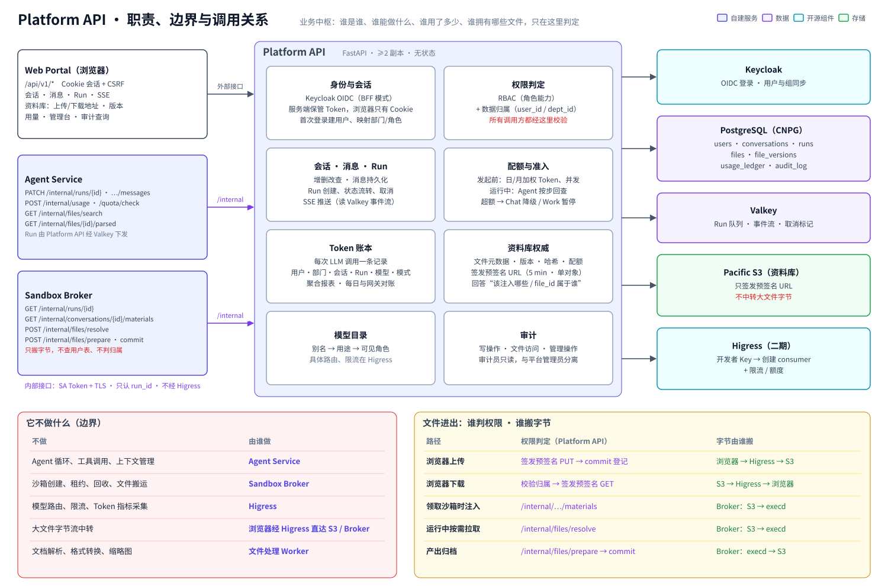
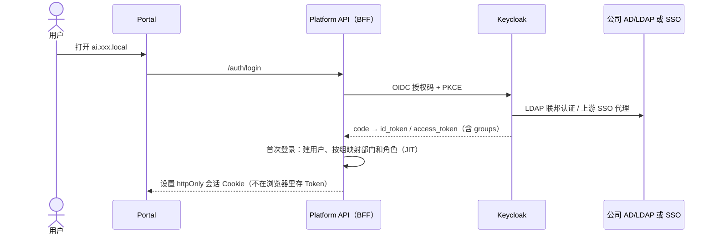
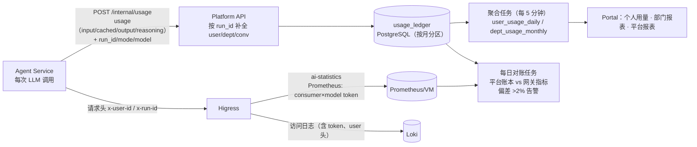
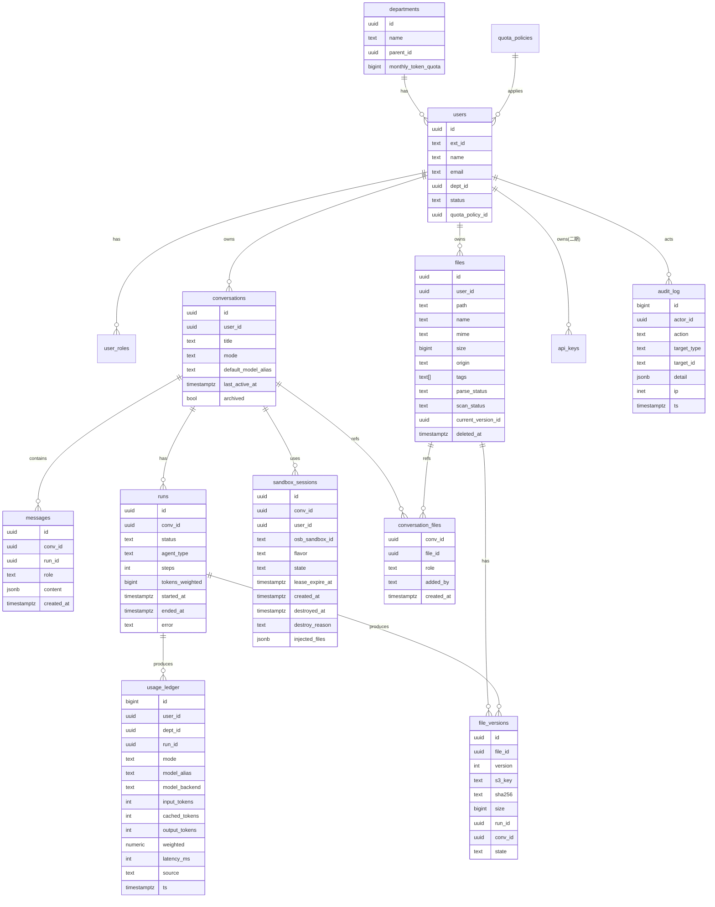

# 04 · 平台服务与数据设计（用户、权限、配额、计量、资料库、前端）

> 相关图：[18 Platform API 职责与边界](diagrams/svg/18-platform-api.svg) ｜ [16 Token 计量与配额](diagrams/svg/16-metering.svg) ｜ [09 文件生命周期](diagrams/svg/09-file-lifecycle.svg)

## 0. Platform API 的定位与职责

Platform API 是整个平台的**业务中枢和唯一权威**：所有“谁是谁、谁能做什么、谁用了多少、谁拥有哪些文件”的判定都在这里，其他组件都不自己做这些决定。



### 0.1 它负责什么

| 职责 | 具体内容 | 谁来调用 |
|---|---|---|
| **身份与会话** | 对接 Keycloak OIDC，服务端保管 Token，浏览器只拿 httpOnly Cookie；首次登录建用户、按组映射部门和角色 | Portal |
| **权限判定** | 每个请求做 RBAC（角色能力）+ 数据归属（`user_id`/`dept_id`）双重校验 | 所有调用方 |
| **会话与消息** | 会话的增删改查、消息持久化、Run 的创建与状态流转、SSE 事件推送 | Portal、Agent Service |
| **配额与准入** | 发起 Run 前检查日/月加权 Token 余额、并发 Run 数、部门池；超额时决定降级还是拒绝 | Portal、Agent Service |
| **Token 账本** | 记录每次 LLM 调用的用量（精确到用户、部门、会话、Run、模型、模式），聚合成报表 | Agent Service |
| **资料库权威** | 文件元数据（归属、版本、哈希、关联会话）、配额计算、签发预签名 URL、**对外提供“这个会话该注入哪些文件”“这个 file_id 属不属于这个用户”的判定** | Portal、Sandbox Broker、Agent Service |
| **模型目录** | 维护别名 → 用途 → 可见角色的映射（具体路由在 Higress，这里管业务可见性） | Portal |
| **审计** | 所有写操作、文件访问、管理操作落审计日志 | 内部 |

### 0.2 它不负责什么（边界）

| 不做 | 由谁做 |
|---|---|
| Agent 循环、工具调用、上下文管理 | Agent Service |
| 沙箱的创建、租约、回收、文件搬运 | Sandbox Broker |
| 模型路由、限流、Token 指标采集 | Higress |
| 大文件的字节流中转 | 浏览器经 Higress 直达 S3（预签名）；沙箱侧由 Broker 流式中转 |
| 文档解析、格式转换 | 文件处理 Worker |

### 0.3 两类接口

- **外部接口**（`/api/v1/*`）：给浏览器用，走 Cookie 会话 + CSRF 防护，见第 7 节。
- **内部接口**（`/internal/*`）：给 Agent Service、Sandbox Broker 等平台内部服务用，**不经 Higress 暴露到外部**（只监听集群内 Service，NetworkPolicy 只放行 Agent Service、Broker、文件处理 Worker）。主要有：

| 内部接口 | 用途 | 调用方 |
|---|---|---|
| `GET /internal/runs/{id}` | 由 run_id 查出用户、部门、会话、角色和 Run 状态 | Sandbox Broker |
| `PATCH /internal/runs/{id}` | 更新 Run 状态、步数、错误信息 | Agent Service |
| `POST /internal/runs/{id}/messages` | 持久化消息（用户可见的回复、工具调用摘要） | Agent Service |
| `POST /internal/usage` | 写 Token 账本（每次 LLM 调用一条，可批量提交） | Agent Service |
| `POST /internal/quota/check` | 运行中按步检查 Token 额度 | Agent Service |
| `GET /internal/files/search` | 按文件名/标签检索该用户的文件（供 `library_search`） | Agent Service |
| `GET /internal/files/{id}/parsed` | 读取文件处理 Worker 解析出的文本（供 Chat Agent） | Agent Service |
| `PATCH /internal/files/{id}/processing` | 回写解析、预览、病毒扫描结果 | 文件处理 Worker |
| `GET /internal/conversations/{id}/materials` | 返回本会话该注入沙箱的文件清单（已校验归属） | Sandbox Broker |
| `POST /internal/files/resolve` | 校验 `file_id` 归属、写会话关联、返回 `s3_key`（供 `library_fetch`） | Sandbox Broker |
| `POST /internal/files/prepare` | 交付第一阶段：去重、检查存储配额、分配 file_id/版本号和 `s3_key` | Sandbox Broker |
| `POST /internal/files/commit` | 交付第二阶段：登记新版本、写会话关联、发 artifact 事件 | Sandbox Broker |

**内部调用怎么认证、怎么防伪造**：
- **服务身份**：调用方用 K8s 的 projected ServiceAccount Token（指定 audience，1 小时自动轮换），Platform API 通过 TokenReview 校验，并按 ServiceAccount 限定能调哪些接口（例如只有 Broker 能调 `/internal/files/prepare`）。链路本身用 cert-manager 签发的内部证书做 TLS。
- **用户上下文绑定到 `run_id`**：内部接口**不接受**调用方直接传 `user_id`。每个请求带 `run_id`，Platform API 自己查出它属于哪个用户和会话，并要求 Run 处于活跃状态。这样即使 Agent Service 的某次工具调用被提示注入诱导、传入了别人的 `file_id` 或 `conversation_id`，也会因为和 Run 的归属不匹配而被拒绝。

**设计原则**：权限判定只有一处。Broker 和 Agent Service 都不直接查用户表或自行判断归属——它们拿到的 `file_id`、`conversation_id` 可能来自模型生成的内容，必须由 Platform API 校验后才能使用。

> 文件进出沙箱的完整时序见 [03 文档第 5 节](03-Agent与沙箱设计.md#5-文件流资料库--沙箱)。

## 1. 用户与身份

### 1.1 登录链路



- **账号来源**：优先对接公司现有的 AD/LDAP 或 SSO（Keycloak 做联邦或代理）。如果没有可对接的源，就在 Keycloak 本地建账号，由管理员批量导入，并开启 MFA（TOTP）。
- **BFF 模式**：浏览器只持有会话 Cookie；Platform API 在服务端保存和刷新 Token，减少 Token 泄露面。
- **离职和停用**：以 LDAP 同步为准（每 15 分钟），停用的用户立即失效；Platform API 每次请求都检查用户状态。
- **运维系统**（GPUStack、Grafana、Harbor、OpenSandbox 管理端）也走 Keycloak OIDC，只对 `ops` 组开放。

### 1.2 角色与权限（RBAC）

| 角色 | 能力 | 默认配额档 |
|---|---|---|
| 普通用户 `user` | Chat、Work、个人资料库、查看个人用量 | 标准档 |
| 高级用户 `power` | 在 `user` 基础上：heavy 规格沙箱、旗舰模型更高额度、2 个并发沙箱 | 高级档 |
| 部门管理员 `dept_admin` | 管理本部门成员的角色和配额（在部门总额度内分配）、查看本部门用量报表 | — |
| 平台管理员 `platform_admin` | 模型别名、Skills 上下架、全局配额与策略、沙箱容量参数、公告 | — |
| 审计员 `auditor` | 只读查看审计日志（**和平台管理员职责分离**） | — |
| 开发者 `developer`（二期） | 申请 API Key、查看 Key 的用量 | API 档 |

> 平台管理员**默认不能查看**用户的对话内容和资料库文件；如果确实需要（例如安全事件调查），必须由审计员审批并留下审计记录。这一条需要和代表处的数据合规要求对齐。

## 2. 配额与准入

### 2.1 配额维度

| 维度 | 标准档（默认值，可调） | 执行点 |
|---|---|---|
| 并发 Run 数 | 2（最多 1 个 Work + 1 个 Chat） | Platform API |
| 活跃沙箱数 | 1 | Sandbox Broker |
| 每日 Token（Work + Chat 合计，按加权 Token 计） | 200 万 | Platform API（发起 Run 前检查，Run 执行中按步检查） |
| 每月 Token | 3000 万 | 同上 |
| 单个 Run 的 Token 上限 | 200 万 | Agent Service |
| 资料库容量 | 20 GB | Platform API（上传和归档时检查） |
| 单文件大小 | 200 MB | Platform API |
| 每分钟 Token（防刷） | 20 万 TPM / 用户 | Higress（`x-user-id`） |

**加权 Token**：不同模型的成本不同，按模型设置权重，例如 `ailab-agent-pro`（DeepSeek）×3、`ailab-agent`（27B）×1、`ailab-chat`（35B-A3B）×0.3、`ailab-ocr`/向量/重排 ×0.1、缓存命中的输入 ×0.1，这样额度就近似反映真实的算力消耗。

**超额策略**：用到 80% 时提醒；用到 100% 时，Work 模式和旗舰模型暂停，Chat 自动降级到 `ailab-chat` 继续可用（避免完全不能用）；部门管理员可以临时追加额度。

### 2.2 部门额度

部门有月度总额度（按人数分配，也可以由平台管理员调整），成员额度之和可以超过部门总额（超卖），但部门实际用量达到总额时，全部门降级。这样既有公平性，又不浪费额度。

## 3. Token 计量

### 3.1 数据流



- **账本以平台为准**（可以精确到会话和 Run，支持“这个 PPT 花了多少 Token”）；网关指标用于对账，并覆盖 API Key 直连的流量（二期把网关日志也写入账本，`source=api`）。
- 流式响应需要 `stream_options.include_usage`：Higress 的 `ai-proxy` 会自动给流式请求注入（Agent Service 也显式带上，双保险），Agent Service 统一从最后一个 chunk 里读取 usage。身份如何从浏览器传到模型调用，见 [09](09-请求链路与网关设计.md)。
- **展示**：每条 AI 回复下方可以展开查看本次 Token 用量；个人页面显示今日和本月用量、额度进度条、按模型和模式的分布；部门管理员看成员排行和趋势；平台管理员看全局用量、各模型池利用率和成本折算。

### 3.2 其他计量

| 指标 | 来源 | 用途 |
|---|---|---|
| 沙箱时长（vCPU·分钟、GiB·分钟） | Broker（`sandbox_sessions` 起止时间 × 规格） | 容量规划；以后可以计入额度 |
| 资料库占用 | Platform API（`files` 表汇总） | 配额 |
| 活跃用户（日活/周活）、会话数、Work 成功率、平均步数 | 业务库 | 运营报表 |
| 用户反馈（点赞/点踩、产出被下载） | Portal | 评估模型和 Skills 效果 |

## 4. 资料库（Library）

### 4.1 存储布局（Pacific S3）

```
bucket: ailab-library   （开启版本管理；对象锁不开）
  u/{user_id}/files/{file_id}/{version}          用户文件（上传的输入、归档的产出）
  u/{user_id}/thumbs/{file_id}.png               缩略图 / 预览
  u/{user_id}/previews/{file_id}/{version}.pdf   Office 文件的 PDF 预览
  u/{user_id}/parsed/{file_id}/{version}.md      解析出的文本（供 Chat 使用）
bucket: ailab-upload-tmp                         分片上传临时区（生命周期 1 天）
```

- Pacific 每个账户最多 100 个桶，所以**不按用户建桶**，而是用前缀加上应用层鉴权。S3 凭据只在三个服务里，各用独立账户、最小权限：Platform API（签发预签名、清理任务，可删除）、Broker（读写 `u/*`，不可删除）、文件处理 Worker（读原文件，写 `thumbs/`、`previews/`、`parsed/`）。
- 浏览器上传和下载都用 **预签名 URL**，经 Higress 入口到达 S3（不经过 Platform API 中转大文件，浏览器也不直接连 Pacific，见 03 第 5.5 节）。预签名 URL 有效期 5 分钟，且只能访问单个对象。
- **元数据在 PG**（文件名、目录、类型、大小、哈希、来源：上传 / Agent 产出 / 会话附件、关联的会话和 Run、标签）；S3 只存内容。
- **配额**：以 PG 中当前版本大小的总和（加上历史版本，最多保留 10 个）计入 20 GB。
- **回收站**：删除后 30 天内可以恢复，之后由生命周期规则彻底清除。
- **删除与会话引用**：文件被删除（进入回收站）后，引用它的会话仍保留记录，但注入沙箱时跳过它并提示“已删除”；从回收站恢复后自动恢复引用。删除会话时，会话本身、消息和 checkpoint 一并删除，**会话产出的文件保留在资料库**（它们是用户资产），只解除关联。

### 4.2 功能

- 目录树、搜索（文件名 + 标签；二期加全文和向量检索）、预览（PPT/Word/Excel 先转成 PDF 再用 pdf.js 显示，图片和 Markdown 直接显示）、下载、版本历史、重命名、移动、删除。
- 在对话中可以“从资料库引用”文件；产出卡片上可以“另存为 / 继续修改”。
### 4.3 文件处理 Worker（上传解析、预览、Chat 读文件）

用户上传的文件在 Chat 模式下没有沙箱可用，由文件处理 Worker 预先处理：

| 项 | 设计 |
|---|---|
| 触发 | `/files/commit` 后 Platform API 往 Valkey 队列 `file-jobs` 投递任务；Worker 消费 |
| 处理内容 | ① Office → PDF 预览、缩略图；② 抽取文本（docx/xlsx/pptx/pdf 文本层；扫描件和图片调用 `ailab-ocr`）；③ 病毒扫描（ClamAV，独立服务，子进程调用） |
| 结果存放 | 预览、缩略图写 S3 `previews/`、`thumbs/`；抽取的文本写 S3 `u/{user_id}/parsed/{file_id}/{version}.md`，`files` 表记录解析状态 |
| Chat 怎么用 | Chat Agent 通过 `/internal/files/{id}/parsed` 读取解析后的文本（同样按 `run_id` 校验归属），超长时只取摘要和相关片段 |
| 运行方式 | **Kata 运行时**（不可信的 Office/PDF 文件交给 LibreOffice 解析，和沙箱一样需要内核级隔离），单任务限时 60 秒，2 副本 |
| 网络 | 不能访问公网；只允许访问 Pacific S3、Higress（调用 `ailab-ocr`，使用独立的服务 Key）和 Valkey |
| 病毒扫描命中 | 文件标记为隔离，不提供预览和下载，也不注入沙箱，通知用户和管理员 |

## 5. 前端（Web Portal）

### 5.1 技术栈

| 层 | 选型 |
|---|---|
| 框架 | Next.js 16（App Router）+ React 19 + TypeScript |
| 组件 | shadcn/ui + Tailwind CSS；对话区用 **assistant-ui**（MIT），包括消息流、Markdown/代码高亮、工具调用卡片、附件 |
| 流式 | SSE（Platform API 输出自定义事件，前端用 assistant-ui 的 external store runtime 适配）；以后如有需要再兼容 AG-UI 协议 |
| 预览 | pdf.js（Office 文件转换后的 PDF）、图片、Markdown、代码 |
| 国际化 | 中文 / 英文（代表处可能有外籍员工） |
| 部署 | 以 standalone 模式容器化，2 副本，由 Higress 做 HTTPS 入口 |

### 5.2 页面结构

```
┌──────────────────────────────────────────────────────────────────────┐
│ Logo  [新对话]                         今日用量 ▓▓▓░ 62%   头像 ▾      │
├──────────────┬───────────────────────────────────┬───────────────────┤
│ 会话列表       │  [ 💬 对话 ]  [ 🛠 工作 ]   模型：标准 ▾  │  工作面板（Work） │
│  · 今天        │                                   │  ┌ 任务计划 ─────┐ │
│  · 昨天        │   消息流                           │  │ ☑ 读取文档    │ │
│  · 更早        │   ├ 用户：把这份报告做成 PPT        │  │ ☑ 生成大纲    │ │
│              │   ├ AI：（思考过程，可折叠）          │  │ ◻ 生成幻灯片  │ │
│ ─────────     │   ├ 🔧 run_python … ✓（可展开）     │  └──────────────┘ │
│ 📁 我的资料库   │   ├ 📎 产出：季度汇报.pptx [预览][下载]│  产出文件 / 预览   │
│ 📊 我的用量    │   └ …                              │  沙箱状态：运行中   │
│ ⚙ 管理台(按权限)│  [ 📎 附件 | 从资料库选择 ]  [发送]  │  （闲置 12:30 后释放）│
└──────────────┴───────────────────────────────────┴───────────────────┘
```

- **Chat/Work 切换**：在会话级别切换；切到 Work 不会立刻创建沙箱，右侧面板显示“环境将在需要时启动”。
- **透明度**：工具调用默认折叠为一行状态，可以展开查看命令和输出（高级用户默认展开）；显示排队位置和沙箱状态。
- **管理台**：用户与角色、部门与额度、模型别名与可见性、Skills 管理、沙箱容量参数、用量报表、公告、审计查询（审计员）。

## 6. 数据模型（核心表）



- **Agent checkpoint**（LangGraph 表）放在同一个 PG 集群的独立库 `agent_ckpt` 里，按 `thread_id = conversation_id` 组织；会话删除时级联清理。
- `conversation_files.role` 取 `input`（上传或拉取）或 `output`（归档的产出）；`file_versions.state` 取 `prepared` / `committed`（两阶段交付，见 03 第 5.4 节）。
- 聚合表 `user_usage_daily`、`dept_usage_monthly`、`model_usage_hourly` 由聚合任务生成，图中省略。
- `usage_ledger`、`audit_log` 按月分区；账本保留 2 年，审计日志保留时长按合规要求（建议 ≥1 年）。
- **数据保留策略**（需和代表处确认）：会话默认长期保留，用户可以删除；超过 12 个月不活跃的会话自动归档（从列表隐藏，可以恢复）。

## 7. Platform API 接口概要

| 分组 | 主要接口 |
|---|---|
| 认证 | `GET /auth/login`、`GET /auth/callback`、`POST /auth/logout`、`GET /me` |
| 会话 | `GET/POST /conversations`、`PATCH /conversations/{id}`（标题、模式、模型）、`DELETE …` |
| 消息与 Run | `POST /conversations/{id}/messages`（创建 Run）、`GET /runs/{id}/events`（SSE）、`POST /runs/{id}/cancel`、`POST /runs/{id}/resume`、`POST /runs/{id}/answer`（回复 ask_user） |
| 资料库 | `GET /files?path=`、`POST /files/upload-url`（预签名）、`POST /files/commit`、`GET /files/{id}/download-url`、`GET /files/{id}/versions`、`POST /files/{id}/restore` |
| 用量 | `GET /usage/me`、`GET /usage/dept/{id}`（部门管理员）、`GET /usage/platform`（平台管理员） |
| 管理 | `/admin/users`、`/admin/departments`、`/admin/quota-policies`、`/admin/models`、`/admin/skills`、`/admin/sandbox-settings`、`/admin/announcements` |
| 审计 | `GET /audit`（审计员） |
| 开发者（二期） | `POST /api-keys`（Platform API 代为向 GPUStack 申请 Key，限定可用模型；Higress 按 Key 限流和计额，见 09 第 2.4 节）、`GET /api-keys/{id}/usage` |

所有写操作都写审计日志；所有接口按 RBAC 加数据归属（`user_id`/`dept_id`）双重校验。
