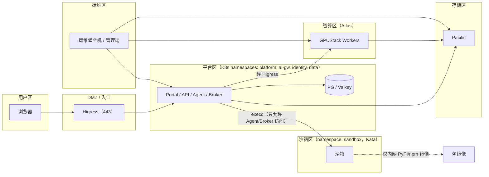
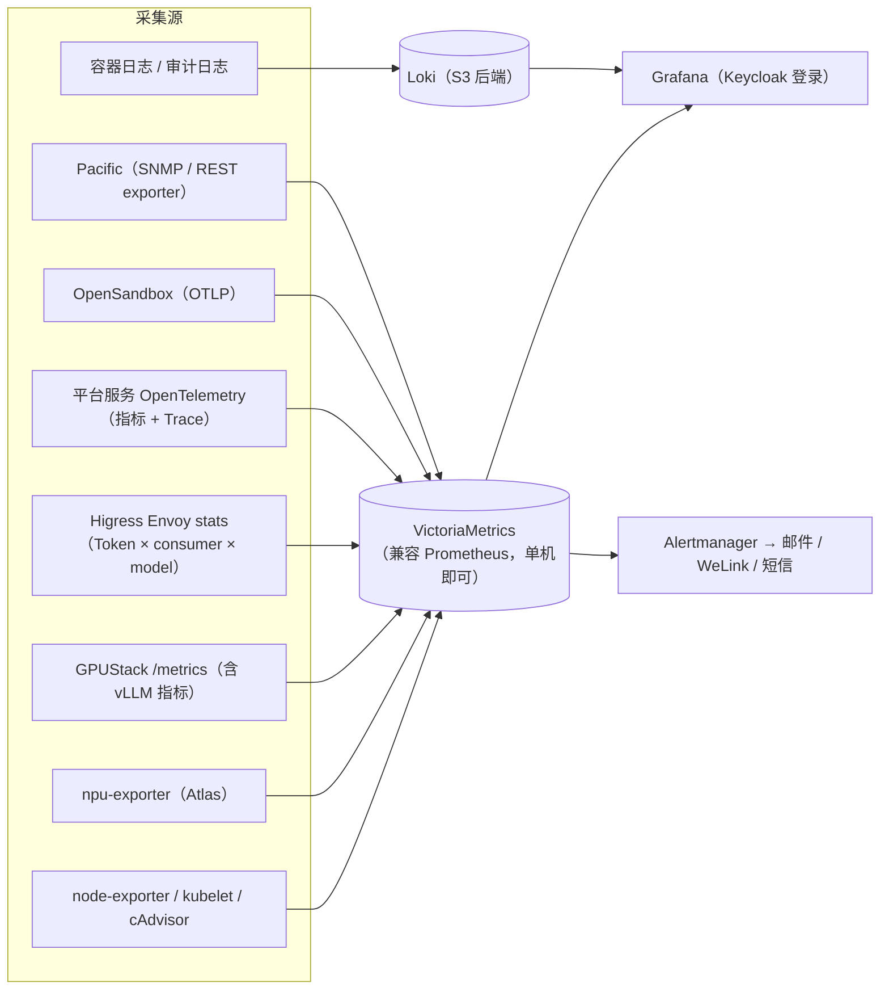

# 06 · 安全、高可用与运维

> 相关图：[13 安全分区](diagrams/svg/13-security-zones.svg) ｜ [03 etcd](diagrams/svg/03-etcd-quorum.svg) ｜ [02 物理部署](diagrams/svg/02-deployment.svg)

## 1. 安全体系

### 1.1 威胁模型（重点）

| 威胁 | 场景 | 主要控制措施 |
|---|---|---|
| 沙箱逃逸 | LLM 生成或被诱导执行恶意代码 | Kata microVM（独立内核）；非 root；不挂 ServiceAccount Token；不挂宿主机目录；低优先级加资源上限 |
| 横向移动或内网扫描 | 沙箱里的代码去访问公司内网或平台服务 | OpenSandbox 出网 sidecar（dns+nft **默认拒绝**，加平台级 `deny.always` 屏蔽 Pod/Service/节点/管理网段）+ K8s NetworkPolicy（`sandbox` 命名空间默认拒绝出入，入站只放行 OpenSandbox ingress 网关访问 execd，出站只放行 CoreDNS 和包镜像，见第 1.5 节） |
| 凭据泄露 | `env`、`cat ~/.config` | **沙箱内零密钥**：模型调用、S3、内部 API 全部由沙箱外的服务完成；execd 只能经 ingress 网关、凭单沙箱 Secure Access 令牌访问 |
| 提示注入 | 上传文档或网页里藏有指令 | 工具输出标记为不可信；高风险工具（外部写操作）需要 `ask_user` 确认；沙箱本身无法外传数据（不能出网），文件只能交付给用户本人 |
| 越权访问 | 访问别人的会话或文件 | 每个接口都按 RBAC 加数据归属双重校验；预签名 URL 只针对单个对象、5 分钟有效；S3 凭据不下发到浏览器或沙箱 |
| 数据出域 | 数据被发送到外部模型 | **所有模型本地部署**；GPUStack 和 Higress 禁止配置外部 Provider 路由；出网代理审计 |
| 供应链 | 投毒的镜像、包或模型 | 所有镜像同步到 Harbor，锁定 digest，cosign 签名校验（准入策略）；Trivy 扫描；PyPI/npm 只走内网镜像；模型只收 safetensors，并做 SHA256 校验 |
| 组件漏洞 | GPUStack、LiteLLM 类网关等曾出现鉴权绕过、注入漏洞 | 订阅安全公告；关键组件（GPUStack ≥2.2.2、Keycloak 最新 minor 版本）按月检查；管理端只挂在运维域名上，登录只开放给 `ops` 组 |
| 资源滥用 | 刷 Token、挖矿 | 网关 TPM 限流、平台额度；沙箱 CPU 上限且不能出网；异常用量告警 |

### 1.2 网络分区（逻辑）

- 用户区**只能**访问 Higress 的 VIP（443）：页面、`/api`、登录页，以及经 Higress 转发的 S3 预签名上传下载；Pacific 的 S3 端口只对 TaiShan 开放，NFS 端口只对 TaiShan 和 Atlas 开放（见 09 第 10 节）。
- 沙箱区**不能**访问平台区、智算区、存储区和运维区；智算区只接受来自 Higress（推理）和 GPUStack Server（管理）的流量，由 Atlas 主机防火墙限制。
- 管理端（GPUStack UI、Grafana、Harbor、Keycloak Admin、OpenSandbox 控制台、K8s API）只对运维区提供，并通过 Keycloak OIDC + MFA 登录，只开放给 `ops` 组。其中**经 Higress 暴露的管理界面（如 GPUStack 的 `gpustack.xxx.local`）和用户入口共用同一个 VIP**：运维域名只在运维区 DNS 解析，但这不是网络隔离（有人手动指定 Host 也能到登录页），真正的防线是登录和 MFA。如果安全评审要求网络隔离，给这些运维域名的 Ingress 加 Higress `ip-restriction`，只放行运维网段（见 09 第 10.1 节）。

### 1.3 数据安全

- **传输**：入口 TLS 1.2+（证书来自公司 CA）；集群内部敏感链路（Platform↔PG、↔S3、内部接口）开启 TLS，证书由 cert-manager + 内部 CA 签发并自动轮换。
- **静态**：如果 Pacific 支持存储侧加密，就开启；PG 备份加密。
- **审计**：登录与登出、会话创建与删除、Run（模型、工具名、命令摘要、访问了哪些文件）、文件上传/下载/删除、管理操作、额度变更，都写入 `audit_log`，同时归档到 S3（WORM 可选）。**不记录**沙箱里的每一个临时文件。
- **内容安全**（按代表处要求选择）：输入输出合规检查可以用 `ailab-agent`（27B）或专门的安全模型做异步抽检，或作为同步护栏（会增加时延，默认关闭）。

### 1.4 服务间认证、密钥与网关头部

| 问题 | 设计 |
|---|---|
| **内部服务之间怎么认证** | 集群内调用用 K8s projected ServiceAccount Token（指定 audience、1 小时轮换），被调方用 TokenReview 校验并按 ServiceAccount 做接口白名单；链路 TLS 由 cert-manager + 内部 CA 签发、自动轮换。不另外引入服务网格 |
| **怎么防止伪造用户身份** | 内部接口只接受 `run_id`，由 Platform API 查出用户和会话（见 04 第 0.3 节）；Broker 的 acquire/fetch/交付也只认 `run_id` |
| **Higress 上的 `x-user-id` 头** | 只有 Agent Service 的服务 Key 发来的请求才采信（按 GPUStack 鉴权插件注入的 `X-Mse-Consumer` 区分调用方，取值形如 `<Key 的 access key>.gpustack-<用户 ID>`） `x-user-id` / `x-run-id`；其他 consumer（开发者 Key、文件处理 Worker）的请求先**删除**这两个头，再按 consumer 本身限流。Portal 的浏览器流量不直接访问模型路由 |
| **execd 访问** | OpenSandbox 生命周期 API Key 只在 Broker；开启 **Secure Access**（默认关闭，需显式配置），Agent Service 只拿 acquire 返回的**单沙箱**令牌，经 ingress 网关访问；NetworkPolicy 禁止直连沙箱 Pod（见 03 第 7 节） |
| **密钥存放** | 所有密钥（S3 账户、Higress 服务 Key、OpenSandbox API Key、Keycloak client secret、PG 密码）以 K8s Secret 存放并**开启 etcd 静态加密**（`EncryptionConfiguration`，aescbc/kms）；源头放在 GitOps 仓库外的 **OpenBao**（Vault 的开源分支，MPL-2.0），经 External Secrets Operator 同步。S3 账户和服务 Key 每 90 天轮换，人员离职或疑似泄露时立即轮换 |
| **时间同步** | 所有节点（TaiShan、Atlas、运维管理机）用 chrony 对齐公司 NTP 源；时钟偏差 > 500ms 告警（etcd、TLS、租约和预签名 URL 都依赖时间） |

### 1.5 出网：包镜像、出网代理与上传扫描

| 组件 | 放在哪里 | 作用与规则 |
|---|---|---|
| **包镜像**（PyPI 用 devpi，npm 用 Verdaccio，均为 MIT） | TaiShan K8s，`mirror` 命名空间，各 1 副本；缓存放 Pacific NFS 共享卷（约 200 GB） | 沙箱里 `pip install` / `npm install` 唯一能访问的地址。沙箱模板中三处同时放行：K8s NetworkPolicy（egress 到 `mirror` 命名空间和 CoreDNS）、OpenSandbox 出网白名单（DNS 名 `pypi.ailab.internal`、`npm.ailab.internal`）、Pod `/etc/pip.conf` 和 `.npmrc` 指向它们。镜像本身经出网代理同步上游；如果不允许出网，就由运维管理机定期离线导入 |
| **出网代理**（Squid，GPL，作为独立进程使用） | 运维管理机或 DMZ，1 台 | 只有 Agent Service（`web_search` / `web_fetch`）、包镜像、模型入库主机可以使用；域名白名单由平台管理员维护，全量访问日志进 Loki。**沙箱和 Atlas 不能使用** |
| **上传扫描**（ClamAV，GPL，独立服务、子进程调用） | 文件处理 Worker 旁 | 每个上传文件先扫描再解析；命中则隔离，不预览、不下载、不注入沙箱（见 04 第 4.3 节）。病毒库经出网代理更新 |

> 文件处理 Worker 用 LibreOffice 解析用户上传的不可信 Office/PDF 文件，所以它也**跑在 Kata 运行时**，和沙箱同等隔离。

## 2. 高可用设计

### 2.1 各组件 HA 方式

| 组件 | 方式 | 单台 TaiShan 故障时 | RTO |
|---|---|---|---|
| etcd | 3 成员：T1、T2、T3 各一个（kubeadm stacked，见 [03 图](diagrams/svg/03-etcd-quorum.svg)） | 2/3 仍有仲裁 | 0 |
| kube-apiserver | T1、T2、T3 三活 + kube-vip VIP | VIP 漂移 | <10s |
| Higress | 2 副本（强制反亲和）+ VIP | 剩 1 副本 | <10s |
| Portal / Platform API / Agent / Broker | ≥2 副本，无状态 | 剩下的副本继续服务；Run 由其他 Worker 认领，从 checkpoint 恢复 | <30s |
| Keycloak | 2 副本（会话存 DB） | 继续服务 | <30s |
| PostgreSQL | CNPG 1 主 1 备，异步复制（`dataDurability: preferred`，备库掉线时不阻塞写入） | 自动提升备库 | <30s，可能丢失秒级数据 |
| Valkey | 1 主 1 备 + 3 个 Sentinel（部署方式在 P0 选定，不依赖已收紧发布策略的 Bitnami 镜像）+ 应用侧自动重连。Higress 的 Token 限流（ai-token-ratelimit）使用同一个 Valkey 的独立 DB | Sentinel 提升备库；事件流和限流计数可丢 | <60s |
| GPUStack Server | **单副本**，K8s 重新调度到另一节点 | 不能部署、扩缩、迁移模型。推理：**2.3 起不受影响**（路由已在 Higress，Key 在网关本地校验）；2.2.x 会因鉴权回调失败而中断（见 02 第 1 节） | 1～3 分钟 |
| OpenSandbox Server | **单副本**（项目限制） | 新建沙箱暂停，Broker 排队并重试 | 1～3 分钟（已有沙箱不受影响） |
| OpenSandbox Controller | Leader 选举 | 切主 | <30s |
| 沙箱 | 不做 HA（一次性） | 该节点上的沙箱丢失，重新领取 | 秒级（outputs 已即时归档） |
| 模型 DeepSeek（agent-pro） | **1P1D 一组，跨 4 台 Atlas**（P：01/02，D：03/04） | P 或 D 任一台故障整组不可用 → Agent Service 降级到 27B | 秒级降级；恢复整组需 5～10 分钟 |
| 模型 35B（chat） | 10 实例分布在 3 台 | 网关摘除故障实例 | 秒级 |
| 模型 27B（agent） | 4 实例在 1 台（Atlas-08） | 整机故障 → `ailab-agent` 降级到 35B；如果此时 DeepSeek 也不可用，`ailab-agent-pro` 跳过 27B 直接降到 35B | 秒级（能力降级） |
| OCR / 向量 / 重排 | 各 1 实例（Atlas-07） | OCR → 35B 多模态；检索 → 关键词 | 秒级（能力降级） |

**可用性目标**：平台整体 **99.5%**（每月不可用时间 ≤ 3.6 小时，计划内维护除外）。GPUStack Server 和 OpenSandbox Server 的单活是目前开源方案的限制；等它们支持多副本后再提高目标。

### 2.2 故障演练（P2 必做）

关掉一台 TaiShan 的电源；kill PG 主库；kill GPUStack Server Pod；拔掉一台 Atlas 的网线（分别测 P 侧和 D 侧）；断开一条 RoCE 参数面链路；把 Pacific NFS 设为只读或断开；把 Higress 降到 1 个副本。每项演练都要记录 RTO 和用户感知，并修正运维手册。

## 3. 可观测性

**核心看板**：
1. **业务总览**：日活、在线会话、运行中的 Run、Work 成功率、排队数、Token/小时（按模式和模型）、Top 用户和部门。
2. **模型服务**：每个模型池的 QPS、TTFT/TPOT P50/P95、排队、KV 使用率、前缀缓存命中率、错误率、副本健康状况。
3. **NPU 硬件**：利用率、HBM、温度、功耗、ECC、HCCS/RoCE 链路。
4. **沙箱**：活跃数、预热池余量、领取耗时、冷启动次数、OOM 和驱逐次数、节点 CPU 被限流时长、超分比。
5. **平台**：API 时延和错误率、PG、Valkey、Keycloak、Pacific 容量和性能。

**SLO 与告警**（示例）：Portal 可用性 99.5%；`ailab-chat` P95 TTFT < 2s；`ailab-agent` P95 TTFT < 4s；沙箱领取 P95 < 3s；Run 失败率 < 5%；Pacific 使用率 > 75%；PG 复制延迟 > 30s；备份失败。

## 4. 备份与恢复

| 对象 | 方式 | RPO / RTO |
|---|---|---|
| PostgreSQL（业务、checkpoint、Keycloak、GPUStack） | CNPG 持续 WAL 归档 + 每日全量 → `ailab-backup`（S3），保留 30 天 | RPO ≤ 5 分钟 / RTO ≤ 1 小时 |
| 资料库 | S3 版本管理 + 回收站 30 天（防误删）。**版本管理不是备份**：阵列故障时一起丢失，所以资料库也要做异地增量备份（见最后一行） | 误删：自助恢复；阵列故障：取决于异地备份 |
| 模型权重 | 可以从来源重新下载；`MODEL_CARD` 和清单在 Git 里 | 不单独备份（量化产物可以选择备份） |
| 配置 | **GitOps**：K8s manifests、Helm values、GPUStack 部署参数、Higress 路由、Kata 和 OpenSandbox 配置，全部放在 Git 仓库 | 可以重建 |
| etcd | 每日快照 → `ailab-backup` | RTO ≤ 1 小时（按 Runbook 恢复） |
| Harbor 镜像 | 平台和沙箱镜像可以由 CI 重新构建；推理镜像来自上游，在 Git 里记录 digest | 可以重建（慢，约半天） |
| **异地 / 异介质** | ⚠️ **所有备份目前都在同一台 Pacific 上**，阵列整体故障时会全部丢失。需要**另找一个备份目标**（另一台 NAS 或存储、磁带，或公司的备份系统），至少每日同步 PG 备份和资料库增量（Pacific 跨集群复制或 rclone 增量）；**每季度做一次资料库抽样恢复演练** | 待确认（07 Q9） |

## 5. 运维与变更

- **交付方式**：GitOps（Argo CD 或 Flux）管理 K8s 中的所有组件；Atlas 节点上的驱动、CANN、Docker、GPUStack Worker 用 Ansible 管理。
- **环境**：P1 阶段在同一集群里用命名空间隔离一个 `staging`（规模很小）+ Atlas-07 上的 2 个 35B 实例作为预发智算槽位（大模型验证借夜间低峰）；P2 之后视需要再独立。
- **升级节奏**：
  - 平台自研服务：按迭代滚动发布（灰度：先给内部用户组）。
  - Keycloak：每季度（只有最新 minor 版本有补丁）。
  - K8s：跟随 OpenSandbox 支持的版本上限，每半年评估一次。
  - GPUStack、vllm-ascend、CANN、驱动：每季度最多一次，先在预发槽位灰度并评测（见 02 第 7 节）；DeepSeek 的 32 卡 PD 组放不进预发槽位，借夜间窗口在正式机器上验证，失败立即回滚。
  - 沙箱镜像和 Skills：按需发布，Pool 模板会滚动替换。
- **容量巡检**：每周看一次沙箱峰值、排队时长、各模型池 P95，以及 Pacific 使用率；每月出容量报告。
- **值班**：P2 起建立告警分级（P1 电话/短信，P2 WeLink，P3 邮件）和运维手册（Runbook）。
