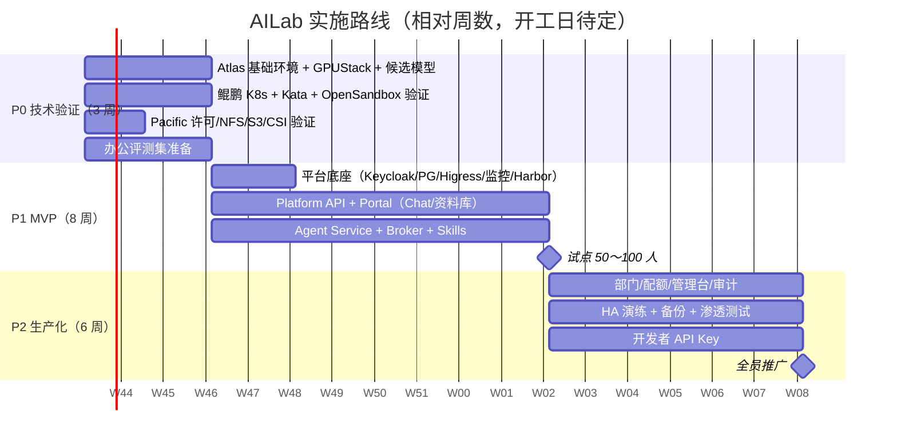

# 07 · 实施路线与待确认事项

## 1. 分阶段计划

### P0 技术验证（3 周）—— 把最大的不确定性先消掉

| 验证项 | 验收标准 |
|---|---|
| **A. 智算链路** | |
| A1 驱动/CANN/Docker/Ascend Docker Runtime + GPUStack 2.2.3（2.3 GA 后在预发验证）纳管 8 台 Atlas | 64 张卡全部可见；`hccn_tool` 检查 RoCE 链路全部正常；**GPUStack 以 incluster 模式把路由写进平台 Higress**，与入口路由、按人限流插件共存；部署/下线模型后路由自动生效；（2.3）停掉 GPUStack Server 后推理不中断 |
| A2 **DeepSeek-V4.1-Flash 1P1D PD 分离**（P：Atlas-01/02，D：Atlas-03/04，Mooncake KV 走 RoCE，`deepseek_v41` parser，128K 起步） | 稳定运行 72 小时；**tool calling 格式正确率 ≥ 98%**；KV 传输 P99 时延、失败率达标；两侧显存余量足够；记录单机故障后整组的恢复时间 |
| A3 对照组：同样 32 卡的**混合部署**（DP4/TP8/EP32），以及 **DeepSeek-V4-Flash 单机 8 卡**（备选） | 与 1P1D 对比 TTFT/TPOT/吞吐，证明 PD 的收益；V4-Flash 作为退路 |
| A4 Qwen3.6-35B-A3B TP2、Qwen3.8-27B TP2（MTP）、DeepSeek-OCR-2 / PaddleOCR-VL、Embedding/Reranker | 都能稳定服务；35B 视觉能力、OCR 准确率达标 |
| A5 AISBench 压测 | 得到每个模型池在 P95 TTFT<3s 下的最大并发，**据此定 35B 的实例数（6～10）** |
| A6 办公评测集（≥100 个任务）：专家档（DeepSeek）vs 标准档（27B） | **定稿 Work 默认档和 DeepSeek 版本（V4.1 / V4）** |
| A7 Higress 暴露面（GPUStack chart 设 `server.ingress.hostname=gpustack.xxx.local`、`higress-core.enabled=false`） | 在办公网用 curl 逐项确认：① 用 VIP 的 IP 或随便一个 Host 访问 `/`，**打不开** GPUStack；② `Host: gpustack.xxx.local` 能打开 GPUStack 登录页；③ 用 IP 访问 `/v1/models`、`/v1/chat/completions`，不带 Key 返回 401；④ `Host: ai.xxx.local` 访问 `/v1/chat/completions`，落到 Portal 而不是模型（确认 Envoy 精确域名优先于不带域名的规则）；⑤ `/docs` 已关闭 |
| **B. 沙箱链路** | |
| B1 openEuler 24.03（4K 页）+ K8s 1.34 + containerd 2 + Kata 4.2 `kata-qemu`（arm64） | Kata Pod 能正常启动；记录冷启动耗时和 QEMU 的实际内存开销 |
| B2 OpenSandbox（BatchSandbox + Pool）on Kata | 能从预热池领取（P95 < 1s）；能执行命令、上传下载文件；到期自动回收；**开启 Secure Access 后，不带令牌或带别的沙箱令牌访问 execd 被拒，直连 Pod IP 不通** |
| B3 出网控制 dns+nft 在 Kata arm64 上生效 | 沙箱访问内网和公网都被拒绝，只有内网 PyPI / npm 镜像可以访问 |
| B4 `sbx-office` 镜像（arm64，Debian 13）跑通 08 第 7 节的全部验收项 | PPT 三条路线、Word、Excel 重算、字体映射、Chromium 在 Kata 中可运行；**实测内存峰值定标准规格（2 或 3 GiB）** |
| B5 密度压测：50 / 100 / 180（单台满载）/ 430（软上限）/ 535 个沙箱并发执行办公脚本 | 得到超分比、P95 耗时劣化和节点内存的曲线，**定稿规格和全局上限** |
| **C. 存储** | |
| C1 确认许可（文件/对象/DPC）、99 TB 是裸容量还是可用容量 | 书面确认 |
| C2 Atlas 并发读取 NFS 模型权重的吞吐 | 单机 ≥ 3 GB/s；记录 8 台同时读取时的总吞吐 |
| C3 S3 版本管理、预签名、桶策略；Huawei CSI（ARM64）挂载 | 功能正常；预签名 URL 经 Higress 的 `files` 域名转发后验签通过（寻址用路径风格）；`files` 域名的证书由 Higress 正确提供 |
| **D. 端到端** | 用 DeerFlow 2.x（或最小原型）接 OpenSandbox + vllm-ascend 走通“上传 Word → 生成 PPT” | 作为 P1 的参照 |
| **E. 控制面** | etcd 三成员分别在三台 TaiShan 上（kubeadm stacked）；关掉任意一台 TaiShan，K8s 仍可调度、apiserver VIP 漂移 | 演练通过 |

**P0 的退路（如果某项不达标）**：
- Kata on arm64 不稳定 → 先用 runc + 加固（seccomp/AppArmor、非 root、只读根文件系统、不能出网），同时报给上游，并计划后续切回 Kata（因为这样隔离强度会下降，需要安全评审）。
- OpenSandbox 有阻塞性缺陷 → 换成 `workload_provider=agent-sandbox`；再不行就直接用 agent-sandbox 加自写 execd 接口。
- GPUStack 拉不起某个模型 → 在 GPUStack 里配自定义镜像；再不行就把这个模型改为 K8s 外的独立 Docker 部署，由 Higress 直接路由。

### P1 MVP（8 周）—— 试点 50～100 人

- 平台底座：Keycloak（对接 AD/LDAP）、CNPG、Valkey、Higress（入口 + AI 网关 + 模型别名）、Harbor、监控与日志、GitOps。
- Portal：登录、Chat、Work（工具卡片、计划面板、产出预览）、资料库（上传、目录、预览、版本）、个人用量。
- Platform API：会话、消息、Run、资料库、Token 账本、基础配额（个人日/月额度、并发）。
- Agent Service：Chat Agent、Work Agent（deepagents + OpenSandbox 适配器）、上下文压缩、`deliver_file`、版式自检。
- Sandbox Broker：准入、预热池、租约、回收、文件进出（两阶段交付）。
- 模型层：GPUStack incluster 网关模式 + 按人限流插件；GPUStack 2.3 GA 且质量达标后，把 DeepSeek PD 纳入 GPUStack 统一管理（夜间窗口切换）。
- 安全底座：内部接口 SA Token 认证、OpenBao + External Secrets、包镜像（devpi/Verdaccio）、出网代理、ClamAV。
- Skills 首批：pptx-builder（带公司模板）、docx-writer、xlsx-analyst、pdf-toolkit、doc-convert、chart-maker、data-analysis。
- **试点验收**：Work 成功率 ≥ 80%（评测集 + 用户反馈）；沙箱领取 P95 < 3s；无 P1 级安全问题；用户满意度调研。

### P2 生产化（6 周）—— 1000 人推广

- 部门管理员、额度分配、报表；平台管理台（模型、Skills、沙箱参数）；审计员视图。
- 开发者 API Key（Platform API 代为向 GPUStack 申请 Key，Higress 按 Key 限流和额度；通过 Portal 自助申请和审批）。
- HA 故障演练、备份恢复演练、异地或异介质备份落地。
- 安全：渗透测试（重点：沙箱逃逸和出网、越权、提示注入）、等保或公司安全基线检查。
- 运维：告警分级、Runbook、值班。

### P3 增强（持续）

知识库与 RAG（Embedding/Rerank 已有槽位，向量库先用 pgvector）、更多 Skills 和模板、定时任务、DeepSeek 扩展为 xPyD 或接入 KV Pool、负载感知调度（Koordinator）、评估把 Atlas 的空闲 CPU 用于沙箱。

## 2. 人力建议

| 角色 | 人数 | 职责 |
|---|---|---|
| 架构 / 技术负责人 | 1 | 方案把控、关键技术决策、P0 牵头 |
| 前端 | 2 | Portal、管理台 |
| 后端（平台） | 2 | Platform API、Broker、账本、资料库 |
| Agent / 算法 | 2 | Agent Service、Skills、评测集、提示词与模型调优 |
| 基础设施 / SRE | 2 | K8s、Kata、OpenSandbox、GPUStack、昇腾环境、存储、监控、GitOps |
| 安全（兼职） | 0.5 | 安全设计评审、渗透测试 |
| 业务对接 / 产品 | 1 | 需求、评测任务收集、试点运营 |

## 3. 待确认事项（影响设计参数，请尽快确认）

| # | 问题 | 影响 |
|---|---|---|
| Q1 | **三台 TaiShan 的内存容量**、本地数据盘配置（CPU 已确认：每台 128 核；三台配置是否相同） | 内存是沙箱容量的唯一瓶颈：每台 256 GB 约 205 个，512 GB 约 535 个，约 600 GB 以上约 620 个；PG 和 etcd 能否放本地盘 |
| Q2 | **Pacific 的 99 TB 是裸容量还是可用容量；已授权哪些服务（文件/对象/DPC）；软件版本** | 存储分配；资料库用 S3 还是 NFS |
| Q3 | **运维域名**：GPUStack 用 `gpustack.xxx.local` 是否可以（Grafana 等其他管理界面同样命名）；运维区 DNS 由谁维护；安全评审是否要求运维入口做网络隔离（Higress `ip-restriction` 只放行运维网段） | GPUStack chart 的 `server.ingress.hostname`、证书申请；管理界面的隔离强度（见 09 第 10.1 节） |
| Q4 | 公司身份源：AD/LDAP，还是华为内部 SSO？是否允许对接？ | Keycloak 联邦方式 |
| Q5 | 出网策略：服务器能否访问公网（下载模型和镜像、网页搜索）？有没有内网 PyPI/npm/镜像源？ | 模型入库方式、网页工具是否启用、镜像同步方案 |
| Q6 | 数据合规：会话和文件的保留期限、管理员能否查看内容、是否需要内容安全审核、审计日志保留多久 | 数据保留策略、审计和内容安全设计 |
| Q7 | Atlas 的 OS、驱动、固件版本，910B 具体型号（B2/B3），本地 NVMe 配置 | CANN 和 vllm-ascend 版本选择 |
| Q8 | 预期使用画像：哪些部门先用、峰值时段、Chat 和 Work 的比例 | 模型池配比（如 35B 实例数）、额度默认值 |
| Q9 | 有没有异地或另一套存储可以用作备份目标 | 备份方案 |
| Q10 | 对外 API 是否需要开放给其他业务系统（二期） | 开发者门户的优先级 |
| Q11 | 公司 PPT/Word 模板和字体规范；HarmonyOS Sans 等字体的使用是否需要法务确认 | Skills 模板、字体 |
| Q12 | DeepSeek 1P1D 的具体并行参数（P/D 各自的 DP/TP/EP）、vllm-ascend 镜像版本、上下文长度 | 部署脚本、容量估算 |
