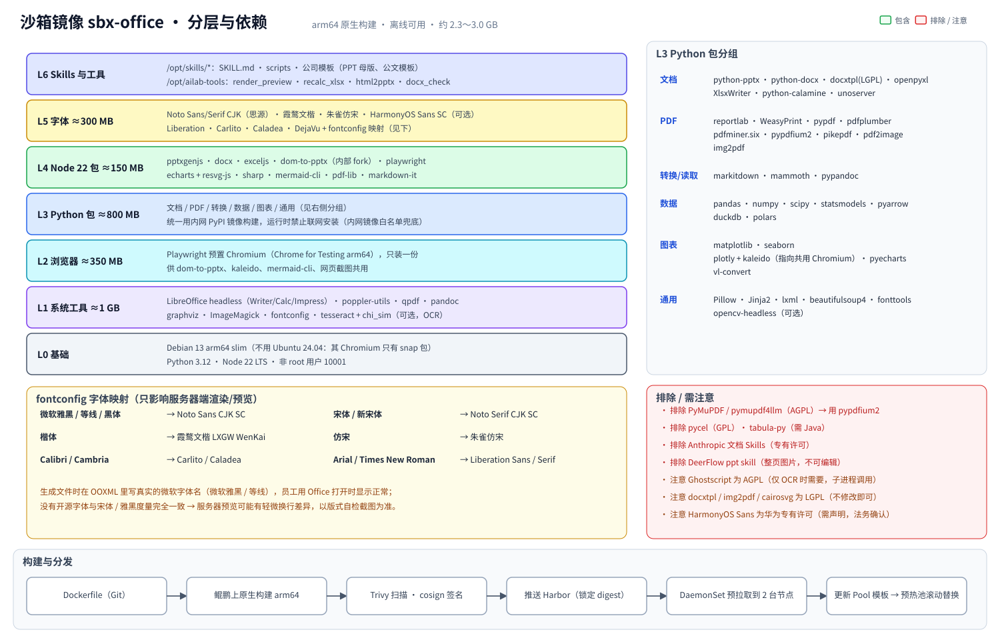
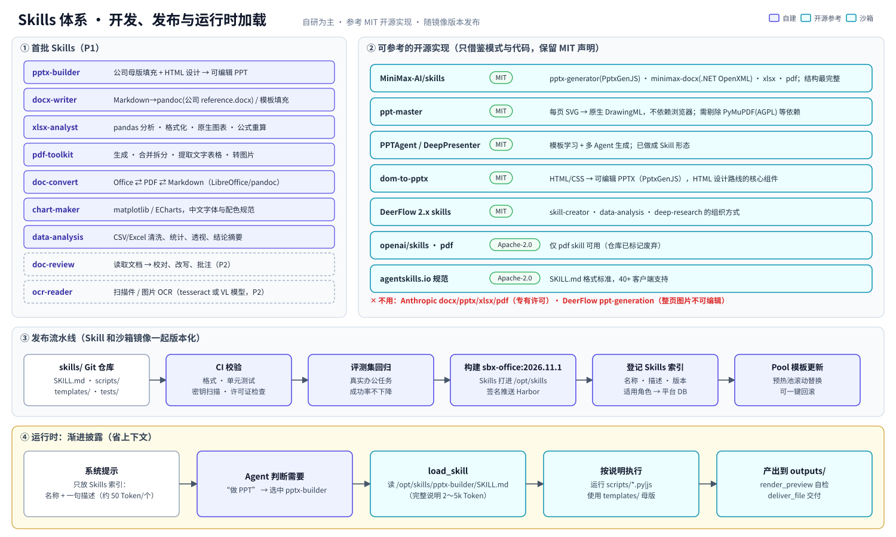
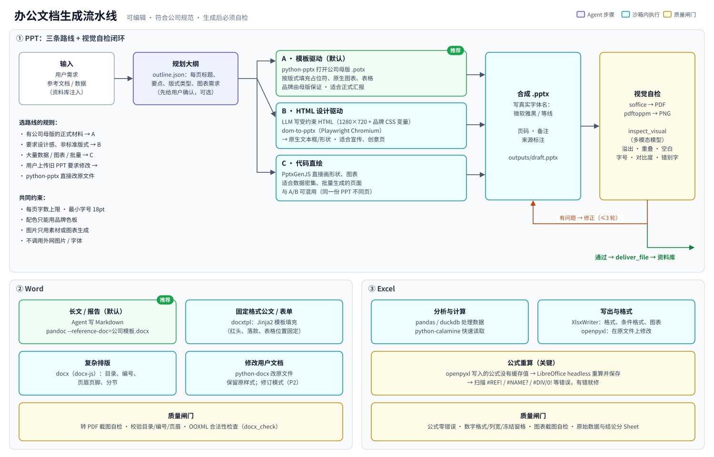

# 08 · Skills 与沙箱环境设计

> 相关图：[10 沙箱镜像分层](diagrams/svg/10-sandbox-image.svg) ｜ [11 Skills 体系](diagrams/svg/11-skills.svg) ｜ [12 文档生成流水线](diagrams/svg/12-docgen.svg)
>
> 目标：沙箱里**办公需要的依赖一个都不漏**，并且全部离线可用、arm64 原生、许可证干净。Skills 自研为主，借鉴 MIT 开源实现，**不用 Anthropic 官方的文档 Skills**。

## 1. 先看别人的沙箱里装了什么

| 产品 | 公开可查的办公相关内容 |
|---|---|
| **Claude 代码执行工具**（官方文档） | pandas、numpy、scipy、scikit-learn、statsmodels、matplotlib、seaborn、pyarrow、openpyxl、xlsxwriter、xlrd、pillow、python-pptx、python-docx、pypdf、pdfplumber、pypdfium2、pdf2image、pdfkit、tabula-py、reportlab、img2pdf；**不能联网** |
| **ChatGPT 代码解释器 / Agent 容器** | 早期 `pip list` 里有 python-docx、python-pptx、reportlab、openpyxl、PyMuPDF、PyPDF2、pypandoc。2025-12 起容器内置 `/home/oai/skills/{pdfs,docs,spreadsheets,slides}`：PDF 用 poppler `pdftoppm` 渲染页面做自检，文档有 docx 渲染脚本；2026-01 起可以运行 Node；桌面版自带 LibreOffice headless |
| **OpenAI codex-universal 镜像** | 只有语言工具链（Python、Node、Rust、Go、Java…），没有办公库；amd64 和 arm64 都有 |
| Manus / Kimi OK Computer / 豆包 | 没有公开的包清单（Kimi 赞助了开源项目 ppt-master） |

**共同核心**：pandas/numpy、matplotlib/seaborn、openpyxl/xlsxwriter、python-docx、python-pptx、pypdf/pdfplumber/pypdfium2、reportlab、poppler-utils、LibreOffice headless、Node。

另一个共同点是**生成后都要渲染成图片，自己看一遍**（ChatGPT 的 PDF/Docs skill 都这样做），这一点我们必须照搬（见第 4 节）。

## 2. 沙箱镜像 `sbx-office`：完整依赖清单



**基础镜像选 Debian 13 (trixie) arm64 slim**，不用 Ubuntu 24.04：Ubuntu 24.04 的 `chromium` 只有 snap 包，容器里装不了；Debian 有原生 arm64 的 chromium 和较新的 LibreOffice（25.2）。

### L0 基础
| 项 | 说明 |
|---|---|
| Debian 13 arm64 slim | 非 root 用户 `sandbox`（uid 10001） |
| Python 3.12（venv） | 所有 Python 包装在 `/opt/venv` |
| Node.js 22 LTS（≥ 22.12） | puppeteer 在 arm64 上需要 ≥ 22.12 |

### L1 系统工具（apt，≈1 GB）
| 包 | 用途 | 许可证 |
|---|---|---|
| `libreoffice-core/-writer/-calc/-impress`（`--no-install-recommends`） | Office ⇄ PDF 转换、公式重算、渲染预览 | MPL/GPL（只以 CLI 方式调用） |
| `poppler-utils` | `pdftoppm` 页面转 PNG、`pdftotext` | GPL（CLI） |
| `qpdf` | PDF 修复、加解密、线性化 | Apache-2.0 |
| `pandoc` | Markdown → docx（配合公司 reference.docx） | GPL（CLI） |
| `graphviz` | 流程图、组织结构图 | EPL |
| `imagemagick` | 图片裁剪、格式转换 | Apache-2.0 类 |
| `fontconfig` | 字体映射（见第 5 节） | MIT |
| `tesseract-ocr` + `chi-sim` + `eng`（可选） | 本地 OCR 兜底（主力 OCR 走 `ailab-ocr` 模型） | Apache-2.0 |
| `ghostscript`（可选，只有 ocrmypdf 需要） | | **AGPL**（子进程调用，内部使用需法务确认） |
| WeasyPrint 运行库：`libpango-1.0-0 libpangoft2-1.0-0 libharfbuzz0b` | HTML → PDF | |
| `unzip git jq curl` 等常用 CLI | | |

### L2 浏览器（≈350 MB）
- **Playwright 预置 Chromium**（Chrome for Testing arm64，Playwright ≥ 1.63 起提供 arm64 官方构建）。镜像构建时用 `PLAYWRIGHT_BROWSERS_PATH` 预下载，**运行时不联网**。
- **全镜像只装一份**，并让下面这些都指向它：dom-to-pptx（HTML → PPT）、kaleido（plotly 导出图片，v1 起需要外部 Chrome）、mermaid-cli、网页截图。设置 `PUPPETEER_EXECUTABLE_PATH`、`BROWSER_PATH` 等环境变量。

### L3 Python 包（≈800 MB）

| 分组 | 包 | 备注 |
|---|---|---|
| **PPT / Word / Excel** | python-pptx 1.0.x · python-docx 1.2.x · docxtpl（LGPL）· openpyxl 3.1.x · XlsxWriter 3.2.x · python-calamine · unoserver | docxtpl 用于 Jinja2 模板填充公文；unoserver 用于常驻 LibreOffice 加速转换 |
| **PDF** | reportlab 5.x · WeasyPrint · pypdf 6.x · pdfplumber · pdfminer.six · **pypdfium2**（替代 PyMuPDF）· pikepdf · pdf2image · img2pdf（LGPL）· camelot-py（可选）· ocrmypdf（可选） | **不装 PyMuPDF**（AGPL） |
| **读取 / 转换** | markitdown · mammoth · pypandoc | markitdown 把各种文档转成 Markdown 给 LLM 读 |
| **数据** | pandas 3.x · numpy · scipy · statsmodels · pyarrow · duckdb · polars | polars 2.x 是元包，要确认内网镜像上有它的 arm64 运行时 wheel |
| **图表** | matplotlib · seaborn · plotly + kaleido · pyecharts · vl-convert-python · graphviz | matplotlib 预设中文字体（`font.sans-serif`、`axes.unicode_minus=False`），构建时重建字体缓存 |
| **通用** | Pillow · Jinja2 · lxml · beautifulsoup4 · fonttools · python-dateutil · tabulate · opencv-python-headless（可选） | |

### L4 Node 包（≈150 MB，全局安装到 `/opt/node_modules`）

| 包 | 用途 |
|---|---|
| `pptxgenjs@4` | 代码直接画 PPT（原生图表、表格、母版） |
| `docx@9`（docx-js） | 复杂 Word 排版（目录、编号、页眉页脚、分节） |
| `exceljs@4` | Node 侧读写 Excel |
| `dom-to-pptx@2`（**内部 fork**） | HTML/CSS → 可编辑 PPTX，HTML 设计路线的核心 |
| `playwright@1.6x` | 浏览器自动化与截图 |
| `echarts@6` + `@resvg/resvg-js` | 服务端渲染 ECharts（SVG → PNG，不需要浏览器） |
| `sharp` | 图片处理（确认内网 npm 镜像有 `@img/sharp-linux-arm64`） |
| `@mermaid-js/mermaid-cli` | 流程图 / 时序图 |
| `pdf-lib` · `markdown-it` | PDF 编辑、Markdown 解析 |

### L5 字体（≈300 MB）
见第 5 节。

### L6 Skills 与工具脚本
| 路径 | 内容 |
|---|---|
| `/opt/skills/<name>/` | `SKILL.md` + `scripts/` + `templates/`（公司 PPT 母版、Word 模板、配色方案） |
| `/opt/ailab-tools/render_preview` | 任意 Office/PDF → PNG（LibreOffice → PDF → pdftoppm），供视觉自检 |
| `/opt/ailab-tools/recalc_xlsx` | LibreOffice headless 重算公式并扫描 `#REF!`/`#NAME?`/`#DIV/0!` 等错误（**自写**，不抄 Anthropic 的 recalc.py） |
| `/opt/ailab-tools/html2pptx` | 包装 dom-to-pptx，统一 1280×720 画布和品牌 CSS 变量 |
| `/opt/ailab-tools/docx_check` | OOXML 合法性、目录/编号/页眉检查 |

### 明确排除
| 不装 | 原因 | 替代 |
|---|---|---|
| PyMuPDF / pymupdf4llm | AGPL（或付费商业授权） | pypdfium2、pdfplumber |
| pycel | GPL，已停更 | LibreOffice 重算 |
| tabula-py | 需要 Java（+200 MB） | camelot-py、pdfplumber |
| Anthropic docx/pptx/xlsx/pdf Skills | 专有许可，禁止复制和再分发 | 自研 |
| DeerFlow 的 ppt-generation skill | 每页是 AI 生成的整张图片，不可编辑 | 自研 pptx-builder |
| .NET SDK（minimax-docx 需要） | 增加约 250 MB；docx-js 和 python-docx 已够用 | 二期如需更强的 docx 校验再加 |

**镜像体积**：约 2.3～3.0 GB（压缩后约 1～1.2 GB）。在三个节点上用 DaemonSet 预拉取。

## 3. Skills 体系



### 3.1 首批 Skills

| Skill | 能力 | 底层 |
|---|---|---|
| `pptx-builder` | 公司母版填充 / HTML 设计 / 代码直绘三条路线，带视觉自检 | python-pptx · dom-to-pptx · PptxGenJS |
| `docx-writer` | 报告长文、公文模板、复杂排版、修改用户文档 | pandoc · docxtpl · docx-js · python-docx |
| `xlsx-analyst` | 数据清洗分析、格式化、原生图表、公式重算 | pandas · XlsxWriter · openpyxl · LibreOffice |
| `pdf-toolkit` | 生成、合并拆分、提取文字和表格、转图片 | reportlab · WeasyPrint · pypdf · pdfplumber · pypdfium2 |
| `doc-convert` | Office ⇄ PDF ⇄ Markdown | LibreOffice · pandoc · markitdown |
| `chart-maker` | 统一中文字体和配色的图表 | matplotlib · ECharts SSR |
| `data-analysis` | CSV/Excel 探索、统计、透视、结论摘要 | pandas · duckdb |
| `doc-review`（P2） | 校对、改写、批注 | python-docx |
| `ocr-reader`（P2） | 扫描件处理 | 调用 `ailab-ocr`（经 Agent 工具，不在沙箱内调模型） |

### 3.2 可以借鉴的开源实现（只借鉴模式和代码，保留 MIT 声明）

| 项目 | 许可证 | 借鉴什么 |
|---|---|---|
| **MiniMax-AI/skills** | MIT | 结构最完整：pptx-generator（PptxGenJS、XML 级编辑）、minimax-docx、xlsx、pdf |
| **ppt-master** | MIT | 每页写 SVG 再转成原生 DrawingML，不依赖浏览器；它的依赖里有 PyMuPDF（AGPL）、google-genai、edge-tts，**借鉴时要剔除** |
| **PPTAgent / DeepPresenter** | MIT | 从参考 PPT 学版式、多 Agent 分工 |
| **dom-to-pptx** | MIT | HTML → 可编辑 PPTX；项目还年轻（单人维护），**fork 到内部维护** |
| DeerFlow 2.x skills | MIT | skill-creator、data-analysis、deep-research 的组织方式 |
| openai/skills 中的 pdf skill | Apache-2.0 | 仓库已标记废弃；只有 pdf 可用，没有 docx/pptx/xlsx |
| agentskills.io | Apache-2.0 | SKILL.md 标准格式 |

### 3.3 SKILL.md 规范（示例骨架）

```markdown
---
name: pptx-builder
description: 生成或修改可编辑的 PowerPoint。用于“做 PPT / 汇报材料 / 幻灯片 / 改这份 PPT”等请求。
version: 2026.11.1
allowed_roles: [user, power]
---
# 何时使用
# 选择路线（A 母版 / B HTML / C 代码）及判断规则
# 步骤
1. 读 inputs/ 下的素材 → 生成 outline.json（每页：标题、要点、版式、图表）
2. 按路线调用 scripts/…
3. /opt/ailab-tools/render_preview outputs/draft.pptx → 用 inspect_visual 自检
4. 修正（≤3 轮）→ deliver_file
# 版式与品牌约束（字号、字数、色板、字体名写“微软雅黑”）
# 常见错误与修复
```

- **原则**：SKILL.md 控制在 2～5k Token；细节放进 `scripts/` 和 `reference/` 子文件，用到时再读（渐进披露）。
- **发布**：Skills 随沙箱镜像一起版本化。CI 会做格式校验、单测、密钥扫描、许可证检查，并跑**评测集回归**，然后更新 Pool 模板，预热池滚动替换，可以一键回滚。

## 4. 文档生成路线



### 4.1 PPT：三条路线混合使用

| 路线 | 怎么做 | 适合 | 依赖 |
|---|---|---|---|
| **A 模板驱动（默认）** | python-pptx 打开**公司母版 .potx**，按版式填充占位符、原生图表、表格 | 正式汇报、周报月报 | python-pptx、XlsxWriter（图表数据） |
| **B HTML 设计驱动** | LLM 写**受约束的 HTML**（1280×720 固定画布 + 品牌 CSS 变量），用 dom-to-pptx 转成原生文本框和形状 | 宣传、方案、创意页面 | Playwright Chromium、dom-to-pptx |
| **C 代码直绘** | PptxGenJS 直接画形状和图表 | 数据密集、批量生成 | pptxgenjs |
| 修改旧 PPT | python-pptx 直接改原文件，保留原样式 | 用户上传的 PPT | python-pptx |

**“用 HTML 做 PPT 需要哪些包”**：Playwright + Chromium（渲染 HTML、计算元素位置）、dom-to-pptx（或自研转换器，把 DOM 映射到 PptxGenJS 对象）、pptxgenjs（写 PPTX）、中文字体（渲染和测量必须一致），以及 sharp / resvg（处理图片和 SVG）。Marp、Slidev 默认导出的是**每页一张图片**，不可编辑，不作为主路线。

**视觉自检闭环（必做）**：`soffice` 转 PDF，再用 `pdftoppm` 转成 PNG，交给 `inspect_visual`（多模态模型 `ailab-chat`）检查文字溢出、元素重叠、空白页、字号过小、对比度、错别字，然后修正，最多 3 轮。

### 4.2 Word
- **长文/报告（默认）**：Agent 写 Markdown，执行 `pandoc --reference-doc=公司模板.docx`。样式（标题级别、正文、表格）全部继承自模板，LLM 不用操心格式。
- **固定格式公文/表单**：docxtpl，在 Word 模板里写 Jinja2 占位符。
- **复杂排版**：docx-js（目录、多级编号、页眉页脚、分节）。
- **修改用户文档**：python-docx 改原文件；修订模式放二期。

### 4.3 Excel
- 分析用 pandas/duckdb；写出用 XlsxWriter（格式、条件格式、图表），在原文件上修改用 openpyxl。
- **公式重算是关键**：openpyxl 写入的公式没有缓存值，用户打开前看不到结果，有些程序读出来是空值。必须用 LibreOffice headless 重算并保存，再扫描错误值。

### 4.4 PDF
- 生成：HTML → PDF 用 WeasyPrint（中文排版好），程序化生成用 reportlab。
- 处理：pypdf（合并拆分）、pikepdf/qpdf（修复、加密）、pdfplumber/pdfminer（提取文字和表格）、pypdfium2（渲染成图片）。

## 5. 字体（中文办公最容易出问题的地方）

| 安装 | 许可证 | 用途 |
|---|---|---|
| Noto Sans/Serif CJK SC（即思源黑体/宋体）`fonts-noto-cjk` | OFL | 主力中文字体 |
| 霞鹜文楷 LXGW WenKai | OFL | 楷体替代 |
| 朱雀仿宋 | OFL | 仿宋替代（公文常用） |
| Liberation Sans/Serif/Mono | OFL | 与 Arial / Times New Roman / Courier New 度量兼容 |
| Carlito / Caladea | OFL | 与 Calibri / Cambria 度量兼容 |
| DejaVu、Noto Color Emoji | 开源 | 符号与表情 |
| HarmonyOS Sans SC（可选） | 华为专有许可：可以免费商用和随软件分发，但须显著声明、不得修改或单独分发 | 品牌字体，**需法务确认** |

**fontconfig 映射**（只影响服务器端的渲染和预览）：

| 文档里写的字体 | 服务器上实际用 |
|---|---|
| 微软雅黑 / 等线 / 黑体 | Noto Sans CJK SC |
| 宋体 / 新宋体 | Noto Serif CJK SC |
| 楷体 | 霞鹜文楷 |
| 仿宋 | 朱雀仿宋 |
| Calibri / Cambria | Carlito / Caladea |
| Arial / Times New Roman | Liberation Sans / Serif |

**两条规则**：
1. **生成的文件里写真实的微软字体名**（微软雅黑、等线、仿宋_GB2312 等），员工在 Windows/Office 上打开时显示正常。
2. 没有开源字体能和宋体、雅黑做到度量完全一致，服务器预览可能和 Office 里有细微的换行差异。所以版式自检要**预留余量**（每页字数上限、文本框留白），不能让文字刚好贴边。

**禁止**把微软雅黑、宋体等 Windows 自带字体文件打进镜像（没有再分发授权）。

## 6. 运行时约定

| 项 | 约定 |
|---|---|
| 网络 | 默认禁止出网；只放行内网 PyPI/npm 镜像（Agent 偶尔需要临时装包） |
| 目录 | `/workspace/inputs`（输入）、`/workspace/outputs`（**只有这里的文件会归档**）、其他目录都是临时的 |
| 资源 | 标准规格 2 vCPU / 2 GiB。**Chromium 加 LibreOffice 同时运行时内存偏紧**：P0 实测，必要时把标准规格调到 3 GiB（容量影响见 05），或者让 HTML 渲染步骤串行执行 |
| 超时 | 单条命令默认 120s，最长 600s；LibreOffice 转换用常驻 unoserver，避免每次冷启动 |
| 安全 | 非 root；没有任何密钥；模型调用（如 OCR、视觉自检）都由 Agent Service 在沙箱外完成 |

## 7. 验收（P0 必测）

- [ ] arm64 镜像构建成功，所有 Python/Node 包都能导入，Chromium 能启动（在 Kata 里测）
- [ ] 三条 PPT 路线各生成 10 页样例，在 Office 2016+/WPS 中打开**无修复提示**，文字可编辑
- [ ] pandoc + 公司 reference.docx 生成的报告，标题样式、目录、页眉页码正确
- [ ] Excel 公式重算后零错误值，图表正常
- [ ] 中文渲染无乱码和豆腐块；字体映射生效；预览与 Office 显示差异可以接受
- [ ] 沙箱内存峰值（Chromium + LibreOffice + pandas 同时运行）实测，用来定标准规格
- [ ] 许可证清单（SBOM）由法务过目：AGPL/GPL 只以子进程方式使用；LGPL 不修改；HarmonyOS Sans 有声明
