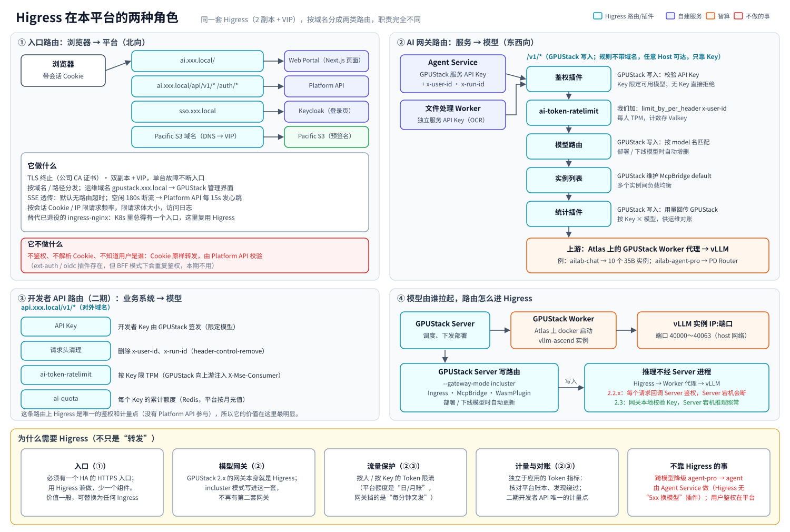

# 09 · 请求链路与网关设计（Platform API × Higress）

> 相关图：[19 一条消息的完整链路](diagrams/svg/19-request-chain.svg) ｜ [20 Higress 的两种角色](diagrams/svg/20-higress-roles.svg) ｜ [06 Work 全链路](diagrams/svg/06-work-flow.svg) ｜ [18 Platform API](diagrams/svg/18-platform-api.svg)

## 1. 一句话

**用户身份只在 Platform API 确认一次，之后跟着 `run_id` 走；模型只由 Agent Service 调用；Higress 认的是“哪个服务在调用”，`x-user-id` 只用于按人限流和打日志标签。**

同一套 Higress 部署（2 副本 + VIP）承担两种完全不同的角色，按域名分开：

| | ① 入口路由（北向） | ② AI 网关路由（东西向） |
|---|---|---|
| 地址 | `ai.xxx.local`、`sso.xxx.local`、Pacific S3 的域名（办公网 DNS 解析到 Higress） | `/v1/*` 模型路由（GPUStack 写入，**规则不带域名**）。Agent Service 用集群内名字 `llm.ailab.internal`，它只是指向 Higress Service 的 DNS 名，不是访问边界（见 2.4）；二期另有对外的 `api.xxx.local` |
| 谁来访问 | 浏览器 | Agent Service、文件处理 Worker；二期还有业务系统 |
| 转发到 | Portal、Platform API、Keycloak、Pacific S3（预签名上传/下载） | Atlas 上的 GPUStack Worker 代理 → vLLM 实例 |
| 做什么 | TLS 终止、HA 入口、按路径分发、SSE 透传、IP 限速、访问日志 | **GPUStack 写入**：API Key 鉴权、按模型名路由、Token 统计；**我们加**：按人 Token 限流、user_id/run_id 日志字段 |
| 是否认识用户 | **不认识**：Cookie 原样转发，由 Platform API 校验 | 认识“哪个服务的 API Key”；用户 ID 由可信服务通过请求头带来 |
| 路由由谁维护 | 我们（Ingress 配置在 GitOps 里） | **GPUStack**（incluster 网关模式，部署/下线模型时自动增删，见 02 第 1 节） |



> **关于 06 图**：06 图里浏览器直接连 Platform API，是因为它画的是业务步骤，省略了入口转发。实际上浏览器发出的每个请求都先到 Higress 入口路由，再转给 Platform API（图中已加注）；图里的“Higress AI 网关 → 模型”一栏是第二种角色。

## 2. 用户身份在哪里确认，怎么传下去

### 2.1 浏览器 → Platform API：在这里确认身份

1. 登录：Platform API 作为 BFF，和 Keycloak 走 OIDC 授权码流程，拿到 Token 后**保存在服务端**，给浏览器发一个 httpOnly 会话 Cookie（见 04 第 1.1 节）。
2. 之后浏览器每个请求都带这个 Cookie，经 Higress 入口路由**原样转发**到 Platform API。
3. Platform API 用 Cookie 找到会话 → `user_id`，再做 RBAC、数据归属和额度检查。**这是整条链路里唯一一次确认“用户是谁”。**

Higress 入口路由在这一步不看 Cookie、不验证用户，也不往请求里加用户头。

### 2.2 Platform API → Agent Service：身份写进 Run

Platform API 创建 Run 时，把 `user_id`、`dept_id`、`conversation_id`、角色都写进 Run 记录，只把 `run_id` 放进 Valkey 队列。Agent Service 领取任务后，凭 `run_id` 调用 `GET /internal/runs/{id}` 取回这些信息；内部调用用 ServiceAccount Token 证明“我是 Agent Service”（见 06 第 1.4 节）。

所以 Agent Service **不需要、也拿不到**用户的 Cookie 或 Keycloak Token，它只知道“我在替哪个 Run 干活，这个 Run 属于谁”。

### 2.3 Agent Service → Higress → 模型：服务身份 + 用户标签

Agent Service 调用模型时带三样东西：

| 请求头 | 来源 | Higress 怎么用 |
|---|---|---|
| `Authorization: Bearer <服务 API Key>` | 由 GPUStack 为 Agent Service 签发（限定可用模型），存在 Secret 里 | GPUStack 写入 Higress 的鉴权插件校验 Key 和可用模型，无效 Key 直接拒绝 |
| `x-user-id` | Run 记录 | `ai-token-ratelimit` 按它做每人每分钟 Token 限流；`ai-statistics` 把它写进访问日志 |
| `x-run-id` | Run 记录 | 写进访问日志和 Trace，便于和平台账本逐条对账 |

**为什么 `x-user-id` 可以信**：本期能拿到 GPUStack API Key 的只有两个服务（Agent Service、文件处理 Worker）。办公网虽然能访问到 `/v1/*`（见 2.4），但没有 Key 的请求在网关就被拒绝，自然也带不进伪造的 `x-user-id`。二期开放开发者 Key 后，开发者也能带任意 `x-user-id`，届时开发者路由要先**删除**这两个头、按 Key 限流：GPUStack 的鉴权插件会向上游注入 `X-Mse-Consumer: <access key>.gpustack-<用户 ID>`，可用 `ai-token-ratelimit` 的 `limit_by_per_consumer` 按 Key 计数（GPUStack `main` 分支源码已核实，目标版本在 P0 复核）。

### 2.4 普通用户能不能绕过平台直接调用模型

**不能，这是有意的设计。** 浏览器里没有任何模型 Key，Portal 前端和 Next.js 服务端也不持有；服务 Key 只在 Agent Service 和文件处理 Worker 的 Secret 里。浏览器能正常使用的只有入口路由（Portal、`/api/v1/*`、Keycloak），而 Platform API 的接口里**没有“转发到模型”的接口**，所以也不存在“Higress 先问 Platform API 鉴权、再把浏览器请求转给模型”这条路。

**但要说清楚：用户“访问得到”模型路由，只是没有 Key。** 按 GPUStack 源码（`gpustack/gateway/utils.py` 的 `generate_model_ingress`），它写入的每条模型 Ingress 都带一条**不带 host 的规则**（设了 hostname 时再多一条带 host 的）。不带 host 的规则对所有没有单独配置的域名生效，所以办公网的人用 VIP 的 IP、或随便填一个域名访问 `/v1/*`，请求都能到达模型路由。`llm.ailab.internal` 只是指向 Higress 的名字，挡不住人。真正挡住他们的是网关鉴权：

| 层 | 措施 | 状态 |
|---|---|---|
| 网关鉴权 | 模型路由要求 GPUStack API Key，用户手里没有；Key 限定可用模型；Key 只放在 Agent Service、文件处理 Worker 的 Secret 里 | **本期唯一的访问控制（已接受）** |
| Key 的来源 | 能登录 GPUStack 的人都能自建 Key（`POST /v2/api-keys` 只要求已登录），所以 GPUStack 账号只开给 `ops` 组，并定期审计 Key 列表 | 本期执行 |
| 推理实例 | vLLM 和 Worker 代理端口只监听 Atlas 业务网；Atlas 主机防火墙只允许 TaiShan 节点访问；Worker 代理本身也要求 GPUStack 内部认证 | 本期执行 |
| 网络 | 不做。NetworkPolicy 管不了这一层：模型路由和用户入口是同一个 Higress 监听端口，办公网流量本来就要进 Higress | 不适用 |

> 加固选项（安全评审要求时再做，二选一）：① 给 GPUStack 生成的模型路由挂 Higress `ip-restriction`，只放行 TaiShan 的 Pod / 节点网段（GPUStack 的 Ingress 名是动态生成的，要用 WasmPlugin 的 `matchRules` 匹配，P0 验证）；② 再部署一套只在集群内监听的 Higress，让 GPUStack 只往它里面写路由，办公网 VIP 上就只剩 `ai`、`sso`、`files` 和运维域名，代价是多一套组件。

**唯一的例外是二期的开发者 API**：有 `developer` 角色的用户经审批后，在 Portal 自助申请个人 API Key（由 Platform API 代为向 GPUStack 申请，用户不登录 GPUStack），走对外的 `api.xxx.local` 路由直接调用模型。这条路由按 Key 鉴权、限流和计额（`ai-quota`），并删除 `x-user-id` 等内部头，和员工日常使用的链路完全分开。

### 2.5 为什么不让 Higress 直接鉴权用户

Higress 有能力做：`ext-auth` 插件可以把请求先发给 Platform API 的 `/auth/verify` 校验，再把返回的 `x-user-id` 加到上游请求里；`oidc` 插件还能在网关上完成整个 OIDC 登录。本期**不用**，原因是：

1. **Platform API 无论如何都要自己查会话**：它要知道用户的角色、部门、额度、数据归属，光有一个 `x-user-id` 不够。网关再验一次只是多一跳（每个请求多一次网络调用），没有增加安全性。
2. **BFF 模式下 Token 在服务端**：如果改由网关的 `oidc` 插件登录，Token 会放在网关的 Cookie 里，登出、刷新、离职立即失效都要在两处处理。
3. **身份判断只放在一处**（与 04 第 0 节“权限判定只有一处”一致），出了问题只查一个地方。

以后如果有**不经 Platform API 的浏览器流量**（例如直接把某个内部工具挂到入口上），可以给那条路由单独加 `ext-auth`，指向 Platform API 的校验接口。

## 3. 完整例子：用户在 Chat 里发一条消息


| 步骤 | 组件 | 做什么 | 身份怎么体现 |
|---|---|---|---|
| 1～2 | 浏览器 → **Higress 入口** → Platform API | `POST /api/v1/conversations/{id}/messages` | Cookie，Higress 不看 |
| 3 | **Platform API** | 会话 Cookie → `user_id`；RBAC、会话归属、额度检查；创建 Run | **身份在这里确认** |
| 4～5 | Platform API → Valkey；→ 浏览器 | 把 `run_id` 放进队列；返回 `202 {run_id}` | Run 记录里有 user/dept/conversation |
| 6 | 浏览器 → Higress 入口 → Platform API | `GET /api/v1/runs/{run_id}/events` 建立 SSE | 同样校验 Cookie 和 Run 归属 |
| 7～8 | Valkey → **Agent Service** → Platform API | 领取 `run_id`；`GET /internal/runs/{id}` 取用户、会话、角色 | 服务身份（SA Token）+ `run_id` |
| 9～12 | Agent Service → **Higress AI 网关** | `POST /v1/chat/completions`，`model=ailab-chat`，`stream=true`；GPUStack 鉴权插件校验 Key → 我们的 `ai-token-ratelimit` 按 `x-user-id` 查 TPM → GPUStack 写入的路由按模型名找到实例 | 服务 API Key + `x-user-id` |
| 13 | Higress → **Worker 代理 → vLLM 实例** | 在该模型的多个实例间负载均衡（例如转到 Atlas-05 上某个实例） | Worker 代理只接受网关转来的请求 |
| 14 | vLLM → Higress → Agent Service | SSE token 流；最后一个 chunk 带 `usage` | — |
| 15 | **Higress** | GPUStack 的统计插件把用量回传 GPUStack（按 Key、按模型）；我们加的日志字段记下 user_id、run_id；限流计数加上本次 Token | — |
| 16～17 | Agent Service → Valkey → Platform API → Higress 入口 → 浏览器 | Agent 把 token、工具调用等事件写进 `run:{id}:events`；Platform API 读出来经 SSE 推给浏览器 | 浏览器 SSE 连接已在第 6 步校验 |
| 18 | Agent Service → **Platform API** | `POST /internal/usage`：本次调用的 input/cached/output Token → `usage_ledger` | 按 `run_id` 补全用户、部门 |
| 19 | Agent Service → Platform API | 更新 Run 状态、保存回复消息 | — |

**Work 模式的区别**：第 9～16 步会循环多轮（每轮模型决定下一个工具），中间插入沙箱工具调用（Agent Service 直连 execd）和文件进出（Broker，见 03 第 5 节）。每一次模型调用都重复第 9～15 步和第 18 步。

## 4. 谁拉起模型，谁调用模型

| 问题 | 答案 |
|---|---|
| 谁拉起模型服务 | **GPUStack**：Server 调度，Atlas 上的 GPUStack Worker 用 Docker 启动 vllm-ascend 实例（DeepSeek PD 在 GPUStack 2.3 GA 前用 vllm-ascend 原生脚本拉起，见 02 第 1 节） |
| Higress 怎么知道实例地址 | **GPUStack 自己写进去**：GPUStack 以 incluster 网关模式运行，部署、扩缩、下线模型时自动在 Higress 里增删路由（Ingress + McpBridge），我们不用同步 |
| 推理流量经不经过 GPUStack Server | **不经过**。路径是 Higress → Atlas 上的 Worker 代理 → vLLM。Server 进程只在鉴权时被回调：2.2.x 每个请求都回调，Server 宕机推理就中断；**2.3 起改为网关本地校验 Key**，Server 宕机推理照常（见 02 第 1 节） |
| 谁发起推理请求 | **只有 Agent Service**（Chat 和 Work 都是），以及文件处理 Worker（只调 `ailab-ocr`）；二期加上持开发者 Key 的业务系统 |
| Platform API 会不会调模型 | **不会**。它只负责身份、权限、额度、账本和 SSE 推送，标题生成、摘要等也由 Agent Service 完成 |

## 5. 流式回复：两段 SSE

1. **模型 → Agent Service**：vLLM 的 SSE 经 Higress AI 网关透传。Higress 的 `ai-statistics` / `ai-token-ratelimit` 会边转发边从流里解析 `usage`，不缓冲整段回复。
2. **Agent Service → 浏览器**：Agent Service 不直接连浏览器，而是把事件写进 Valkey Stream；Platform API 从任意副本读取，经 Higress 入口推给浏览器。断线后浏览器带 `Last-Event-ID` 重连续读，Agent Service 的执行不受影响。

**两个超时要注意**（P0 验证）：
- Higress 默认**没有**路由超时，但连接**空闲 180 秒**会被断开（`higress-config` 的 `downstream.idleTimeout`）。所以 Platform API 每 15 秒发一次 SSE 心跳注释行；模型调用一律用流式。
- DeepSeek 长上下文的首 token 可能较慢；如果实测超过 180 秒，需要调大 `idleTimeout`。

## 6. 记账：两本账，各管各的

| | 平台账本（权威） | Higress 指标（对账、防刷） |
|---|---|---|
| 记录者 | Agent Service 每次调用后 `POST /internal/usage` | GPUStack 写入的统计插件（按 Key × 模型，回传 GPUStack）+ 我们加的日志字段（user_id、run_id） |
| 粒度 | 用户 · 部门 · 会话 · Run · 模型 · 模式，逐条 | GPUStack 用量页：Key × 模型 × 天；Higress 访问日志：逐条，含 user_id、run_id |
| 用途 | 额度扣减、个人/部门报表、“这份 PPT 花了多少 Token” | 每日核对平台账本合计，偏差 > 2% 告警；二期开发者 Key 只能靠它计量 |
| usage 从哪来 | vLLM 流式响应最后一个 chunk（Agent Service 请求时带 `stream_options.include_usage`） | 同一个 chunk，网关插件自己解析 |

**为什么不只用网关的数**：网关只知道“哪个服务、哪个用户、哪个模型”，不知道会话、Run、模式，也做不了“超额后降级到 35B”这类业务判断。**为什么还要网关的数**：它独立于应用，能发现漏记、绕过平台直接调模型、计费 Bug。

**两种限额的分工**：平台额度管“日/月总量”（在 Platform API 判定，超额时降级或拒绝）；网关 `ai-token-ratelimit` 管“每分钟突发”（保护模型池不被单个用户或失控的 Agent 循环占满）。

## 7. Higress 上的配置分工（示意）

模型这一侧的路由**大部分由 GPUStack 自动维护**，我们只在它之上补 GPUStack 没有的能力：

| 配置 | 谁维护 | 内容 |
|---|---|---|
| 模型路由（Ingress）、实例列表（McpBridge `default`）、鉴权和统计插件（WasmPlugin）、EnvoyFilter | **GPUStack**（incluster 模式自动增删） | `/v1/*` 按 `model` 名转到对应模型的实例；校验 GPUStack API Key；统计用量回传 GPUStack |
| 入口路由（Portal、`/api/v1/*`、Keycloak） | 我们（GitOps） | 指向 K8s Service，**不使用** McpBridge（`default` 留给 GPUStack） |
| 按人 Token 限流 | 我们（GitOps，WasmPlugin 绑定到模型路由） | `ai-token-ratelimit` 按 `x-user-id` |
| user_id / run_id 写入访问日志 | 我们 | P0 确认能否在 GPUStack 管理的 `ai-statistics` 之外再挂一个只写日志字段的实例；不行就以 Agent Service 自己的调用日志为准（账本本来就带 run_id） |

```bash
# GPUStack Server 启动参数（Helm values 或环境变量）
--gateway-mode incluster            # 环境变量 GPUSTACK_GATEWAY_MODE；注意枚举值拼写是 incluster
--gateway-namespace higress-system  # 我们的 Higress 所在命名空间
```

```yaml
# 我们加的按人 Token 限流（WasmPlugin，匹配 GPUStack 生成的模型路由）
ai-token-ratelimit:
  rule_name: per-user-tpm
  rule_items:
    - limit_by_per_header: x-user-id      # 每个 x-user-id 各自计数
      limit_keys:
        - { key: "*", token_per_minute: 200000 }
  redis: { service_name: valkey.data.svc.cluster.local, service_port: 6379, database: 2 }
```

**P0 要确认的兼容性**：
- GPUStack 固定使用 Higress **2.1.9**（它的镜像和 Helm 依赖都锁这个版本）。我们的 Higress 先用同一版本；升级到 2.2.x 前先验证 GPUStack 写入的资源仍然生效。
- Host 匹配行为（见 07 A7）：GPUStack 的模型 Ingress 已确认带一条不带 host 的规则，要实测 `ai.xxx.local` 等精确域名下的 `/v1/*` 不会落到模型路由；EnvoyFilter 是否影响入口路由；我们的限流插件和它的鉴权插件的执行顺序（应当先鉴权、再限流）。
- 部署 / 下线 / 扩缩模型后，路由在多长时间内生效；GPUStack Server 重启（2.3）时推理是否不受影响。

## 8. 能力核验（Higress、GPUStack 仓库 `main`，2026-10）

| 设计里用到的能力 | 是否存在 | 插件 / 功能 | 本平台怎么用 |
|---|---|---|---|
| GPUStack 把模型路由写进已有的 Higress | ✅ | `--gateway-mode incluster`：写 Ingress、McpBridge、WasmPlugin、EnvoyFilter | **模型路由的主方案** |
| GPUStack Server 宕机时推理继续 | ⚠️ 看版本 | 2.2.x 每个请求回调 Server 鉴权（Server 宕机 → 403）；2.3 起网关本地校验 Key | 生产以 2.3.x 为准 |
| GPUStack API Key 鉴权、限定可用模型 | ✅ | GPUStack 写入的鉴权插件 | Agent Service、文件处理 Worker 各一个服务 Key |
| 把鉴权委托给外部服务，并把返回头传给上游 | ✅ | Higress `ext-auth`（`forward_auth` 模式） | **入口路由本期不用**（见第 2.5 节）；GPUStack 自己用它做 Key 鉴权 |
| 网关上做 OIDC 登录 | ✅ | `oidc`（基于 oauth2-proxy） | 不用，登录由 Platform API（BFF）做 |
| 按请求头 / 按 consumer 做 Token 限流 | ✅ 需要 Redis 协议存储 | `ai-token-ratelimit`（`limit_by_per_header`、`limit_by_per_consumer`） | 按 `x-user-id` 限 TPM。计入 input + output；**超限的那一次请求仍会放行**，下一次才拒绝 |
| Token 统计 | ✅ | GPUStack 的统计插件（按 Key × 模型）；Higress `ai-statistics`（可从请求头取自定义字段） | 运维侧总量与对账 |
| 每个 consumer 的累计额度 | ✅ 需要 Redis | `ai-quota` | 只考虑用于二期开发者 Key；员工额度在平台 |
| 按路由删除/改写请求头 | ✅ | `higress.io/request-header-control-remove` 等注解，或 `transformer` 插件 | 二期开发者路由删除 `x-user-id` |
| 上游 5xx 时自动换另一个模型 | ❌ **没有现成插件** | `ai-proxy` 的 `retryOnFailure` 只对非流式请求、只重试同一上游 | **跨模型降级由 Agent Service 实现**（见 02 第 5 节） |
| 长时间 SSE | ✅ 有条件 | 默认无路由超时；空闲 180 秒断开 | Platform API 15 秒心跳 |
| 替代 ingress-nginx、TLS、arm64 | ✅ | 标准 Ingress + 大部分 nginx 注解；amd64/arm64 镜像 | 入口路由 |

**注意事项**：
- `ai-token-ratelimit` 要求 Redis，文档没有提到 Valkey；它用的是标准 RESP 和 `EVAL`，Valkey 应当兼容，**P0 实测**。
- `ai-token-ratelimit` 新版本改了多条规则的匹配逻辑，旧的 Redis 计数不兼容，升级时要清空计数。

## 9. 为什么需要 Higress，什么情况下可以不要

| 角色 | 必要性 | 如果不用 Higress |
|---|---|---|
| ① 入口 | **需要“一个”HA 入口**，但不一定是 Higress。这里只做 TLS 和转发，价值一般；选 Higress 是为了和 AI 网关共用一个组件（ingress-nginx 已退役） | 换成任意 Ingress 控制器即可，架构不变 |
| ② AI 网关 | **需要**，而且这就是 GPUStack 2.x 本身的网关（GPUStack 的模型路由就是写在 Higress 里的）。它提供：按模型名路由和多实例负载均衡；API Key 鉴权；Token 统计；GPUStack 2.3 起 Server 宕机推理不断；我们再加按人 Token 限流 | 只能用 GPUStack 的 Python 代理（`disabled` 模式），性能和高可用都不行 |
| ③ 开发者 API（二期） | **必需**。这条路由上没有 Platform API 参与，Higress 是唯一的鉴权、限流和计量点 | 要自己写一个 API 网关 |

结论：**Higress 的价值主要在模型这一侧（②③），不在浏览器这一侧（①）**。浏览器侧它只是一个入口转发，用户鉴权和业务判断都在 Platform API；这不是重复，而是分工——入口管“流量能不能进来”，Platform API 管“这个人能做什么”，AI 网关管“模型资源怎么被公平、可观测地使用”。

## 10. 浏览器能碰到哪些地址，浏览器流量怎么限流

### 10.1 浏览器只能碰到 Higress

用户的浏览器**只和 Higress 的 VIP（443 端口）通信**。Higress 按 Host 名字转发：

| 浏览器访问的地址 | Higress 转发到 | 用途 |
|---|---|---|
| `ai.xxx.local/` | Web Portal | 页面和静态资源 |
| `ai.xxx.local/api/v1/*` | Platform API | 所有业务接口，包括 SSE 推送 |
| `sso.xxx.local` | Keycloak | 登录页（只在登录时） |
| Pacific S3 的域名（办公网 DNS 解析到 Higress） | Pacific S3 | 凭预签名 URL 上传、下载单个文件（见 03 第 5.5 节） |
| `gpustack.xxx.local`（运维域名，只在运维区 DNS 解析） | GPUStack Server | 管理界面，只有 `ops` 组能登录 |
| 其他任何 Host（包括直接用 VIP 的 IP）+ `/v1/*` 等模型路径 | GPUStack 模型路由 → Atlas | 规则不带域名；没有 GPUStack API Key 一律拒绝（见 2.4） |

这三个名字（`ai`、`sso`、`files`）都解析到**同一个 Higress VIP**，不是三台机器。Higress 按请求里的 Host 名字决定转给谁：v2.1.9 源码 `pkg/ingress/kube/ingressv1/controller.go` 为每条 Ingress 规则的 host 生成一个 Gateway 监听和一个 VirtualService，同一个 host 下的路径再分到不同后端。所以办公网防火墙只需放行 VIP 的 443 端口。

平台用到的域名一览（`xxx` 是公司域名占位符，`ailab.internal` 是平台内部父域，名字都待 DNS 管理员确认）：

| 类别 | 域名 | 谁来解析 | 用途 |
|---|---|---|---|
| 办公网 · 浏览器 | `ai.xxx.local`、`sso.xxx.local`、`files.xxx.local` | 办公网 DNS → Higress VIP | 3 个名字，1 个入口 |
| 集群内部 | `llm.ailab.internal`、`harbor.ailab.internal`、`pypi.ailab.internal`、`npm.ailab.internal` | 集群内 DNS，办公网 DNS 不需要记录 | 模型路由、镜像仓库、沙箱里的包镜像 |
| 二期 | `api.xxx.local` | 对外 DNS，待定 | 开发者 API |
| 运维 | `gpustack.xxx.local`；Grafana、Keycloak Admin 等待定 | 运维区 DNS → 同一个 Higress VIP | GPUStack 的名字写进 chart 的 `server.ingress.hostname`；其余管理界面若每个单独一个，共约 5 到 6 个 |

`.local` 是 mDNS 保留后缀，macOS 和 Windows 上可能解析变慢，建议把 `xxx.local` 换成公司内部子域。`.internal` 是私有网络保留后缀，平台内部名字用它。

**为什么一定要给 GPUStack 设运维域名**：GPUStack chart 为 Server 建的 Ingress 路径是 `/`，而 `server.ingress.hostname` 默认为空，即不带 host（`charts/gpustack-chart/templates/server-service.yaml`）。不设的话，任何没匹配上 `ai`、`sso`、`files` 的请求（例如直接用 VIP 的 IP）都会落到 GPUStack：登录页、`/docs` 接口文档、`/v2/*` 管理接口。设了之后这条规则只认 `gpustack.xxx.local`，用 IP 访问 `/` 返回 404；模型 Ingress 也会多一条这个域名的规则（GPUStack 照抄 hostname 和 TLS），不影响 Agent Service 的调用。运维域名不在办公网 DNS 里，但这不是网络隔离（手动指定 Host 仍能看到登录页），真正的防线是 Keycloak 登录（`ops` 组 + MFA）；要网络隔离就在这个 Ingress 上加 `ip-restriction`，只放行运维网段。

浏览器**碰不到**的：Agent Service、Sandbox Broker、沙箱、PostgreSQL、Valkey。**碰得到但用不了**的：模型路由（要 GPUStack API Key，用户没有）、GPUStack 等管理界面（只在运维域名上提供，只有 `ops` 组能登录）。浏览器也不能直接连 Pacific 和 Atlas（Pacific 的 S3 只对 TaiShan 开放，NFS 只对 TaiShan 和 Atlas 开放）。

### 10.2 用户没有 Key，Higress 怎么按人限流

这里有两种完全不同的流量，限流方法也不同：

**① 模型调用（Agent Service → 模型）**：用户从不直接调用模型，调用模型的始终是 Agent Service，用的是**同一个服务 API Key**。Key 只回答“谁有资格调用”，不用来区分用户；区分用户靠 Agent Service 加上的 `x-user-id` 请求头。`ai-token-ratelimit` 配置成 `limit_by_per_header: x-user-id`，就会**按这个头的每个不同取值各自计数**——同一个 Key，按人分开算。所以用户不需要 Key，也能按人限流（见第 2.3 节为什么这个头可信）。

**② 浏览器请求（浏览器 → Platform API / S3）**：这一段 Higress 确实**不知道用户是谁**（Cookie 是不透明的会话 ID，Higress 不解析）。所以分两层：

| 层 | 能识别什么 | 做什么 |
|---|---|---|
| **Higress**（粗粒度，挡异常流量） | 客户端 IP、会话 Cookie 的值（不验证真假） | `cluster-key-rate-limit` 插件：按会话 Cookie 值限请求频率（`limit_by_per_cookie`），按 IP 限总频率（`limit_by_per_ip: from-remote-addr`，代表处办公网可能多人共用出口 IP，阈值要放宽）；限制请求体大小（`/api` 10 MB，文件域名 200 MB）；计数存 Valkey，两个 Higress 副本共享 |
| **Platform API**（细粒度，按人） | 校验 Cookie 后知道 `user_id`、角色、部门 | 按用户、按接口类型做令牌桶限流（Valkey），例如发消息 20 次/分钟、申请上传地址 60 次/分钟、同时打开的 SSE 连接 ≤ 5；再加上业务额度：并发 Run 2 个、日/月 Token、资料库 20 GB |

伪造很多不同的 Cookie 绕过 Higress 的按 Cookie 限流也没用：没有登录的 Cookie 在 Platform API 第一步就被拒（只查一次会话缓存，开销很小），还会撞上按 IP 的总限额。

### 10.3 为什么浏览器流量不会把后端“打爆”

| 用户可能做的事 | 实际影响 |
|---|---|
| 狂发消息 | 每条消息只是创建一个 Run 放进队列；**并发 Run 最多 2 个**，多出来的排队或被拒。所以模型和沙箱的负载由“并发 Run 数 × 单 Run 上限 × 网关按人 TPM”封顶，和用户点了多少次无关 |
| 反复刷新页面、开很多标签页 | 页面是静态资源；SSE 连接每人最多 5 个；Higress 按 Cookie / IP 限请求频率 |
| 反复上传大文件 | 申请上传地址前 Platform API 先查 20 GB 配额和单文件 200 MB 上限；commit 时核对实际大小，超出就删；未完成的分片在临时桶里 1 天后自动清除 |
| 反复下载 | 下载地址需要逐个申请，按人限频；每个地址只对一个文件、5 分钟有效 |
| 暴力尝试登录 | Keycloak 自带暴力破解防护（连续失败后临时锁定）；Higress 按 IP 限频 |

> 结论：Higress 在浏览器这一侧挡的是“异常流量”（频率、体积、连接数），按人的公平使用由 Platform API 和额度体系保证；真正昂贵的资源（模型、沙箱）用户根本碰不到，只能经由 Run 间接使用，而 Run 的数量是被严格限制的。
