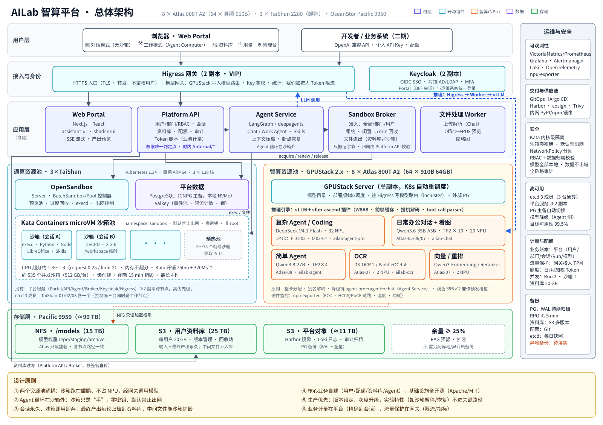
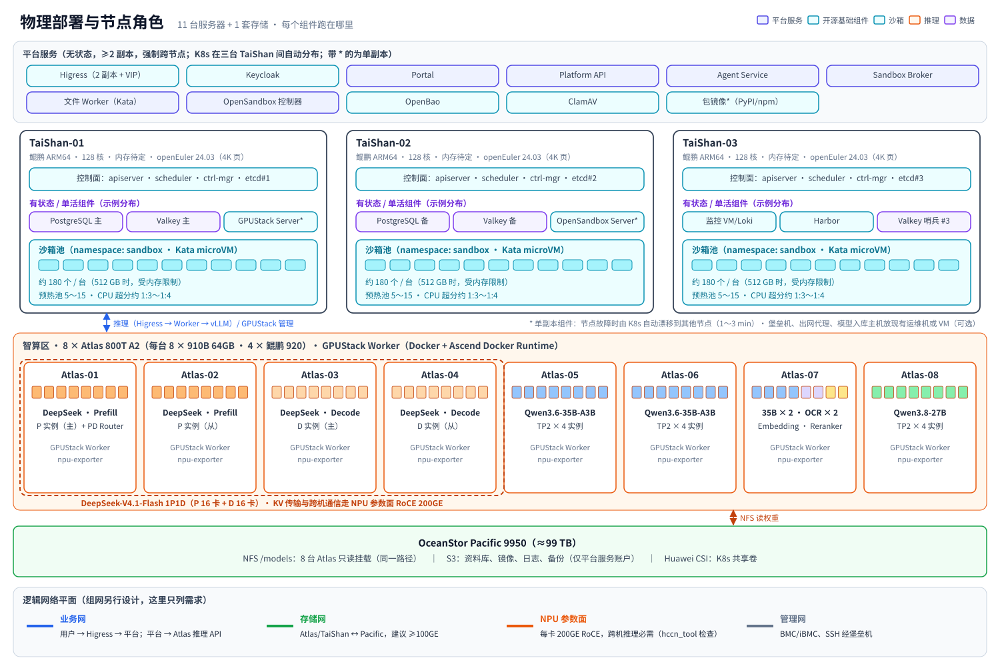
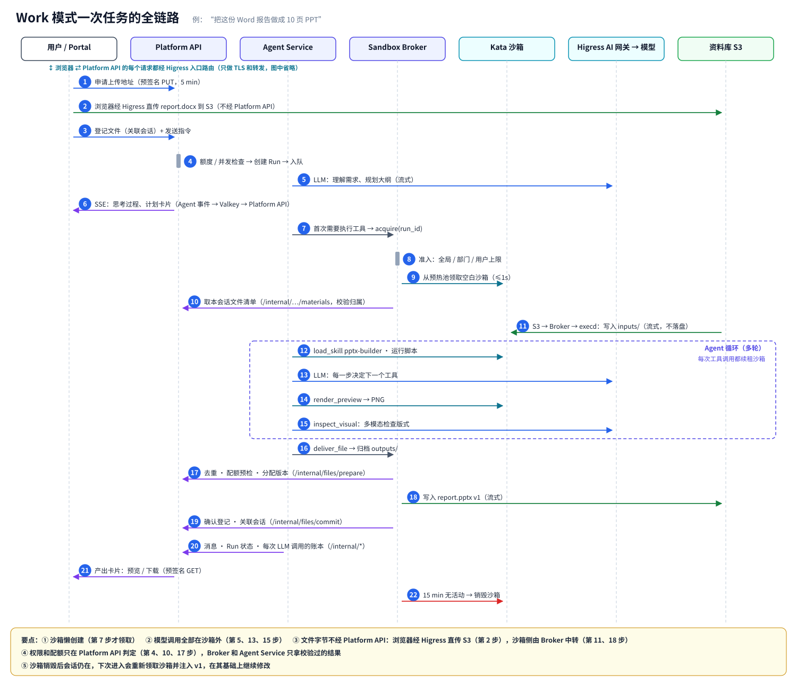
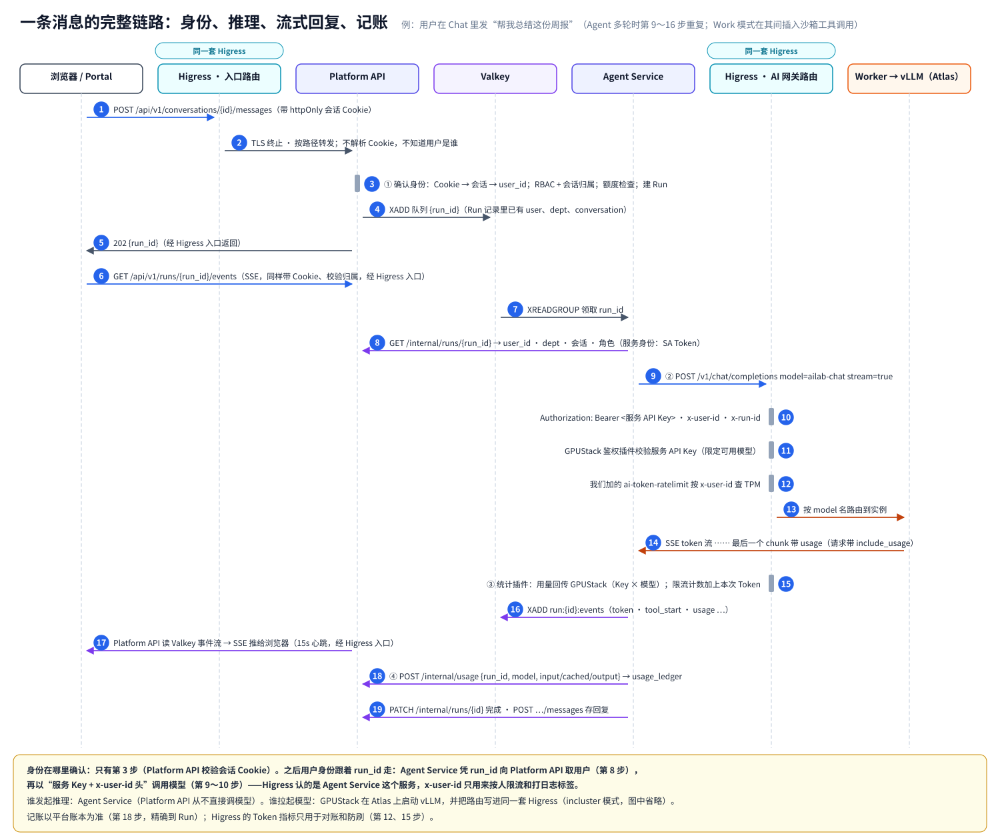
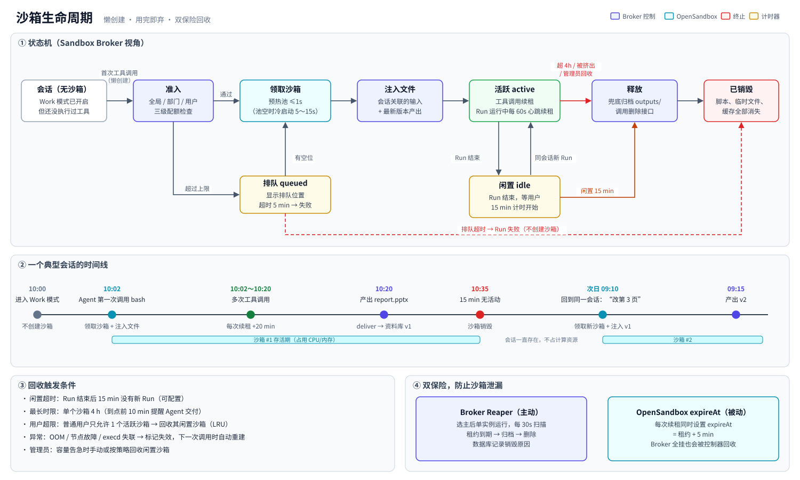
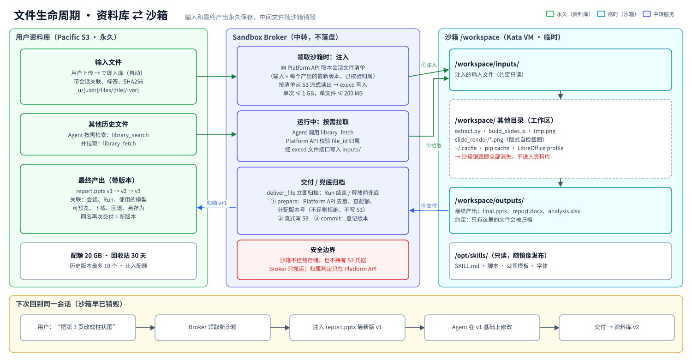
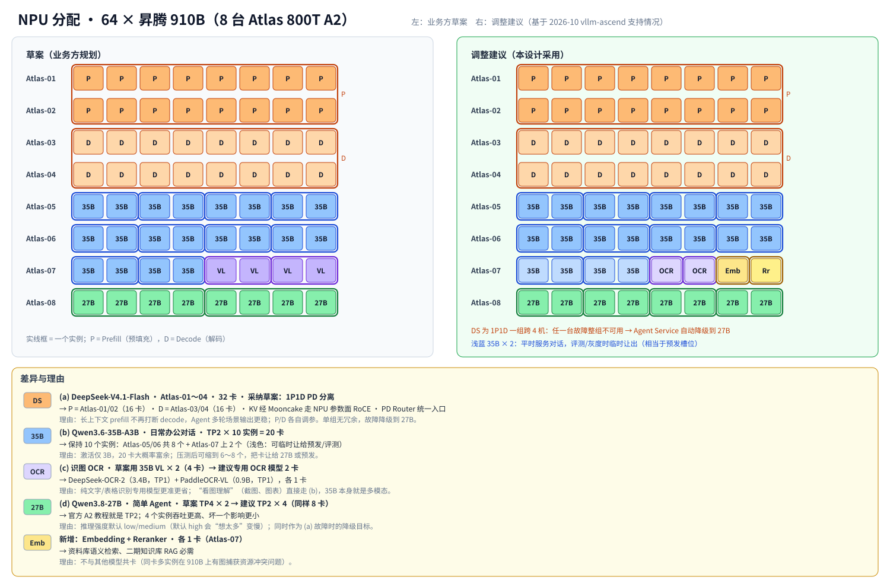
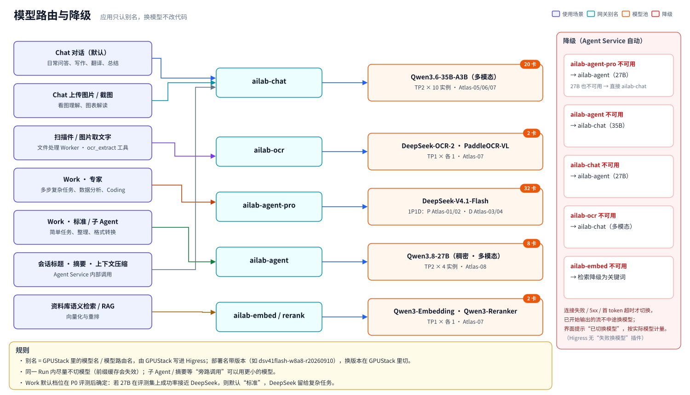
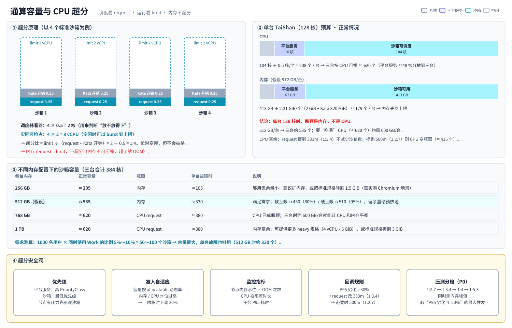
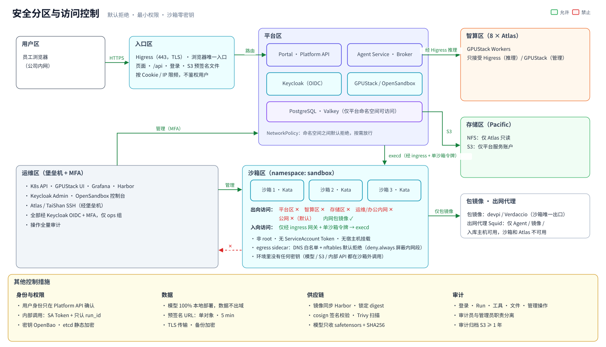

# AILab 智算平台 · 总体架构设计（v1.8）

> 适用范围：代表处内部 AI 平台（600～1000 用户），面向生产，非 POC
> 硬件：8 × Atlas 800T A2（64 × 昇腾 910B 64GB）+ 3 × TaiShan 2280（鲲鹏 ARM64，每台 128 核）+ OceanStor Pacific 9950（≈99 TB）
> 版本：v1.8（2026-10-20）｜ 技术版本基线以 2026-10 调研为准（见第 11 节）
> v1.1 变更：采纳业务方的模型规划并做了可行性调整；补充 etcd 和 VM 方案说明；新增 Skills/沙箱依赖设计（08）；架构图从 1 张扩到 16 张
> v1.2 变更：DeepSeek-V4.1-Flash 按 **32 卡 1P1D PD 分离**部署（P：Atlas-01/02，D：Atlas-03/04），新增 [17 PD 拓扑图](diagrams/svg/17-deepseek-pd.svg)；TaiShan 更正为**每台 128 核**，沙箱容量重算（瓶颈变为内存）
> v1.3 变更：补全 Platform API 职责与内部接口（04 第 0 节，[18 图](diagrams/svg/18-platform-api.svg)）和文件进出机制（03 第 5 节，交付改为两阶段提交）；**推理流量由 Higress 直连 vLLM 实例**，GPUStack Server 宕机不再中断推理；平台预留按两节点重算，512 GB/台时沙箱容量更正为约 330 个；补充服务间认证、密钥管理、包镜像与出网代理、上传扫描（06 第 1.4、1.5 节）；新增术语表（第 13 节）
> v1.4 变更：新增 [09 请求链路与网关设计](09-请求链路与网关设计.md) 和 19、20 图，讲清 Higress 的两种角色（入口只转发、不鉴权用户；AI 网关认服务 Key、按 `x-user-id` 限流）和身份传递方式；对照 Higress 仓库核实插件能力。**更正**：Higress 没有“上游失败换模型”的插件，跨模型降级改由 Agent Service 实现；同时按当前设计复核了全部旧图，修正 01、02、05、07、08、09、13、16、17 中与新设计不一致的内容
> v1.5 变更：GPUStack 改用 incluster 网关模式，把模型路由直接写进平台的 Higress（GPUStack 2.x 的标准做法），撤销“自建同步器 + 直连实例”方案；Higress 版本对齐 GPUStack 的 2.1.9
> v1.6 变更：新增 03 第 7 节和 [21 图](diagrams/svg/21-agent-boundary.svg)，说明 Agent 的运行方式和权限边界；**更正**：OpenSandbox 的 execd 默认不鉴权，改为显式开启 Secure Access（单沙箱令牌）+ 只允许经 ingress 网关访问
> v1.7 变更：浏览器的 S3 上传下载改为经 Higress 转发（Pacific 不再对办公网开放）；新增 09 第 10 节：浏览器能碰到哪些地址、没有 Key 时怎么按人限流、为什么不会把后端打爆
> v1.8 变更：通算改为 **3 台 TaiShan**，etcd 三个成员各占一台，撤销“新增管理节点 / etcd 放 Atlas-01”方案；沙箱容量重算（512 GB/台时正常约 535 个，单台故障时约 330 个）。GPUStack 管理界面改挂**运维域名** `gpustack.xxx.local`（chart 的 `server.ingress.hostname`）；按 GPUStack 源码写明模型路由 `/v1/*` 不带域名、只靠 API Key 保护（**已接受**，见 09 第 2.4 节）。修正前后矛盾：服务 Key 数量、NetworkPolicy 能否限制模型路由、旧“端点同步器”残留、P3“合并两层网关”等。更新 01、02、03、15、20 图

## 文档导航

| 文档 | 内容 |
|---|---|
| **README.md（本文）** | 精简版总体架构：目标、关键决策、架构图、部署、核心流程、FAQ |
| [01-关键决策与取舍.md](01-关键决策与取舍.md) | 每个关键选型的备选方案和取舍理由（ADR） |
| [02-模型服务层设计.md](02-模型服务层设计.md) | GPUStack + vLLM-Ascend、NPU 分配、模型路由、权重管理 |
| [03-Agent与沙箱设计.md](03-Agent与沙箱设计.md) | Agent Service 内部机制、沙箱生命周期、文件流 |
| [04-平台服务与数据设计.md](04-平台服务与数据设计.md) | 用户/权限、配额、Token 计量、资料库、前端、数据模型 |
| [05-存储与容量规划.md](05-存储与容量规划.md) | Pacific 存储布局（含模型权重）、通算/智算容量、超分 |
| [06-安全-高可用-运维.md](06-安全-高可用-运维.md) | 安全体系、HA、etcd、可观测性、备份、升级 |
| [07-实施路线与待确认事项.md](07-实施路线与待确认事项.md) | 分阶段计划、PoC 验收项、人力、待确认问题 |
| [08-Skills与沙箱环境设计.md](08-Skills与沙箱环境设计.md) | 沙箱依赖清单、PPT/Word/Excel/PDF 生成路线、Skills 体系、字体与许可证 |
| [09-请求链路与网关设计.md](09-请求链路与网关设计.md) | **新增**：Platform API 与 Higress 如何配合；用户身份在哪确认、怎么传到模型调用；一条消息从提交到记账的完整链路；Higress 能力核验 |

### 架构图索引（`diagrams/svg/` 可缩放，`diagrams/png/` 为 2x 位图，可直接放 PPT）

| # | 图 | 说明 |
|---|---|---|
| 01 | [总体架构](diagrams/svg/01-overview.svg) | 一张图看全貌 |
| 02 | [物理部署与节点角色](diagrams/svg/02-deployment.svg) | 每个组件跑在哪台机器上 |
| 03 | [etcd 与控制面](diagrams/svg/03-etcd-quorum.svg) | etcd 是什么；三台通算怎么放 |
| 04 | [NPU 分配](diagrams/svg/04-npu-allocation.svg) | 业务方草案 vs 调整建议，64 张卡逐卡分配 |
| 05 | [模型路由与降级](diagrams/svg/05-model-routing.svg) | 场景 → 别名 → 模型池；故障时降级 |
| 06 | [Work 全链路](diagrams/svg/06-work-flow.svg) | 一次 PPT 任务的 22 步，含每一步经过哪个接口 |
| 07 | [Agent Service 内部](diagrams/svg/07-agent-internals.svg) | Agent 循环、中间件、工具层 |
| 08 | [沙箱生命周期](diagrams/svg/08-sandbox-lifecycle.svg) | 状态机、时间线、回收双保险 |
| 09 | [文件生命周期](diagrams/svg/09-file-lifecycle.svg) | 资料库 ⇄ 沙箱，什么永久、什么临时 |
| 10 | [沙箱镜像分层](diagrams/svg/10-sandbox-image.svg) | 依赖清单、字体映射、排除项 |
| 11 | [Skills 体系](diagrams/svg/11-skills.svg) | 首批 Skills、开源参考、发布流水线、渐进披露 |
| 12 | [文档生成流水线](diagrams/svg/12-docgen.svg) | PPT 三条路线 + 视觉自检；Word；Excel |
| 13 | [安全分区](diagrams/svg/13-security-zones.svg) | 网络分区与访问矩阵 |
| 14 | [存储规划](diagrams/svg/14-storage-layout.svg) | 空间分配、协议映射、模型目录 |
| 15 | [容量与超分](diagrams/svg/15-capacity.svg) | CPU 超分原理与不同内存配置下的容量表 |
| 16 | [Token 计量与配额](diagrams/svg/16-metering.svg) | 账本、限流、对账、报表 |
| 17 | [DeepSeek 1P1D PD 分离](diagrams/svg/17-deepseek-pd.svg) | Prefill 16 卡 + Decode 16 卡，KV 经 Mooncake 传输 |
| 18 | [Platform API 职责与边界](diagrams/svg/18-platform-api.svg) | 它管什么、不管什么、谁调它；文件进出时谁判权限、谁搬字节 |
| 19 | [一条消息的完整链路](diagrams/svg/19-request-chain.svg) | 浏览器 → 身份确认 → 推理 → 流式回复 → 记账，每一步经过谁 |
| 20 | [Higress 的两种角色](diagrams/svg/20-higress-roles.svg) | 入口路由 vs 模型网关路由；插件分工；GPUStack 怎么把路由写进 Higress |
| 21 | [Agent 的权限边界](diagrams/svg/21-agent-boundary.svg) | Agent 怎么跑；为什么碰不到本机和别人的沙箱；被提示注入时最多能做什么 |

图的源码在 `diagrams/src/`（Python 生成，可改可重建）：SVG 输出到 `diagrams/svg/`，PNG 输出到 `diagrams/png/`。

---

## 1. 目标与设计原则

**目标**：为代表处提供**先进、可靠、安全**的 AI 算力与 AI 应用。
1. **对话模式（Chat）**：低成本、低延迟的大模型对话，支持文件和图片理解。
2. **工作模式（Work）**：类 Codex / 豆包工作的 *Agent Computer*。Agent 在一次性的 Linux CLI 沙箱里调用 Skills，完成 PPT、Word、Excel、PDF、数据分析等办公任务。
3. **个人资料库**：输入和最终产出自动入库（每人 20 GB），中间文件随沙箱销毁。
4. **模型 API**（二期）：统一的 OpenAI 兼容 API、Key 与配额。

| # | 原则 | 落到设计上 |
|---|---|---|
| P1 | **两个资源池解耦** | 智算池（昇腾跑模型）与通算池（鲲鹏跑平台和沙箱）分开；沙箱不占 NPU，经网关调用模型 |
| P2 | **Agent 在沙箱外，沙箱只是“手”** | Agent 循环跑在 Agent Service；沙箱里**没有任何密钥、默认不能联网**，只负责执行和处理文件 |
| P3 | **会话永久，沙箱即用即弃** | 会话永久保存；沙箱懒创建，闲置 15 分钟销毁；最终产出每轮归档 |
| P4 | **核心业务自建，基础设施全开源** | 用户、配额、资料库、Agent 编排自建；调度、沙箱、推理、网关、IAM 用 Apache/MIT 组件 |
| P5 | **生产优先** | 版本锁定、灰度升级；未经验证的特性（如沙箱暂停/恢复）不进关键路径 |
| P6 | **业务计量在平台，流量保护在网关** | Token 账本由平台记（精确到会话）；网关负责服务鉴权、按人限流、Token 指标；跨模型降级在 Agent Service |

---

## 2. 关键决策一览

| 领域 | 决策 | 关键理由（详见 01） |
|---|---|---|
| 模型部署与管理 | **GPUStack 2.x**（Apache-2.0）纳管 8 台 Atlas | 原生支持 910B 和 vLLM-Ascend，有模型目录、副本调度、NPU 监控、Token 统计。**但没有限流和配额，Server 单活**，需要外围补齐 |
| 推理引擎 | **vLLM + vllm-ascend 插件**（不是直接用原生 vLLM） | 昇腾上模型覆盖最广，官方有 A2 教程；OpenAI 兼容；支持 tool-call 和 reasoning parser |
| 模型规划 | 采纳业务方的四类模型（DeepSeek 按 **32 卡 1P1D PD 分离**），另做 3 处调整（见第 7 节） | OCR 换专用小模型；27B 改为 TP2×4；新增向量和重排模型 |
| AI 网关 | **Higress**（Apache-2.0，CNCF Sandbox）独立部署在 K8s | 全平台一套：HTTPS 入口（只转发，不鉴权用户）+ 模型网关（GPUStack 以 incluster 模式写入模型路由、Key 鉴权和统计；我们加按人 Token 限流），见 [09](09-请求链路与网关设计.md) |
| 沙箱 | **OpenSandbox + Kata Containers（QEMU）**，不叠加 agent-sandbox | 两者都正式支持 ARM64（见 FAQ）；Kata 提供内核级隔离 |
| 容器编排 | **kubeadm 原生 Kubernetes 1.34.x** on openEuler 24.03 LTS | OpenSandbox 只支持到 K8s 1.34 |
| K8s 控制面 | **3 台 TaiShan 各放一个 etcd 成员**（kubeadm stacked），三台同时是工作节点 | 任意一台坏控制面仍可用；不需要额外的管理节点，智算节点上也不跑控制面进程 |
| Agent 运行时 | **自建 Agent Service**（LangGraph + deepagents，MIT 库） | 配额、资料库、部门、准入都得自建；参考 DeerFlow / MiniMax / PPTAgent 等开源实现 |
| Skills | **自研**，借鉴 MIT 开源实现；**不用** Anthropic 官方 Skills | 后者是专有许可；公司模板和规范是我们自己的差异化 |
| 前端 | **自建 Portal**：Next.js + assistant-ui（MIT） | Chat/Work/资料库/管理台一体；现成 UI 的许可证或功能不满足 |
| 身份 | **Keycloak 26.x**，对接 AD/LDAP/SSO | 统一 OIDC；业务权限放在平台内 RBAC |
| 存储 | 模型权重走 **NFS（只读）**，资料库走 **S3**，数据库放**本地 NVMe** | PG 不放 NFS；S3 支持版本和预签名；没有 S3 许可时退回 NFS 加 dtree 配额 |
| 超分 | **CPU 约 1:3～1:4，内存不超分** | K8s requests/limits 原生实现；每台 128 核时 CPU 富余，**容量瓶颈在内存** |

---

## 3. 总体架构图

**一句话说明**：用户在 Portal 里发起 Chat 或 Work，Platform API 负责身份、配额和资料库，Agent Service 负责“思考”（经 Higress 调用昇腾上的模型）。需要动手时，Sandbox Broker 从预热池领一个 Kata 沙箱，在里面执行命令、处理文件。最终产出归档到 Pacific S3 资料库，沙箱闲置 15 分钟后销毁。

---

## 4. 分层职责

| 层 | 组件 | 职责 | 自建/开源 |
|---|---|---|---|
| 接入 | Higress | HTTPS 入口（TLS、路由，不鉴权用户）；AI 网关（服务 Key、按人限流、Token 指标、别名 → 实例池） | 开源 |
| 身份 | Keycloak | SSO、OIDC、AD/LDAP 联邦、MFA | 开源 |
| 应用 | Web Portal | Chat/Work、产出预览、资料库、用量、管理台 | **自建** |
| 应用 | Platform API | 用户/部门/角色、会话、资料库、配额、Token 账本、审计、模型目录 | **自建** |
| 应用 | Agent Service | Agent 编排（LangGraph + deepagents）、工具、Skills、上下文压缩、流式、断点恢复 | **自建**（基于开源库） |
| 应用 | Sandbox Broker | 沙箱准入、排队、租约、回收、会话绑定、文件进出 | **自建** |
| 沙箱 | OpenSandbox + Kata | 生命周期 API、execd、预热池、出网控制、microVM 隔离 | 开源 |
| 编排 | Kubernetes | 鲲鹏节点调度、超分、配额、网络策略 | 开源 |
| 智算 | GPUStack + vLLM-Ascend | 昇腾纳管、模型部署/副本、推理服务、监控 | 开源 |
| 数据 | PostgreSQL / Valkey / Pacific | 业务数据、事件流、模型权重、资料库、备份 | 开源 / 已有硬件 |
| 运维 | Prometheus 生态、Harbor、Argo CD | 指标、日志、告警、镜像、GitOps | 开源 |

> 内部结构见 [07 Agent Service 内部](diagrams/svg/07-agent-internals.svg)。

---

## 5. 物理部署与节点角色

| 节点 | 角色 |
|---|---|
| TaiShan-01/02/03（各 128 核） | K8s 控制面（每台一个 etcd）+ 工作节点。平台服务每个 ≥2 副本、跨节点；剩余资源给沙箱池（CPU 约 1:3～1:4 超分） |
| 运维管理机（可选） | 堡垒机、出网代理、模型入库主机；可用公司现有运维机或 VM，**不再承担 etcd** |
| Atlas-01～08 | GPUStack Worker（Docker），只跑推理 |
| Pacific 9950 | `/models` NFS 只读挂到 8 台 Atlas；S3 给平台用 |

**etcd 为什么要三个成员、放在三台不同的物理机上** → 见 [03 etcd 图](diagrams/svg/03-etcd-quorum.svg) 和第 12 节 FAQ。

---

## 6. 核心流程

### 6.1 Work 模式一次任务

### 6.2 Chat 模式（以及身份、推理、记账的完整链路）

`Portal → Platform API（配额）→ Agent Service（Chat Agent，不带沙箱）→ Higress → ailab-chat`。上传的图片直接交给多模态模型（Qwen3.6-35B-A3B 本身支持看图）；扫描件或图片里的文字先由文件处理 Worker 调用 `ailab-ocr` 提取。会话可以随时“转为工作模式”。

### 6.3 沙箱生命周期与文件流

---

## 7. 模型规划与 NPU 分配

| 别名（应用只认别名） | 用途 | 模型 | 部署 | NPU |
|---|---|---|---|---|
| `ailab-agent-pro` | 复杂 Agent、Coding（Work 专家档） | **DeepSeek-V4.1-Flash** W8A8 | **1P1D PD 分离**：Prefill = Atlas-01/02（16 卡），Decode = Atlas-03/04（16 卡），KV 经 Mooncake 走 RoCE | 32 |
| `ailab-chat` | 日常办公对话、看图理解、摘要/标题 | **Qwen3.6-35B-A3B** W8A8（多模态） | TP2 × **10 实例**（Atlas-05/06 各 4 个，Atlas-07 上 2 个兼作预发） | 20 |
| `ailab-agent` | 简单 Agent（Work 标准档）、子 Agent、专家档降级目标 | **Qwen3.8-27B** W8A8（稠密，多模态） | TP2 × **4 实例**（Atlas-08） | 8 |
| `ailab-ocr` | 扫描件/图片取文字、表格识别 | **DeepSeek-OCR-2** + **PaddleOCR-VL** | 各 1 卡（Atlas-07） | 2 |
| `ailab-embed` / `ailab-rerank` | 资料库语义检索、二期 RAG | Qwen3-Embedding + Qwen3-Reranker | 各 1 卡（Atlas-07） | 2 |

**DeepSeek 按业务方方案做 1P1D PD 分离**（详见 [17 PD 拓扑图](diagrams/svg/17-deepseek-pd.svg) 和 [02 文档 3.3 节](02-模型服务层设计.md)）：Prefill 和 Decode 各 16 卡。长上下文的 prefill 不再打断 decode，Agent 多轮场景下输出更稳；P、D 可以各自调参。前面经 PD Router（GPUStack 2.3 PD 模式，或 vllm-ascend 原生 proxy），对上层仍然只是 `ailab-agent-pro` 这一个别名。

**相对业务方草案的 3 处调整**（理由详见 [02 文档](02-模型服务层设计.md#3-npu-分配与模型选型)）：
1. **(c) 识图 OCR 改用专用 OCR 小模型**（2 卡代替 4 卡）：纯识别更准、更省；“看图理解”直接走 `ailab-chat`，35B 本身就是多模态。
2. **(d) 27B 改为 TP2 × 4**（同样 8 卡）：官方 A2 教程用的是 TP2，4 个实例吞吐更高，坏一个影响更小。
3. **新增 Embedding + Reranker 各 1 卡**：资料库检索和二期 RAG 需要。

> ⚠️ **单点提醒**：1P1D 是一组、跨 4 台机器，P 或 D 任一台故障整组不可用 → Agent Service 自动降级到 `ailab-agent`（27B）。这是在“用最强模型”和“冗余”之间做的取舍。如果评测显示 27B 已能满足大部分 Work 任务，可以考虑把 Work 默认档设为“标准”。

---

## 8. 容量结论（详见 05）

| 项目 | 结论 |
|---|---|
| 存储 | 99 TB（**需确认是可用容量还是裸容量**）对 1000 人 × 20 GB 足够；当前模型权重（含上一版本和原版）约 2.5～3.5 TB，规划 15 TB |
| 沙箱并发 | 三台共 384 核，**瓶颈在内存**：每台 512 GB 时正常约 **535 个**活跃 Work 沙箱，单台故障时约 330 个；每台 768 GB 以上约 620 个（受 CPU 限制）；每台只有 256 GB 时约 205 个 |
| 推理 | 量级估算，**以 P0 阶段 AISBench 压测为准** |
| 用户规模 | 1000 人、同时使用 Work 的比例 5%～10%（50～100 个沙箱），**现有硬件可以支撑** |

---

## 9. 安全与高可用（摘要，详见 06）

- **隔离**：Kata microVM；沙箱零密钥、默认禁止出网（只放行内网包镜像）；所有模型本地部署，数据不出域。
- **控制面**：etcd 三成员分别在三台 TaiShan 上；平台服务至少 2 副本；PG 主备自动切换。
- **管理入口**：GPUStack 管理界面只挂在运维域名 `gpustack.xxx.local` 上（办公网 DNS 不解析），登录只开放给 Keycloak `ops` 组。它和用户入口共用 Higress VIP，隔离靠 Host 和登录，不是网络隔离；模型路由 `/v1/*` 对任意 Host 都可达，只靠 GPUStack API Key 保护（已接受，见 09 第 2.4 节）。
- **单活组件**：GPUStack Server、OpenSandbox Server 故障时由 K8s 自动漂移（1～3 分钟）。期间不能部署模型、不能新建沙箱（Broker 排队重试），推理不经 GPUStack Server 进程（Higress → Worker → vLLM），**GPUStack 2.3 起 Server 宕机时推理不中断**（2.2.x 仍会中断，见 02 第 1 节）；已运行的沙箱不受影响。
- **模型**：降级链 `agent-pro → agent → chat`，链上不可用的一级自动跳过。
- **备份**：PG 持续归档到 S3；资料库开启版本管理；**需要 Pacific 之外的备份目标**。

---

## 10. 实施路线（详见 07）

| 阶段 | 周期 | 目标 |
|---|---|---|
| **P0 技术验证** | 3 周 | ① Atlas：GPUStack + vllm-ascend 跑通四类模型，压测，跑办公评测集；② 鲲鹏：K8s 1.34 + Kata(arm64) + OpenSandbox 预热池，沙箱密度压测；③ 沙箱镜像跑通 PPT/Word/Excel 生成；④ Pacific 许可与性能 |
| **P1 MVP** | 8 周 | Portal、Agent Service、Broker、首批 Skills、SSO、账本、Higress、监控；**50～100 人试点** |
| **P2 生产化** | 6 周 | 部门/配额管理、审计、开发者 API、HA 与备份演练、渗透测试；**1000 人推广** |
| **P3 增强** | 持续 | RAG、更多 Skills、xPyD 扩展 / KV Pool、负载感知调度等 |

---

## 11. 版本基线（2026-10 调研，上线前冻结）

| 组件 | 版本 | 备注 |
|---|---|---|
| OS（TaiShan） | openEuler 24.03 LTS（当前 SP） | **必须是 4K 页内核**（`getconf PAGESIZE`=4096） |
| Kubernetes | 1.34.x（kubeadm） | OpenSandbox 支持 1.21～1.34 |
| containerd / Kata | containerd 2.x / Kata 4.2.x `kata-qemu` | arm64 上只有 QEMU；不用发行版自带的旧 Kata |
| OpenSandbox | release-1.1.1 → 1.2.x GA | amd64 + arm64 多架构镜像 |
| GPUStack | **2.3.x**（PD 分离需要；截至 10-16 仍是 rc，里程碑 10-18） | 不低于 2.2.2（之前的版本有 SAML 绕过漏洞）。2.3 GA 前，其他模型可以先用 2.2.3 部署，DeepSeek PD 可以先用 vllm-ascend 原生方式部署 |
| vllm-ascend | 按模型锁定镜像 | DeepSeek-V4.1-Flash 需要 ≥ v0.30.0rc1（或专用镜像 `deepseek-v4.1-flash`）；Qwen3.8-27B 需要 ≥ v0.23.0；Qwen3.6 需要 ≥ v0.18.0 |
| CANN / 驱动 | 与所选 vllm-ascend 配套（9.x） | |
| Higress | 2.1.9（与 GPUStack 锁定的版本一致） | 升级前验证 GPUStack incluster 模式写入的资源仍然生效 |
| Keycloak | 26.8.x（Operator） | 只有最新 minor 版本出补丁 |
| CloudNativePG | 1.30.x + Barman Cloud 插件 | |
| Harbor | ≥ 2.16（首个原生 arm64 版本） | 发布前可临时用 Zot |
| Huawei CSI | eSDK_K8S_Plugin 4.13.x | 有 ARM64 包 |
| 沙箱基础镜像 | Debian 13 arm64 + Python 3.12 + Node 22 + Playwright Chromium | 详见 08 |
| Agent 库 | LangGraph 1.x + deepagents 0.7.x | 不使用 LangGraph Agent Server（需商业授权） |
| 前端 | Next.js 16 / React 19 / assistant-ui / shadcn/ui | |

---

## 12. 常见问题

**Q1：ARM64 + Kata + OpenSandbox 到底支不支持 ARM？**
**支持**，而且三者都是**官方正式支持**，不是“理论上能跑”：
- **OpenSandbox**：所有组件镜像（server、controller、execd、egress、ingress 等）都发布了 amd64 + arm64 多架构版本，已在镜像仓库清单中逐个核实。
- **Kata Containers**：官方支持 aarch64；kata-deploy 4.2 在 arm64 上提供 `kata-qemu`（Cloud Hypervisor、Firecracker 只有 x86）。
- **Kubernetes / containerd**：arm64 是一等公民。

这里说的“有风险”，指的是这三者**组合起来**在 arm64 上**没有上游自动化测试**，也没有公开的大规模案例，而不是不支持。另外有两个具体的坑：OpenSandbox 不支持 64K 页内核（openEuler 22.03/24.03 默认是 4K 页，没问题）；arm64 上 Kata 不支持 CPU 热插拔（我们本来就用固定规格）。所以 P0 留了 2～3 周专门验证这个组合。

**Q2：etcd 是干什么的？**
etcd 是 Kubernetes 的“数据库”，集群里所有 Pod、沙箱、配置、Secret、节点状态都存在里面。它用 Raft 协议，**每次写入都要过半数成员确认**：3 个成员可以容忍坏 1 个，2 个成员坏 1 个就停。失去过半数后，已在运行的 Pod、沙箱、模型会继续跑，但不能新建沙箱、不能调度、PG 不能自动切主、服务不能漂移，平台等于“半瘫”。

**Q3：etcd 三个成员放在哪里？以前说的“管理节点 / Atlas-01 / 两个 VM”还要吗？**
**不要了。** 现在有 3 台 TaiShan，每台放一个 etcd 成员（kubeadm 的 stacked 控制面），任意一台故障都还剩 2/3，控制面照常工作。
- 以前只有两台通算，第三个成员必须另找物理机，所以才有“新增管理节点 > 放 Atlas-01 > 一台通算起两个 VM”的取舍；三台通算后这些方案全部撤销。
- 三台同时是工作节点（去掉 kubeadm 默认的控制面污点），每台给系统和控制面预留 8 核 / 32 GB，沙箱优先级最低，节点有压力时先驱逐沙箱。
- 鲲鹏 920 不支持嵌套虚拟化（华为官方 FAQ 确认），沙箱节点仍然必须是物理机。

**Q4：GPUStack 是否已经支持模型管理和部署？**
大约覆盖 70%：部署、副本、调度、模型目录、监控、Token 统计都有；**限流、配额、Server 高可用、LDAP 没有**，由 Higress、平台和 K8s 补齐。PD 分离（`vllm-ascend-mooncake` 模式）在 2.3 才引入，2.3 目前还是 rc，GA 前 DeepSeek 的 PD 可以先用 vllm-ascend 原生脚本部署，由 Higress 直接路由。

**Q5：vLLM 在昇腾上是直接用 vLLM 部署吗？**
不是。要用上游 vLLM 加上 **vllm-ascend 硬件插件**，CANN、torch-npu、驱动的版本必须严格配套。实际操作是直接用官方镜像 `quay.io/ascend/vllm-ascend`，或者在 GPUStack 里选 vLLM 后端。不同模型需要的版本不同，所以**按模型锁定镜像**。

**Q6：用户的文件怎么进沙箱、产出怎么回资料库？**
沙箱不挂载任何存储。领取沙箱时，Sandbox Broker 向 Platform API 要“本会话该注入哪些文件”（已校验归属），从 S3 流式读出、经 execd 写进 `/workspace/inputs/`；运行中需要别的文件，走 `library_fetch`，同样由 Platform API 校验 `file_id` 归属；产出放在 `/workspace/outputs/`，由 Broker 两阶段提交归档（Platform API 预检配额、分配版本 → Broker 写 S3 → Platform API 确认登记）。详见 [03 第 5 节](03-Agent与沙箱设计.md) 和 [18 图](diagrams/svg/18-platform-api.svg)。

**Q7：浏览器只连 Higress，用户鉴权却在 Platform API，Higress 知道用户是谁吗？模型调用是谁发的？**
Higress 入口路由**不知道**用户是谁，只做 TLS 和转发，Cookie 原样交给 Platform API 校验——这是唯一一次确认身份。之后身份跟着 `run_id` 走：Agent Service 凭 `run_id` 向 Platform API 取用户，再用“服务 Key + `x-user-id` 头”经 Higress AI 网关调用模型。Higress 认的是 Agent Service 这个服务，`x-user-id` 只用来按人限流和打日志标签。模型只由 Agent Service 调用，Platform API 从不直接调模型。详见 [09](09-请求链路与网关设计.md) 和 [19 图](diagrams/svg/19-request-chain.svg)。

---

## 13. 术语表

| 术语 | 含义 |
|---|---|
| ADR | Architecture Decision Record，架构决策记录（见 01） |
| PD 分离 / 1P1D / xPyD | Prefill（处理输入）和 Decode（逐字生成）放在不同机器上；1P1D = 1 组 Prefill + 1 组 Decode，xPyD = 多组 |
| KV / KV Cache | 模型推理时缓存的注意力中间结果；PD 分离时要把它从 P 传到 D |
| Mooncake | 开源的 KV Cache 传输与存储组件，vllm-ascend 用它在 P、D 之间传 KV |
| TP / DP / EP | 张量并行 / 数据并行 / 专家并行，大模型切分到多张卡上的方式 |
| W8A8 / W4A8 | 权重 8 位（或 4 位）、激活 8 位的整数量化；910B 不支持 FP8，所以用它 |
| MTP / DSpark | 投机解码（一次预测多个 token 提速）：MTP 用于 Qwen，DSpark 是 DeepSeek 的草稿模型 |
| Engram | DeepSeek-V4.1 的外挂记忆模块，Eco-Tech 权重里以 INT8 存放 |
| TTFT / TPOT | 首 token 时延 / 每个输出 token 的时延 |
| RoCE / HCCS | Atlas 机间的 RDMA 网络 / 机内 NPU 互联 |
| CANN | 昇腾的底层软件栈（相当于 CUDA） |
| 别名 | 应用调用的稳定模型名（如 `ailab-agent`），即 GPUStack 里的模型名或模型路由名，GPUStack 把它写进 Higress |
| 预发槽位 | Atlas-07 上 2 个 35B 实例的位置，平时正常服务，升级时先在这里验证新版本 |
| Run | 用户发一条消息触发的一次完整 Agent 执行（多次模型调用 + 工具调用） |
| 沙箱 / execd | Kata microVM 里的一次性 Linux 环境；execd 是其中执行命令、读写文件的服务 |
| 预热池 | 提前建好、尚未分配给任何用户的空白沙箱，领取时毫秒～1 秒可用 |
| 租约 | 沙箱的“有效期”，有活动就续期，过期由 Broker 回收 |
| BFF | Backend for Frontend：由 Platform API 在服务端保管登录 Token，浏览器只拿 Cookie |
| CNPG | CloudNativePG，K8s 上的 PostgreSQL 主备管理 Operator |
| RBAC / JIT | 基于角色的权限控制 / 首次登录时自动建用户 |
| LRU | 最近最少使用；用户沙箱超限时回收最久没用的那个 |
| RPO / RTO / PITR | 最多丢多少数据 / 多久恢复 / 恢复到任意时间点 |
| EC / dtree / DPC | Pacific 的纠删码保护 / 目录级配额单元 / 分布式并行客户端 |
| WORM | 一次写入、不可修改，用于审计归档 |
