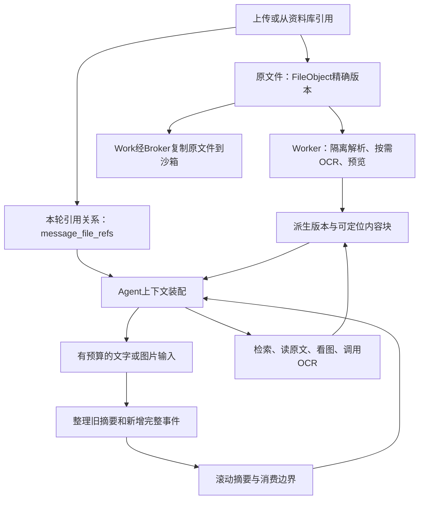

# 消息、文件与来源关系

> 实施状态（2026-10-29）：用户已授权本方案实施，覆盖下文历史“只设计”限制；不授权push/PR/merge/部署。OCR只计量、不计费、不设用户累计配额，资源隔离仍保留。当前实现、验收及剩余缺口以[实施记录](../../../progress/updates/2026-10-29-file-context-core-validation.md)和[验收逐项记录](../../../reviews/file-context-2026-10-29/acceptance.md)为准。本文其余历史状态不代表当前完成度。

状态：设计修订稿，未实施。基线 `main@e71a60f`。本轮明确Chat预处理、Work自主操作、图片按视觉能力分流、RapidOCR与昇腾NPU优先；正文中的资源与大小数值均为待验收候选。

[总览与模块入口](README.md)。

## 总体架构与持久对象



### 原文件与文件引用

复用 FileObject 的现有版本模型。`file_id` 指定一个不可变内容版本；`lineage_id` 用于展示版本关系，不能在读取时隐式替换 file_id。输出文件继续走现有 Artifact/交付协议。

新增 `message_file_refs`，解决 JSON 数组难以分页查询与新旧引用混淆：

| 字段 | 约束/用途 |
| --- | --- |
| `run_id, message_kind, message_id, file_id, role` | message_kind=run_prompt/queued_message；唯一消息+文件+role；role=input/agent_read；输出从Artifact投影 |
| `ordinal` | 保留本轮附件顺序；同名文件按位置、ID区分 |
| `reference_origin` | upload/library/agent_read；upload 必须由服务端上传完成凭据证明，不能信任客户端标签 |
| `upload_id` | 可空；复用上传完成身份，无现成持久上传来源时新增服务端 upload provenance；一个上传凭据首次附加才标本轮新上传 |
| `created_at` | UTC；不是“最新上传”的判定算法 |

输入创建 Run 时，同事务写引用；重试沿用精确文件，编辑提交显式替换附件；队列/插话若支持文件，必须绑定到对应消息身份。用户从资料库重新选旧文件属于“本轮明确引用”，优先级与新上传一样；历史引用不自动变成新附件。

不因为文件 hash 相同就跨用户共享授权或读取缓存。历史权限依照当前用户、项目策略及分支祖先链重新判定；文件删除、版本保留过期均不能由老引用绕过。

### 派生版本与内容块

新增 `file_derivations`：`id,file_id,kind,fingerprint,parser_version,engine_version,config_hash,status,attempt_id,manifest_key,error_code,created_at,updated_at`。唯一 `(file_id,kind,fingerprint)`；fingerprint 包含原始 SHA、解析器、OCR模型版本、语言和渲染参数。不同配置不能互相冒充缓存命中。

状态为 `pending → running → ready | partial | failed | unavailable`，取消为 `canceled`。`partial` 必须有缺失页/块范围；ready 文件状态和派生处理状态分离。OCR 单位按页/区域形成 child work item，复用现有持久 job/claim/ACK/outbox，不再新造任务队列。

原生文字和OCR各有派生版本；读取器为每个所选unit确定一个主文本表示，不把两个全文直接拼接。需要保留冲突时返回两份带method的候选和冲突状态。进行中派生物增加 `content_revision`，已提交块不可原位改写；每次读返回使用到的派生ID/revision/block digest。分页cursor固定这些版本，途中有新页或重识别结果导致视图变化时返回409 `cursor_stale`及新续读建议，不能悄悄换文本；未变的块可按block_id重读。覆盖清单分片存储，不为每完成一页复制一份全文件大manifest。

新增 `document_blocks` 作为 DB 中有界可查询的索引。实体列包含 `id,derivation_id,ordinal,kind,unit_type,unit_number,text_key,unit_member,method,quality,estimated_tokens`；其余定位和诊断放JSON。PDF页/PPT页使用unit_number，Word结构路径/Excel工作表另设有界规范化selector键，不能要求它们也有物理页号：

```json
{
  "block_id": "blk_...",
  "derivation_id": "drv_...",
  "ordinal": 83,
  "kind": "paragraph",
  "locator": {"type": "pdf_page", "page": 8, "bbox": [0.1, 0.2, 0.9, 0.4]},
  "text_key": "derived/fil_x/drv_y/units/000008.json",
  "unit_member": "b3",
  "method": "native",
  "quality": "usable",
  "quality_reasons": [],
  "estimated_tokens": 410
}
```

坐标统一归一化、左上原点并携带页面尺寸/旋转元数据；转换来源坐标由解析器负责。PDF 用物理页；PPT 用 slide；Word 用 heading/paragraph/table/cell；Excel 用 sheet/cell_range，不能虚构 Word 页码。Word 只有另行转换的固定渲染版本才可增加物理页定位。

大正文不进 File.meta 或摘要表。每个 unit 对象候选上限256KiB，超过就拆成连续子 unit；一个 unit 包含多个块，避免一行一个 S3 对象。读取只加载被选 unit，不为读第80页扫描前79页。现有存储接口没有通用 Range 读取，本版采用有界对象，**不假定已有 Range 能力**。原生全文兼容导出采用流式组合，不能先拼全文件。

`document_blocks` 可含最多512字符的检索片段和标准化关键词字段；全文检索是独立受控索引（见[文档内检索](02-chat-work.md)），不能只索引这512字后宣称支持全文查询。

### 摘要状态

新增 `context_summaries` 保存不可变 frame：`id,conversation_id,branch_anchor,scope,run_id,previous_id,revision,from_cursor,through_cursor,input_digest,source_epoch,summary_json,model_alias,prompt_version,usage_call_id,status`。scope=conversation/run；run scope 不伪装成 conversation 已完成轮次。

会话仅保存当前 summary frame 指针/版本；运行 checkpoint 保存 run frame 指针、事件边界和恢复必需状态。旧 frame 供短期恢复与审查，候选保留7天/每分支最多20代；清理按页执行。保留策略不影响原始用户消息或文件的产品保留策略。

`context_summary_sources` 记录仍有效摘要条目对 file/run/block 的依赖，唯一 `(frame_id,entry_id,source_type,source_id,locator_hash)`；按 `source_type,source_id,frame_id` 索引，用于删除失效和审计。只记录条目实际依赖，不复制整段历史所有 ID 到每代摘要，避免二次方增长。完整覆盖区间由 cursor 表达，文件引用全集由 message_file_refs 查询。

新增账号 `context_source_epoch`，发生删除、项目可见性变更或相关来源撤销时递增。它是提交栅栏，不是授权本身；读取仍检查每个来源。epoch变化会让在途整理作废，但不要求无关摘要全部重算。摘要来源索引用于定位真正受影响条目。

## “消息关系定位”的具体算法

不新增一套通用消息系统。普通用户消息的稳定身份是`run_prompt:run_id`；排队/插话消息使用已有`queued_message:queue_id`。queue转成run或被steer应用后，保留原queue_id并由API记录归属run和应用事件序号。只有实际应用的消息参与模型历史，未发送草稿/未执行队列不算“上一条”。

已应用消息的顺序用轻量`applied_message_positions(run_id,message_kind,message_id,application_seq,alias_run_prompt_id)`保存，与steer实际应用同事务提交；唯一`(message_kind,message_id)`，索引`(run_id,application_seq,message_id)`。它只记录位置，不新造另一份聊天正文。回填沿用已有steer_ids的实际顺序；未知应用event不捏造时间。队列消息提升为新run时保留原queue身份，run_prompt作为同一消息的别名，不插入两个顺序位置。

附件关系不能依赖队列临时记录永久存在。若队列或RunEvent到期清理，最小身份/顺序和附件引用仍按其保留合同保存并可分页；清理原文时更新可见性/墓碑，不能让一个被删queue_id后来指到别的内容。未执行queue不进入位置表，因此不会被“上一条已应用消息”误选。

每条消息的附件按用户看到的最终顺序保存ordinal（从1开始）；文件显式多选顺序是权威，禁止后台按上传完成时间重排。提交消息与绑定文件同事务完成，幂等请求重试不产生两份关系。`file_id`已有不可变version，仍保留展示时的filename快照；文件重命名不会改变旧消息里的附件身份。

例：

| 稳定消息身份 | 附件顺序 | 引用与来源 |
| --- | --- | --- |
| `run_prompt:r1` | 1→F10，2→F11 | 本轮新上传两图 |
| `run_prompt:r3` | 1→F10 | 从资料库重新选择F10；文件创建时间没变 |
| `queued_message:q8`，应用于r4/事件9 | 1→F20 | 插话上传PDF；压缩以应用事件位置确定先后 |

### 定位优先级

1. 用户点选/引用附件时前端发送精确message key+file_id；API验证它确实绑定在该可见消息，直接定位。
2. “本轮第二张图”按本轮图片子序列ordinal查；“第二个文件”按全部附件序列查，两者不混用。
3. “上一条消息的图片”先定位当前分支上上一条**已应用用户消息**，再查其附件；不等于全库最新图。
4. “刚才那张图/刚才那份合同”只在当前任务/最近已应用消息的有界候选集中解析。若恰好一个匹配可用；多个则返回候选及消息/附件位置，让用户澄清。不能宣称任意自然语言都能确定性解析。
5. 指定“上周那份报告”超出最近窗口时，通过按需发现的`resolve_attachment`/`search_library`查询有界历史；文件名只作过滤，不作唯一ID。用户没授权的项目/分支先过滤再排名。

### 读取协议与压缩关系

API为每次model-input返回小型attachment manifest：当前附件及最近有关引用，含message key、file_id、ordinal、version、MIME、处理状态。全集仍在数据库，以keyset cursor分页，默认20条、模型输入候选≤`min(800,0.05B)` token。对于“上一条”可通过结构指针直接查，不依赖这20条恰好覆盖。

`resolve_attachment({message_ref?,relative?,kind?,ordinal?,filename?,cursor?})`返回`resolved|ambiguous|unavailable`，resolved给精确ref handle，ambiguous最多5候选。模型可提出选择意图，API不相信模型虚构message/file组合。任意返回之后读取仍重查owner、项目访问、删除和版本保留状态。

关系表不在摘要文字里，所以压缩不会删掉附件顺序/版本。摘要仅保留有关handle；句子被摘要省略后，仍能根据原始消息定位。分叉只查询分叉祖先与当前支，编辑/retry废弃消息不会成为“最近一条”；移动项目后重新检查权限。

### 索引与有效性边界

唯一`(message_kind,message_id,file_id,role)`；查顺序`(run_id,message_kind,message_id,ordinal,file_id)`；倒查删除`(file_id,run_id)`。queue尚未归属run时run_id可空，后续绑定不改消息主身份；用户ID从消息/Run推导。跨分支序列用parent_run与实际steer event顺序，不按created_at猜。

能确定性保证的是“关系正确、候选不越权、同一结构指令得到同一文件”，不能保证歧义语句永远无需用户确认。验收必须含同名不同文件、同文件重引、乱序上传完成、已编辑旧轮次、未执行队列、两张候选和连续多代压缩。
